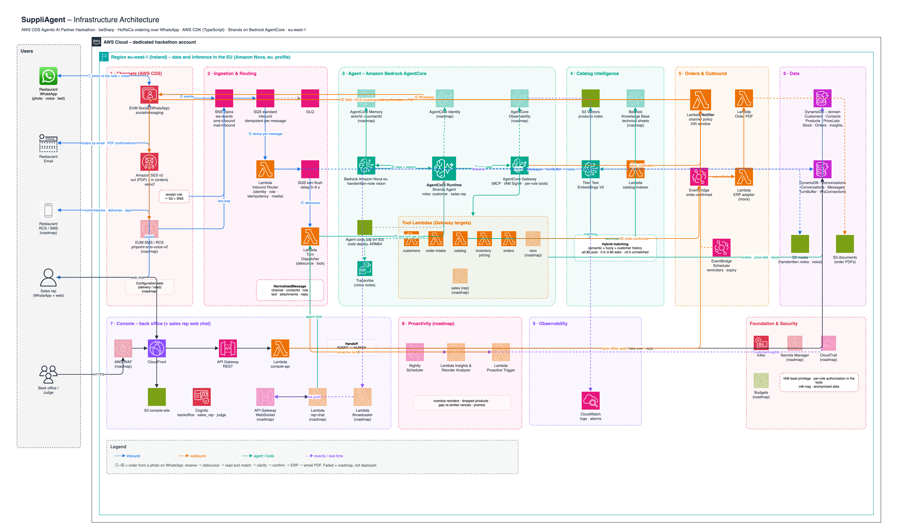

<p align="center">
  
</p>

# SuppliAgent

**An agentic AI that turns the way restaurants already order – a photo of a handwritten note, a voice message, a quick text on WhatsApp – into verified, confirmed orders for their food distributor.**

Built by [beSharp](https://www.besharp.it) for the **AWS Communication Developer Services (CDS) Agentic AI Partner Hackathon**, on a real use case of a beSharp customer: a food distributor serving the HoReCa channel (hotels, restaurants, cafés).

> Status: 🚧 in development – submission deadline 28 Oct 2026, 21:00 CET.
>
> **Team: start from [`START_HERE.md`](START_HERE.md)** (Italian) – single source for project status, timeline, task backlog, manual actions and decisions.

---

## What it does

**For restaurant owners (customers)**
- Order on **WhatsApp** with a photo of a handwritten list, a voice note or free text – or by **email**.
- The agent reads the order, **matches each line to the catalog** using the customer's purchase history, checks **stock, price list, pack sizes, cut-off and delivery days**, asks for clarification **only where needed** (interactive buttons), proposes substitutes and at most one relevant suggestion.
- Explicit **confirmation with one tap**, then confirmation by **email (PDF)** and **SMS/RCS**, delivery notifications with *Received / Report a problem*.
- **Proactive reorder**: when a regular reorder is overdue, the agent offers to repeat it with one tap.

**For sales reps (copilot, WhatsApp or web chat)**
- "What should I pitch to restaurant X?" – recommendations from history, lapsed products, peers and promotions.
- Catalog search and **technical sheet Q&A** (allergens, storage, formats) with citations.
- Visit briefings and orders placed on behalf of customers.

**For the back office** – a real-time console with orders, low-confidence lines next to the original photo, conversations, delivery issues, handoff and impact KPIs.

## AWS CDS usage

| Service | API | Used for |
|---|---|---|
| AWS End User Messaging Social (WhatsApp) | `socialmessaging:SendWhatsAppMessage` | Ordering conversations, interactive clarifications, reorder proposals, sales copilot |
| Amazon SES v2 | `sesv2:SendEmail` + email receiving | Order confirmation with PDF, orders received by email, rep briefings |
| AWS End User Messaging SMS (RCS/SMS) | `pinpoint-sms-voice-v2:SendRcsMessage`, `SendTextMessage` | Order confirmations, delivery notifications with suggested replies, SMS fallback |

## Architecture

<p align="center"><br><a href="docs/architecture.drawio">docs/architecture.drawio</a></p>

- Region **eu-west-1**; **Amazon Nova Pro** (reasoning and handwritten-note vision) on Amazon Bedrock via the **`eu.` inference profile** (data and inference stay in the EU).
- **Strands Agents on Amazon Bedrock AgentCore** (Runtime, Memory, Gateway, Identity, Observability), Bedrock Guardrails, Bedrock Knowledge Bases, **Amazon S3 Vectors**, Amazon Transcribe.
- Serverless ingestion: SNS → SQS (idempotent per provider message, parallel across chats) → debounce with a per-conversation lock (one answer per burst of messages, in arrival order).
- DynamoDB, S3, EventBridge, Lambda (Python 3.12), API Gateway (REST + WebSocket), Cognito, CloudFront, Firehose, Glue, Athena.
- Infrastructure as code with **AWS CDK (TypeScript)**.

Full design: [`docs/INFRASTRUCTURE_DESIGN.md`](docs/INFRASTRUCTURE_DESIGN.md) (Italian).

## Repository layout

```
├── agent-context/   # context for AI coding agents (AGENTS.md, CLAUDE.md, Kiro steering)
├── docs/            # functional & technical documentation (Italian) – source of truth
├── assets/brand/    # logo
├── infra/           # AWS CDK app (TypeScript)
├── agent/           # Strands agent for AgentCore Runtime (Python) + evals
├── services/        # Lambda functions and Gateway tools (Python)
├── console/         # back-office console & sales rep web chat (React + Vite)
├── seed/            # anonymized / synthetic demo data + seed/reset scripts
└── scripts/         # utilities
```

## Getting started

Everything is deployed with AWS CDK from a single account and region (`eu-west-1`); the only environment is `dev`. The sections below give the full sequence: prerequisites, first deploy, manual steps, seed data, console. Development commands (lint, tests) are in [`agent-context/AGENTS.md`](agent-context/AGENTS.md) §6.

**Prerequisites**: AWS account with access to Amazon Bedrock models in `eu-west-1`, Node.js 22, Python 3.12, [`uv`](https://docs.astral.sh/uv/), AWS CDK v2, Docker.

**Manual prerequisites** (cannot be automated): WhatsApp Business Account linked to AWS End User Messaging Social and approved message templates; SES domain verification, production access and MX record; RCS agent registration and test devices; SMS origination identity; CloudWatch Transaction Search enabled once per account and region, for the agent traces in CloudWatch GenAI Observability (`aws xray get-trace-segment-destination` shows `CloudWatchLogs`/`ACTIVE`).

**Manual steps** (after `cdk deploy suppliagent-<env>-channels`):
1. *WhatsApp* (step by step, in Italian: [docs/WABA_SETUP.md](docs/WABA_SETUP.md)): link the WABA to AWS End User Messaging Social, then add an event destination pointing at the SNS topic `suppliagent-<env>-wa-events` (ARN in SSM `/suppliagent/<env>/waEventsTopicArn`); then set `waPhoneNumberId` for the environment in `infra/config/environments.ts` and redeploy `channels` (`-c waPhoneNumberId=<id>` only overrides it).
2. *Email*: set `sesDomain` for the environment in `infra/config/environments.ts` (`-c sesDomain=<domain>` only overrides it) and deploy, add the DKIM CNAME records shown by the SES identity and an `MX 10 inbound-smtp.eu-west-1.amazonaws.com` record, request SES production access (sandbox: verified recipients only; in production the account-level suppression list for bounces and complaints is on by default). With the zone on Route 53, `scripts/ses-dns-records.sh` and `scripts/ses-production-access.sh` do both. Only one SES receipt rule set can be active per region; the stack activates its own.
3. *Later deploys*: `sesDomain` and `waPhoneNumberId` live in `infra/config/environments.ts`, so no `-c` is needed and the SSM parameters, SES identity and receipt rule set do not change. Current values: `aws ssm get-parameters --names /suppliagent/<env>/sesDomain /suppliagent/<env>/waPhoneNumberId`.
4. *Console users*: self sign-up is off. Create each user in the Cognito user pool of `suppliagent-<env>-console` (`admin-create-user` with `--desired-delivery-mediums EMAIL`, Cognito emails a temporary password) and add it to one group: `backoffice`, `sales_rep` or `judge`.
5. *WhatsApp templates*: submit the 8 definitions in `services/notifier/whatsapp_templates/` to Meta (command in [docs/09_CONTENT_AND_TEMPLATES.md](docs/09_CONTENT_AND_TEMPLATES.md) §1) and wait for approval (up to 24 h; `list-whatsapp-message-templates` shows the status). Needed only to write outside the 24-hour window.
6. *RCS and SMS* (step by step, in Italian: [docs/RCS_SMS_SETUP.md](docs/RCS_SMS_SETUP.md)): create an RCS agent with a `TEST_RCS_LAUNCH_REGISTRATION` (auto-approved in minutes), invite Android test devices (RCS for business does not reach iPhones on Italian carriers), and request the alphanumeric sender ID `SuppliAgent` for Italy (one-way). The SMS account stays in the sandbox: SMS only to verified numbers.
7. *Console domain* (optional): request an ACM certificate for the console hostname in **us-east-1** (CloudFront requirement, DNS validation, one CNAME in the zone), set `consoleDomain` and `consoleCertificateArn` for the environment in `infra/config/environments.ts`, deploy `console`, then point the hostname at the distribution: `scripts/console-dns-records.sh <console-domain> <hosted-zone-name>` (a CNAME, created only if missing). Without both values the console stays on the `*.cloudfront.net` URL. The hostname must differ from `sesDomain`: the SES domain has an `MX` record and cannot also carry a CNAME. If the distribution is ever recreated, only the CNAME needs re-pointing (the alias moves with `aws cloudfront associate-alias`).
8. *Demo page*: once the WhatsApp number and the order mailbox exist, republish the console with `VITE_DEMO_WHATSAPP="+39…" VITE_DEMO_ORDER_EMAIL="ordini@<sesDomain>" scripts/deploy-console.sh <env>`. For `dev` the values are in `console/.env.example`; the deploy script takes them from the environment variables above, not from `.env` files.

**Deploy from scratch** (credentials for the target account in `AWS_PROFILE`; manual steps 1, 2, 5, 6 and 7 depend on Meta and DNS and run alongside the deploy):

```bash
npm ci && uv sync                                              # dependencies (npm workspaces + uv workspace)
cd infra && npx cdk bootstrap -c env=dev                       # once per account and region
npx cdk deploy --all -c env=dev                                # 9 stacks, in dependency order
cd .. && uv run python seed/seed.py --env dev                  # catalog, customers, test customers C90001-C90003
scripts/deploy-console.sh dev                                  # build and publish the console (orders from the real API)
```

Then create the console users (manual step 4). `seed/reset.py --env dev` brings the demo back to its initial state: it clears orders, deliveries and issues, reloads the seed and rebuilds the product index with the `catalog-indexer` Lambda (run it once after the first seed so the catalog is searchable).

Without a WhatsApp number, test the whole pipeline with the channel simulator (`dev` only: it refuses to run unless the Notifier sandbox is on, so nothing is sent). The sandbox is off by default (`notifierSandbox: 'false'` in `infra/config/environments.ts`: replies really go out); switch it on in SSM for the test and off again afterwards:

```bash
aws ssm put-parameter --name /suppliagent/dev/notifierSandbox --value true --overwrite
uv run python scripts/simulate_channel.py --env dev --from +393330000001 --text "ciao" --wait
uv run python scripts/simulate_channel.py --env dev --from +393330000001 --image note.jpg --wait
aws ssm put-parameter --name /suppliagent/dev/notifierSandbox --value false --overwrite
```

## Try it (for judges)

The console has a read-only `judge` role: judges can browse orders and see each handwritten ticket next to the lines the agent read, but cannot change anything (enforced by the API, not only by the UI). After signing in, the **Try the demo** page walks through ordering and offers a sample handwritten order to download (the same image is in the repo: [`agent/evals/data/bigliettini/ordine_ristorante.jpeg`](agent/evals/data/bigliettini/ordine_ristorante.jpeg)); send it as a photo on WhatsApp or by email to see the agent read it.

**Order channels (`dev`)**
- **WhatsApp**: send a message, a photo of a handwritten list or a voice note to **+39 345 246 0472** (display name "SuppliAgent"). Replies within 24 hours of your message are free-form; outside that window the agent uses Meta-approved templates.
- **Email**: send the order (text or attached photo) to **ordini@suppliagent.stonecutters.besharp.net**.
- The agent identifies you by your phone number or email address. The first time, it asks for your venue name and customer code: use one of the **test customers** below (pick one at random, so you are less likely to share it with another judge). They are verified at once so you can order right away; other customers' new contacts wait for the distributor's verification.

| Venue name | Customer code | VAT number |
|---|---|---|
| Demo Bistro 1 | C90001 | IT90000000901 |
| Demo Bistro 2 | C90002 | IT90000000902 |
| Demo Bistro 3 | C90003 | IT90000000903 |

Judges using the same code share that venue (order history and orders). Orders may be cleared when the demo data is reset; your number stays registered.

**Console (read-only `judge` role)**
- URL: https://app.suppliagent.stonecutters.besharp.net (stable alias; the CloudFront URL https://d3po2gqnlfcxyr.cloudfront.net keeps working)
- Email: `matteo.goretti+judge@besharp.it`
- Password: `judgeAWSCDShackathon2026!`

## Pre-existing code

None so far. Any third-party or pre-existing code will be listed here.

## License

[MIT](LICENSE)
