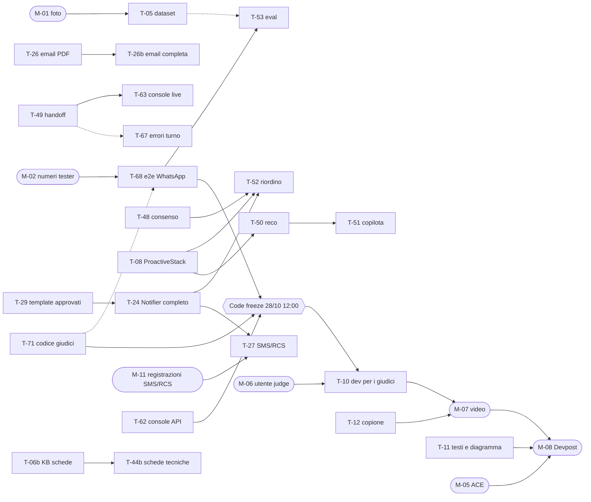

# SuppliAgent – Da dove partire

> **Fonte unica** per: punto di partenza, stato del progetto, timeline, backlog dei task (con dipendenze), azioni manuali, decisioni e registro del fatto.
> Comportamento e requisiti: [`docs/`](./docs/README.md) · Regole per gli agenti di sviluppo: [`AGENTS.md`](./agent-context/AGENTS.md).
> Aggiornato al **27/10/2026 ore 18:00** · Code freeze **28/10 ore 12:00** · Submission interna **28/10 ore 15:00** · Scadenza Devpost **28/10 ore 21:00** (ora italiana)

**Team**: MG, MM, FZ (sviluppo) · PS (Team Representative su Devpost: invia la submission).

---

## 1. Punto di partenza

### 1.1 Se arrivi adesso (10 minuti)

1. Leggi §2 (stato) e §3 (timeline) di questo file.
2. Setup (una volta): Node 22, Python 3.12, `uv`, AWS CLI, `gh`, CDK v2, Docker Desktop.
   ```bash
   bash agent-context/install.sh          # collega AGENTS.md, CLAUDE.md, .claude/, .mcp.json, .github/
   npm ci && uv sync
   npm run check                          # lint + typecheck + test + cdk synth (come la CI)
   aws sts get-caller-identity            # account 471112860008, region eu-west-1 (profilo usato finora: default)
   ```
3. Scegli un task dal backlog (§4) con la regola di §1.2 e lavoralo con il tuo agente di sviluppo (Claude Code, Copilot, Kiro: tutti leggono `AGENTS.md`). Con Claude Code: `/implement-fn FN-xx`, poi `/dod-check` (+ `/cds-check` sui canali).
4. Per capire **cosa** costruire: scheda `FN-xx` in [03](./docs/03_FUNCTIONAL_SPEC.md) e flussi `F-xx` in [02](./docs/02_TECHNICAL_FLOWS.md); architettura in [INFRASTRUCTURE_DESIGN](./docs/INFRASTRUCTURE_DESIGN.md).

### 1.2 Come prendere e chiudere un task

- **Prendere**: un task del perimetro (§4.2) con stato ☐ e tutte le dipendenze **bloccanti** ✅. Crea il branch (`feat/FN-xx-…`), come primo commit metti la tua sigla in *Owner* e ◐ in *Stato* nella riga del task, fai push e apri subito la **PR in draft**; avvisa il team. Le dipendenze ↺ (di integrazione) non bloccano: si lavora con mock/stub dichiarati nella PR.
- **Chiudere** (nella stessa PR): togli la riga da §4.2 e aggiungi una riga in §7 (data, task, cosa, PR). Se il lavoro crea o rinvia task, aggiorna §4.
- **Git**: un task = una PR (salvo task accoppiati, §4.5). Merge su `main` solo da chi revisiona, con CI verde e *Create a merge commit*. Mai push o force push su `main`. `git pull --rebase origin main` prima di iniziare e prima di ogni deploy.
- **Deploy** solo da `main` aggiornato, solo gli stack toccati: `cd infra && npx cdk deploy suppliagent-dev-<stack> --exclusively -c env=dev`. `dev` è l'**unico ambiente** (sviluppo, video e giudici): dopo il code freeze si fa deploy solo con conferma di MG.

### 1.3 Cosa non fare senza chiedere

Deploy dopo il code freeze, modifiche a risorse condivise (numero WhatsApp, dominio SES, template Meta), cambio di region/modello, servizi a costo fisso, cancellazione di dati o bucket, dati reali del cliente. Elenco completo: [AGENTS.md §11](./agent-context/AGENTS.md).

### 1.4 Note operative (problemi già incontrati)

- Dagli agenti di sviluppo il `cdk deploy` va lanciato **fuori dal sandbox** (il proxy interrompe i changeset con `Error: aborted`).
- Se dopo un deploy una Lambda ha `CodeSize` di poche centinaia di byte, l'asset è stato pubblicato vuoto (sintesi concorrente tra worktree): ripubblicare lo zip corretto con la stessa chiave e aggiornare il codice.
- Dopo un deploy di `agent`, le sessioni AgentCore già aperte restano sul codice vecchio: provare con una conversazione nuova.
- `cdk synth` a volte fallisce senza motivo riproducibile: rilanciare.
- Su `dev` il **Notifier è in sandbox** (`notifierSandbox = true` in `infra/config/environments.ts`): le risposte sono registrate ma non inviate. Il simulatore (`scripts/simulate_channel.py`) funziona solo così. T-68 passa a invio reale: da quel momento il simulatore non si usa più (o si riaccende il sandbox per una prova e lo si rispegne). Il valore va cambiato nella config, non solo in SSM: ogni deploy sovrascrive il parametro.

### 1.5 Mappa dei documenti

| File | Contenuto |
|---|---|
| `START_HERE.md` | Questo file |
| `README.md` | Presentazione in inglese per GitHub e giudici, setup, passi manuali, "Try it" |
| `SUPPLIAGENT_SOLUTION.md` | Concept: problema, scenario demo, KPI, criteri di gara, rischi |
| [`docs/README.md`](./docs/README.md) | Indice di `docs/` e convenzioni sugli ID |
| `agent-context/` | Regole e strumenti per gli agenti di sviluppo (si modificano solo lì; `install.sh` li collega) |

---

## 2. Stato del progetto (27/10 ore 18:00)

**In sintesi**: la pipeline è completa su `dev` e un ordine va da messaggio a `CONFIRMED` → ERP mock → PDF **col simulatore**. WhatsApp reale riceve testo e foto fino all'agente, ma **la risposta sul telefono non è mai stata provata** (Notifier in sandbox). Mancano per la gara: e2e da telefono, ingresso dei giudici (T-71), email di conferma, console su dati reali, `dev` pronto per i giudici, materiali di submission. Poi, se c'è tempo, i flussi 6–8 (§4.3).

| Area | Stato | Dettaglio |
|---|---|---|
| Infra di base (CDK, CI, tag, KMS, dati) | ✅ | 9 stack su `dev`, CI verde, cdk-nag |
| WhatsApp (EUM Social) | ◐ | Numero +39 345 246 0472 collegato, ricezione ok; 8 template inviati a Meta, `PENDING` (T-29); invio reale mai provato (T-68) |
| Email (SES) | ◐ | Dominio `suppliagent.stonecutters.besharp.net` verificato, fuori sandbox, ricezione ok; email di conferma con PDF da fare (T-26) |
| SMS/RCS | ☐ | Could (T-27), servono registrazioni con tempi di attesa (M-11) |
| Pipeline (Router, debounce, Dispatcher, Notifier base) | ✅ | Errori del turno senza cortesia/handoff (T-67) |
| Agente (AgentCore Runtime + Gateway, Strands, Nova `eu.`) | ◐ | Versione ridotta: ruoli e tool ok; Memory e Guardrail da fare (T-54); primo contatto (T-48) |
| Identificazione di nuovi contatti | ◐ | Abbinamento ok, ma il contatto resta da verificare e non può ordinare: i giudici sono bloccati (T-71) |
| Lettura bigliettini (`order_intake`) | ✅ | 62% di righe corrette sul corsivo (3 note): da migliorare (T-05, T-53) |
| Matching catalogo (S3 Vectors) | ✅ | Schede tecniche (Knowledge Base) Could (T-06b, T-44b) |
| Ordine (stock, prezzi, consegne, stato, conferma, sweeper) | ✅ | Pulsanti WhatsApp da fare (T-25) |
| ERP mock + PDF ordine | ✅ | |
| Console (Cognito, inbox, dettaglio con bigliettino, ruolo `judge`) | ◐ | Online su `dev` ma con **dati mock** (T-62); live e handoff da fare (T-49, T-63) |
| Copilota agenti, riordino proattivo | ☐ | Could (flussi 6 e 7) |
| Analytics e KPI | – | Tolti (§4.4) |
| `dev` pronto per i giudici, README giudici | ☐ | T-10 |
| Materiali (diagramma, testi, video, ACE, Devpost) | ☐ | T-11, T-12, §5 |

**Limiti noti** (da tenere presenti nella demo):
- il matcher chiede conferma per "farina tipo 00 da 25 kg" (due candidati vicini); Nova a volte non converte "5 kg di farina" in sacchi da 25 kg;
- nessun controllo di stock al momento della conferma (solo prima); `cancel_order` non avvisa l'ERP;
- fuori dalla finestra 24h di WhatsApp niente template né fallback di canale;
- rischi di sicurezza accettati fino alla demo: [INFRASTRUCTURE_DESIGN §12](./docs/INFRASTRUCTURE_DESIGN.md).

---

## 3. Timeline

| Quando | Sviluppo (MG, MM, FZ) | Azioni manuali (§5) |
|---|---|---|
| ✅ 12/10–26/10 | Concept, documenti, P0, pipeline, agente, ordini, console su mock | Devpost, account AWS, SES, WABA |
| **Mar 27/10 sera** | Must: **T-68 per primo** (e2e da telefono), T-71, T-26, T-62, T-11, T-12; poi Should: T-25, T-48, T-49, T-54 | M-01 foto bigliettini, M-02 numeri tester, M-05 ACE, M-11 registrazioni SMS/RCS |
| **Mer 28/10 08:00–12:00** | Should: T-63, T-67, T-26b, T-05 + T-53, T-29; correzioni da T-68. Could (flussi 6–8) solo con i Must chiusi | M-06 utente `judge` |
| **Mer 28/10 ore 12:00** | **Code freeze**: dopo, solo bugfix bloccanti | |
| 12:00–13:00 | T-10: ultimo deploy di `dev` da `main`, reset, prova del flusso 9 | |
| 13:00–14:00 | T-72 (documenti) | M-07 registrazione e upload video |
| 14:00–15:00 | Supporto | M-08 Devpost compilato e **inviato** (PS), M-09 controllo link |
| 28/10 ore 21:00 | | Scadenza Devpost |
| fino al 12/11 17:00 PT | | M-10 ambiente attivo, costi sotto controllo |
| ~19/11 | | Annuncio vincitori |

Se T-68 non è verde entro le 08:00 del 28/10: si ferma tutto il resto e si lavora solo sull'e2e. Si taglia prima dal Could, poi dal Should; il freeze non si sposta.

---

## 4. Backlog

### 4.1 Legenda

- **Stato**: ☐ da fare · ◐ in corso (branch/PR draft) · ⏸ in attesa · ✅ fatto (va in §7).
- **Dipende da**: `T-xx` = bloccante (si inizia solo quando è ✅ su `main`); `↺ T-xx` = integrazione (si procede con mock); `M-xx` = azione manuale (§5).
- **Stream** (area, non persona): **IN** infra, dati e materiali · **CH** canali CDS · **AG** agente e AgentCore · **CO** console.
- **Priorità**:
  - **Must**: senza, la demo o la submission non stanno in piedi (flussi 1, 2, 5a, 9 e materiali).
  - **Should**: completa i flussi 2–5 e la qualità tecnica.
  - **Could**: flussi 6–8. Si iniziano solo quando tutti i Must sono presi; quello che non è pronto al code freeze va nel video come "prossimi passi".
- **Owner**: chi ha preso il task (vuoto = libero). Chiunque può prendere qualsiasi task libero.

### 4.2 Backlog per flusso utente

I flussi sono quelli dell'applicazione (utenti: ristoratore, agente di commercio, back office, giudice): §4.3 li descrive passo per passo.



**Flusso 1 – Primo contatto e identificazione (ristoratore)** e **Flusso 9 – Prova dei giudici**

| ID | Task | FN | Stream | Priorità | Dipende da | Owner | Stato |
|---|---|---|---|---|---|---|---|
| T-71 | Cliente di prova per i giudici: chi si identifica con il suo codice è verificato subito | FN-03, 31 | AG | Must | – | | ☐ |
| T-48 | Informativa e consenso proattivo al primo contatto | FN-02 | AG | Should | – | | ☐ |

**Flusso 2 – Ordine da foto (ristoratore)** e **Flusso 3 – Dopo l'ordine**

| ID | Task | FN | Stream | Priorità | Dipende da | Owner | Stato |
|---|---|---|---|---|---|---|---|
| T-68 | Flussi 2 e 3 end-to-end da WhatsApp reale, in italiano e in inglese | FN-01, 05–17, 27 | CH + AG | Must | M-02, ↺ T-71 | | ☐ |
| T-26 | Email di conferma con PDF (l'assistente chiede l'email se manca) | FN-14 | CH + AG | Must | – | | ☐ |
| T-25 | Pulsanti WhatsApp per chiarimenti e *Confermo / Modifica* | FN-08, 12 | CH | Should | – | | ☐ |
| T-29 | Approvazione dei template WhatsApp | FN-12, 19 | CH | Should | – | | ☐ |

**Flusso 4 – Ordine via email (ristoratore)**

| ID | Task | FN | Stream | Priorità | Dipende da | Owner | Stato |
|---|---|---|---|---|---|---|---|
| T-26b | Ordine via email end-to-end e conferma aggiornata dopo una modifica | FN-06, 14, 16 | CH | Should | T-26 | | ☐ |

**Flusso 5 – Supervisione in console (back office)**

| ID | Task | FN | Stream | Priorità | Dipende da | Owner | Stato |
|---|---|---|---|---|---|---|---|
| T-62 | 5a/5b: elenco e dettaglio ordine su API reali, correzione riga | FN-28 | CO | Must | – | | ☐ |
| T-49 | 5c: `handoff_to_human` e `mode = HUMAN` / release | FN-24 | AG | Should | – | | ☐ |
| T-63 | 5c: conversazioni live + *Take over / Reply / Release* | FN-24, 28 | CO | Should | T-49 | | ☐ |
| T-67 | Messaggi di cortesia e handoff sugli errori del turno | FN-26, 24 | CH | Should | ↺ T-49 | | ☐ |

**Flusso 6 – Copilota per l'agente di commercio**

| ID | Task | FN | Stream | Priorità | Dipende da | Owner | Stato |
|---|---|---|---|---|---|---|---|
| T-08 | `ProactiveStack`: insight per cliente (anche per T-50 e T-52) | FN-19, 20 | IN | Could | – | | ☐ |
| T-50 | Tool `reco`: suggerimenti motivati | FN-11, 20 | AG | Could | T-08 | | ☐ |
| T-51 | Tool `sales`: briefing, agenda, ordine per conto del cliente | FN-20, 22, 23 | AG | Could | T-50 | | ☐ |
| T-06b | Knowledge Base delle schede tecniche | FN-21 | IN | Could | – | | ☐ |
| T-44b | Tool `ask_product_sheets` | FN-21 | AG | Could | T-06b | | ☐ |
| T-64 | Chat web per gli agenti di commercio in console | FN-29 | CO | Could | – | | ☐ |

**Flusso 7 – Riordino proattivo**

| ID | Task | FN | Stream | Priorità | Dipende da | Owner | Stato |
|---|---|---|---|---|---|---|---|
| T-24 | Notifier completo: template fuori finestra 24h, fallback, opt-out, errori di invio | FN-01, 14, 15 | CH | Could | T-29 | | ☐ |
| T-52 | Turno proattivo di riordino | FN-19 | AG | Could | T-08, T-24, T-48 | | ☐ |

**Flusso 8 – Consegna (SMS/RCS)**

| ID | Task | FN | Stream | Priorità | Dipende da | Owner | Stato |
|---|---|---|---|---|---|---|---|
| T-27 | SMS/RCS: conferma e avviso di consegna con *Ricevuto / Segnala problema* | FN-15, 18 | CH | Could | M-11, T-24 | | ☐ |

**Qualità tecnica**

| ID | Task | FN | Stream | Priorità | Dipende da | Owner | Stato |
|---|---|---|---|---|---|---|---|
| T-54 | AgentCore Memory, Guardrail, Observability, prompt `sales_rep` | FN-03, 04, 25, 27, 32 | AG | Should | – | | ☐ |
| T-05 | Dataset eval (≥ 15 bigliettini, vocali, email) | FN-05, 07 | IN | Should | M-01 | | ☐ |
| T-53 | Eval: lettura, matching, conversazione d'ordine | FN-04, 05, 07 | AG | Should | T-68, ↺ T-05 | | ☐ |

**Demo e submission**

| ID | Task | FN | Stream | Priorità | Dipende da | Owner | Stato |
|---|---|---|---|---|---|---|---|
| T-11 | Diagramma aggiornato + PNG, testi submission (EN), paragrafo WhatsApp | – | IN | Must | – | | ☐ |
| T-12 | Copione del video (≤ 3 min) | – | IN | Must | – | | ☐ |
| T-10 | `dev` pronto per i giudici, README di deploy e per i giudici | FN-31 | IN | Must | code freeze, M-06 | | ☐ |
| T-72 | Documenti di design (01, 02, 03, INFRA) ridotti alle funzionalità della gara | – | IN | Should | code freeze | | ☐ |

<details>
<summary><b>Dettaglio dei task</b></summary>

**Flussi 1 e 9**
- **T-71 – Cliente di prova per i giudici** (nuovo, 27/10). Oggi un numero sconosciuto che si identifica (nome del locale + codice cliente) diventa contatto `PENDING_VERIFICATION` e non può ordinare. Nel seed, uno o più clienti di prova con un flag (es. `autoVerifyContacts: true`) e un codice pubblicato nel README; `identify_contact` per quei clienti crea il contatto già verificato, per tutti gli altri resta `PENDING_VERIFICATION` (test negativo). Aggiornare `customer_unknown.md`. Nota: i giudici che usano lo stesso codice condividono il locale di prova (storico e ordini); valutare un codice per giudice o un reset periodico.
- **T-48 – Primo contatto**. Informativa e richiesta di consenso proattivo al primo messaggio di un contatto (F-01); preferenza salvata (serve a T-52).

**Flussi 2 e 3**
- **T-68 – Flussi 2 e 3 da WhatsApp reale** (nuovo, 27/10). Su `dev`: numeri dei tester registrati come contatti (M-02), `notifierSandbox: 'false'` in `infra/config/environments.ts` (invio reale; resta così anche per i giudici), deploy di `foundation` (parametri SSM) e `messaging`. Dal telefono: foto del bigliettino (+ vocale) → righe lette → chiarimento → sostituto, consegna e cut-off → riepilogo → *Confermo* → `CONFIRMED` → ERP mock → PDF; poi stato dell'ordine, modifica e annullo prima del cut-off. Ripetere in inglese. Con T-71 pronto, ripetere da un numero sconosciuto con il codice di prova. Annotare nella PR tempi, numero di scambi e problemi; correggere quelli bloccanti (es. i limiti noti di §2). Uscita: flussi ripetibili dopo `seed/reset.py`.
- **T-26 – Email di conferma con PDF**. Template HTML (IT/EN) con il PDF di `order_pdf` allegato, inviato dal Notifier con `sesv2:SendEmail` dopo `order.confirmed`. Se il contatto non ha un'email registrata (es. un giudice da WhatsApp), l'assistente la chiede prima della conferma e la salva sul contatto, usata solo per le conferme d'ordine.
- **T-25 – Pulsanti WhatsApp**. Button/list e parsing delle risposte; riepilogo d'ordine con *Confermo / Modifica* come messaggio interattivo: il Notifier registra l'id del messaggio in `Orders.summaryMessageId` (il tool `orders` accetta il tap solo se `interactiveReply.contextId` lo uguaglia); l'agente passa `interactiveReply` a `confirm_order`.
- **T-29 – Template WhatsApp**. Gli 8 JSON di `services/notifier/whatsapp_templates/` sono stati inviati il 27/10, `PENDING`. Controllare con `aws socialmessaging list-whatsapp-message-templates --id <WABA_ID>` (comando in [09 §1](./docs/09_CONTENT_AND_TEMPLATES.md)) fino ad `APPROVED`; se Meta rifiuta o cambia categoria, correggere il JSON (test verde) e reinviare; annotare l'esito in 09. Servono a T-24 e T-52.

**Flusso 4**
- **T-26b – Ordine via email**. Ordine per email (testo e foto; l'ingresso è già nel Router, T-23) fino alla conferma con PDF; conferma aggiornata dopo una modifica entro il cut-off (evento `order.updated`, FN-16). Esclusi: allegati PDF/Excel, F-02.C3.

**Flusso 5**
- **T-62 – Console su API reali**. UI con mock già fatta: `VITE_ORDERS_SOURCE=api`, `PATCH` di correzione riga in `console_api` (oggi `correctLine` lancia errore), `customerName`/`uncertainLines`/`handoff` nel riepilogo, nome prodotto sulla riga, `imageS3Uri`. Vista chiave della demo: bigliettino accanto alle righe.
- **T-49 – Handoff**. Tool `handoff_to_human` e gestione `mode = HUMAN` / release (il controllo `mode = HUMAN` è già nel Router), F-14.
- **T-63 – Conversazioni live**. `broadcaster` (WebSocket) + azioni *Take over / Reply / Release* in `console_api`.
- **T-67 – Errori del turno**. Messaggio di cortesia al primo errore del Runtime (E-05), al secondo `handoff_to_human` con `LOW_CONFIDENCE` (E-12); oggi solo retry SQS ×3 e DLQ senza avviso. Tetto alla lunghezza di `pending`.

**Flusso 6**
- **T-08 – `ProactiveStack`** (lo stack esiste vuoto). `insights_analyzer` (riordini scaduti, prodotti smessi, gap rispetto a clienti simili), `proactive_trigger`, scheduler notturno. Per la demo basta un'esecuzione a comando sui dati del seed.
- **T-50 – Tool `reco`**. Suggerimenti motivati per cliente; per il ristoratore max 1 per ordine, solo con consenso (FN-11).
- **T-51 – Tool `sales`**. Briefing del cliente, agenda, ordine per conto del cliente; solo clienti del portafoglio dell'agente (autorizzazione già nei tool).
- **T-06b – Knowledge Base schede tecniche** (resto di T-06; indice `products` e `catalog_indexer` sono fatti). `CfnKnowledgeBase` (L1), vector store S3 Vectors, indice `product-sheets`, data source `catalog-assets/sheets/` con schede sintetiche.
- **T-44b – Tool `ask_product_sheets`** (target Gateway `catalog`, stessa Lambda `tool-catalog` di T-44). Risposte dalle schede tecniche con citazione, o dichiarazione esplicita che l'informazione non c'è; per tutti i ruoli, senza dati interni.
- **T-64 – Chat web agenti di commercio**. Lambda `rep_chat` + UI con streaming; `NormalizedMessage` con `channel = WEB`. Meno prioritario: l'agente di commercio può già usare WhatsApp.

**Flusso 7**
- **T-24 – Completamento del Notifier** (la base — risposte su WhatsApp ed email, sandbox, idempotenza, read receipt — è fatta). Template fuori dalla finestra 24h (F-11.C2), compreso `order_pending_reminder` inviato da `order-sweeper`; fallback di canale e RCS→SMS; fasce orarie; opt-out. Dal Router: richiesta di reinvio per media non scaricati (E-02) e avviso per allegati rifiutati senza `s3Uri` (E-13). Fallimenti di invio: retry ×3 e fallback (E-09).
- **T-52 – Turno proattivo di riordino**. Template `reorder_suggestion` (approvato, T-29), pulsanti *Riordina uguale / Modifica / No grazie / Stop proposte*, cooldown di 7 giorni, mai in fascia notturna, solo con consenso (FN-19).

**Flusso 8**
- **T-27 – SMS/RCS**. Infra EUM SMS v2 (configuration set, event destinations, opt-out list, topic `sms-inbound`); sottoscrizione del topic alla coda `inbound` e normalizzazione SMS/RCS nel Router; rich card di conferma e di avviso di consegna (avanzamento dall'ERP mock, azione `advance`) con *Ricevuto / Segnala problema* (tool `report_delivery_issue` già fatto); fallback SMS. Bloccato dalle registrazioni di M-11.

**Qualità tecnica**
- **T-54 – Completamento dell'agente**. AgentCore Memory (`actorId = contactId`, storico e preferenze), Bedrock Guardrail (PII, topic negati), prompt e tool `sales_rep` completi, Observability/OTel (`aws-opentelemetry-distro`), retention e CMK del log group del Runtime, verifica multilingua; testo e allegati dei messaggi passati al modello come **contenuto non fidato** delimitato (`<user_message>`), mai come istruzioni.
- **T-05 – Dataset eval**. ≥ 15 bigliettini scritti a mano (grafie diverse, da M-01), vocali, email d'ordine, conversazioni attese, in `agent/evals/data/`, con soluzione attesa.
- **T-53 – Eval**. Runner e metriche (lettura righe, matching, intento, n. scambi) anche con AgentCore Evaluations; eval della conversazione d'ordine (da bigliettino a `CONFIRMED` con sostituto, arrotondamento, cut-off, *Modifica*, doppia conferma); miglioramento della lettura del corsivo (oggi 62% con Nova Pro). Report in `agent/evals/README.md`.

**Demo e submission**
- **T-11 – Materiali**. Aggiornare `docs/architecture.drawio` (coda `inbound` standard, niente Lambda Media Fetcher, niente analytics) ed esportarlo in PNG; testi Devpost in inglese (problema, soluzione, servizi AWS, impatto misurabile) e paragrafo sull'uso di EUM Social / WhatsApp (premio Meta); bozza in `docs/SUBMISSION_TEXT.md`.
- **T-12 – Copione del video**. ≤ 3 minuti, in inglese o con sottotitoli: telefono del ristoratore + console affiancati; flusso 2 completo, momento "wow" foto → ordine verificato; flusso 5; i flussi 6–8 mostrati se pronti, altrimenti citati come prossimi passi; checklist di registrazione (reset dati, nessun marchio o musica senza licenza).
- **T-10 – `dev` pronto per i giudici**. Dopo il freeze: ultimo deploy di tutti gli stack da `main`, console ripubblicata con `VITE_ORDERS_SOURCE=api` (`scripts/deploy-console.sh dev`), `seed/reset.py --env dev`, prova del flusso 9 da un telefono non registrato. README: sezione di deploy riproducibile da zero (oggi dice "Commands will be finalized"), passi manuali, seed; "Try it (for judges)" con URL della console, credenziali `judge` (M-06), codice cliente di prova (T-71), bigliettino di esempio. Da lì `dev` resta congelato fino al 12/11.
- **T-72 – Documenti di design snelli**. 01, 02, 03 e INFRASTRUCTURE_DESIGN ridotti alle funzionalità della gara: via analytics/KPI (FN-30, FN-33 lato Firehose/Athena), domande per il cliente reale, integrazione ERP reale, parti mai pianificate. Solo documentazione, si può fare dopo il freeze.

</details>

### 4.3 I flussi utente

Utenti: **ristoratore** (WhatsApp +39 345 246 0472 o email `ordini@…`), **agente di commercio** (WhatsApp o chat in console), **back office** (console), **giudice** (console in sola lettura + WhatsApp come un ristoratore). Ogni messaggio passa da: raccolta dei messaggi ravvicinati → un turno dell'agente (Amazon Nova su AgentCore) con i suoi tool → una sola risposta, inviata dal Notifier.

| # | Flusso | Passi | Stato oggi |
|---|---|---|---|
| 1 | Primo contatto e identificazione | Numero sconosciuto → l'assistente si presenta, chiede nome del locale e codice cliente → collega il numero al locale; informativa e consenso alle proposte | ◐ abbinamento ok, ma il contatto resta da verificare e non può ordinare (T-71) |
| 2 | Ordine da foto | Foto del bigliettino (+ vocale) → righe lette → abbinamento al catalogo con lo storico → chiarimenti sulle righe incerte → sostituti, multipli, data di consegna e cut-off → riepilogo con totale → *Confermo* → ERP mock, numero d'ordine, PDF → email con PDF | ✅ col simulatore, mai da telefono (T-68); ☐ email (T-26), pulsanti (T-25) |
| 3 | Dopo l'ordine | Stato dell'ordine; modifica o annullo fino al cut-off del giorno prima; promemoria della bozza dopo 2 h, scadenza a mezzanotte | ✅ nei tool, mai da telefono (T-68) |
| 4 | Ordine via email | Email a `ordini@…` con testo o foto → stesso flusso, risposte via email | ◐ ricezione e risposta ok (T-26b) |
| 5 | Supervisione in console | 5a elenco ordini e dettaglio con il bigliettino accanto alle righe · 5b correzione di una riga · 5c handoff: l'operatore prende la conversazione, risponde, la restituisce | ◐ elenco e dettaglio su dati finti (T-62); ☐ handoff (T-49, T-63) |
| 6 | Copilota per l'agente di commercio | "Cosa propongo alla Trattoria X?", briefing prima della visita, domande sulle schede tecniche, ordine per conto del cliente | ☐ (solo il ruolo e i permessi) |
| 7 | Riordino proattivo | L'assistente scrive per primo ("di solito riordinate l'olio ogni 10 giorni…") → riordino con un tap | ☐ |
| 8 | Consegna | Avviso via SMS/RCS il giorno della consegna con *Ricevuto / Segnala problema* | ☐ |
| 9 | Prova dei giudici | Dal README: numero WhatsApp e codice di prova → ordine da foto → console in sola lettura con il proprio ordine | ◐ console e pagina demo ✅; ordine bloccato dal flusso 1 (T-71) |

### 4.4 Tolti dal backlog

Il repo serve solo alla gara (decisione del 27/10): tolti **T-09** `AnalyticsStack` e **T-65** dashboard KPI (lo stack `analytics` vuoto resta per ora), **T-70** hardening (rischi accettati in [INFRASTRUCTURE_DESIGN §12](./docs/INFRASTRUCTURE_DESIGN.md)) e le domande per il cliente reale. Descrizioni originali in [`docs/OLD/04_BACKLOG.md`](./docs/OLD/04_BACKLOG.md).

### 4.5 PR accorpate

Task sullo stesso stack non testabili da soli: una PR, un commit per task. Finora: T-40 + T-41, T-45 + T-46 + T-47. Candidati: T-49 + T-63 (handoff), T-06b + T-44b (schede tecniche).

---

## 5. Azioni manuali

Quello che gli agenti di sviluppo non possono fare: accessi, Meta, AWS Partner Central, registrazione, Devpost.

| ID | Azione | Owner | Entro | Sblocca | Stato |
|---|---|---|---|---|---|
| M-01 | ≥ 15 foto di bigliettini scritti a mano da persone diverse (prodotti del catalogo sintetico) + qualche vocale, consegnate a chi fa T-05 | | 27/10 sera | T-05 | ☐ |
| M-02 | Registrare i numeri WhatsApp dei tester come contatti di prova (`seed/private/`, mai nel repo) | MG | 27/10 sera | T-68 | ☐ |
| M-03 | Tag `Project`, `Owner`, `Env` sulla risorsa del numero `phone-number-id-79f9…` (il WABA li ha già) | MG | 28/10 | – | ☐ |
| M-04 | Attivare `Project` ed `Env` come *cost allocation tags* in Billing | MG | 28/10 | M-10 | ☐ |
| M-05 | **Opportunità ACE** su Partner Central (dettagli sotto) → annotare l'ID | PS | 28/10 12:00 | M-08 | ☐ |
| M-06 | Utente Cognito `judge` su `dev` (README, *Manual steps* §4) | | 28/10 12:00 | T-10 | ☐ |
| M-07 | Registrare il video (copione T-12) e caricarlo **pubblico** su YouTube o Vimeo | | 28/10 14:00 | M-08 | ☐ |
| M-08 | Compilare e **inviare** Devpost (dettagli sotto) | PS | 28/10 15:00 | – | ☐ |
| M-09 | Controllo finale: repo pubblico con licenza visibile, video pubblico, console raggiungibile, WhatsApp che risponde | | 28/10 15:00 | – | ☐ |
| M-10 | Ambiente attivo e gratuito per i giudici fino al **12/11 17:00 PT**, costi sotto controllo, risposte ai giudici; in caso di vittoria moduli entro 10 giorni lavorativi | MG, PS | 12/11 | – | ☐ |
| M-11 | Avviare subito la registrazione del mittente SMS per l'Italia e dell'agente RCS con i telefoni tester (inviti), verificando i tempi: se non arrivano entro il freeze, T-27 esce | MG | 27/10 sera | T-27 | ☐ |

**M-05 – ACE** ([Partner Central](https://partnercentral.awspartner.com/)): opportunità **nuova** (creata dopo il 14/09/2026), stato almeno *Created*; Step 2 → *Opportunity marketing details* → *Sourced from marketing activity* → campaign `AWS CDS Agentic AI Hackathon -Sept. 2026`; Step 4 → prodotti **AWS End User Messaging**, **AWS End User Messaging Social**, **Amazon SES**; sul cliente reale (distribuzione alimentare HoReCa), ARR stimato con il commerciale beSharp; ID `OXXXXXXXX` in *Sell → Opportunities*.

**M-08 – Form Devpost** ([overview](https://aws-cds-partner.devpost.com/) · [rules](https://aws-cds-partner.devpost.com/rules) · [FAQ](https://aws-cds-partner.devpost.com/details/faq)): URL del repo · diagramma (PNG da T-11) · descrizione (T-11) · link al video (M-07) · istruzioni di test per i giudici (README, T-10) · ID ACE (M-05) · paragrafo sull'uso di WhatsApp (premio Meta, T-11).

---

## 6. Decisioni

**Aperte**

Nessuna per la gara.

**Prese**

| Data | Decisione |
|---|---|
| 27/10 | Un solo ambiente, `dev`, per sviluppo, video e giudici: l'ambiente `demo` è stato tolto da codice e documenti; dopo il code freeze `dev` è congelato |
| 27/10 | Il repo serve solo alla gara: niente task o domande per il cliente reale; tolti T-09, T-65 (analytics/KPI) e T-70 (hardening) |
| 27/10 | Perimetro = flussi utente 1–9 (§4.3), con priorità Must/Should/Could; i flussi 6–8 sono Could |
| 27/10 | I giudici entrano con un codice cliente di prova che verifica subito il contatto (T-71); l'email per la conferma, se manca, la chiede l'assistente (T-26) |
| 27/10 | Code freeze spostato al 28/10 ore 12:00 |
| 27/10 | Prezzi mostrati al ristoratore (riepilogo con totale stimato) |
| 27/10 | Pulsanti WhatsApp per chiarimenti e conferma (T-25) |
| 27/10 | Repo pubblico (già pubblico, licenza MIT) |
| 27/10 | Regole di consegna, cut-off (18:00), minimi e multipli: quelle sintetiche del seed |
| 27/10 | Marchio del cliente non usato: brand fittizio, dati sintetici |
| 27/10 | Ordine inserito dall'agente di commercio: basta la sua conferma |
| 27/10 | Modello: Amazon Nova (`eu.`) per la gara; Claude non abilitato sull'account (*channel program*) |
| 27/10 | Crediti AWS dell'hackathon non richiesti (scaduti): costi su budget beSharp |
| 27/10 | Team: MG, MM, FZ sviluppo; PS Team Representative. Task non assegnati a priori: li prende chi è libero (§1.2) |
| 26/10 | Flusso Git: PR aperta dall'agente, merge commit da chi revisiona, deploy da locale |
| 26/10 | `security-reviewer` solo su richiesta esplicita |
| 26/10 | Coda `inbound` SQS standard + debounce applicativo con lock (SNS standard non consegna a FIFO) |
| 25/10 | Account `471112860008` condiviso: nessun AWS Budget nel CDK, costi isolati con i tag |

---

## 7. Fatto

Una riga per task chiuso (più recente in alto). Dettagli, scelte e verifiche: descrizione della PR; storico fino al 27/10 in [`docs/OLD/DONE.md`](./docs/OLD/DONE.md).

| Data | Task | Cosa | PR |
|---|---|---|---|
| 27/10 | T-29 (invio) | 8 template WhatsApp inviati a Meta (`PENDING`); numero ed email d'ordine nel README e nella console | #33 |
| 27/10 | – | WhatsApp reale su `dev`: WABA collegata, testo e foto fino all'agente; fix dimensione media | #31, #32 |
| 27/10 | – | Deploy `dev` e prova e2e del flusso d'ordine col simulatore; fix nomi tool per Nova, prompt per ruolo, `seed/reset.py` | #30 |
| 27/10 | T-45, T-46, T-47, T-04 | Stock, prezzi, consegne e cut-off; stato ordine, conferma idempotente, modifica/annullo, sweeper; catalogo e listini di prova | #29 |
| 27/10 | T-07 | ERP adapter mock, PDF ordine, regola `order.confirmed` | #28 |
| 27/10 | T-44 | Tool `catalog`: `match_products`, `search_catalog` | #27 |
| 27/10 | T-14 | Simulatore canali (solo `dev`, Notifier in sandbox) | #26 |
| 27/10 | T-06 | Indice prodotti S3 Vectors e `catalog_indexer` | #25 |
| 27/10 | T-15 | `sesDomain` e `waPhoneNumberId` nella config per ambiente | #24 |
| 27/10 | – | SES fuori dalla sandbox | #23 |
| 26/10 | T-22, T-24 (base) | Debounce, Turn Dispatcher, Notifier con sandbox e idempotenza | #22 |
| 26/10 | T-43 | Tool `order_intake`: lettura di foto, vocali e testo | #21 |
| 26/10 | – | SES su `dev`: dominio, DNS, ricezione | #20 |
| 26/10 | T-21, T-23 | `MessagingStack`, Inbound Router, media WhatsApp e allegati email su S3 | #16 |
| 26/10 | T-40, T-41 (ridotti) | AgentCore Gateway + Runtime, agente Strands per ruolo | #15 |
| 26/10 | T-66 | Ruolo `judge` in sola lettura, pagina demo | #13 |
| 26/10 | – | Console online su `dev` (script di pubblicazione) | #12 |
| 26/10 | T-62 (UI) | Inbox e dettaglio ordine con bigliettino, su mock | #10 |
| 26/10 | T-61 | Scaffold console React + Vite + Cognito | #9, #11 |
| 26/10 | T-20 | `ChannelsStack`: topic SNS, SES configuration set e rule set | #7 |
| 26/10 | T-60 | `ConsoleStack` ridotto: Cognito, CloudFront, API ordini | #4, #6, #8 |
| 26/10 | T-42 | Tool `customers`: `identify_contact`, `get_customer_profile` | #5 |
| 26/10 | T-04 (parte) | Dati sintetici: clienti, contatti, storico ordini | #3 |
| 26/10 | T-28 | Testi dei template WhatsApp (IT/EN) | #2 |
| 25/10 | – | Primo deploy `dev` (9 stack, 18 tabelle, CMK, event bus, SSM) | – |
| 24/10 | T-13 | Tag obbligatori su tutte le risorse | `2b5d967` |
| 23/10 | T-01, T-03, T-02 | Monorepo, app CDK con Foundation e Data, CI | `chore/p0-foundations` |
| ≤ 16/10 | – | Concept, documenti 01/02/03, Infrastructure Design, backlog | – |
