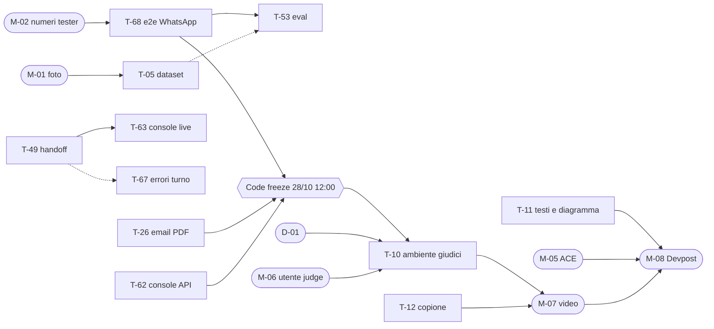

# SuppliAgent – Da dove partire

> **Fonte unica** per: punto di partenza, stato del progetto, timeline, backlog dei task (con dipendenze), azioni manuali, decisioni e registro del fatto.
> Comportamento e requisiti: [`docs/`](./docs/README.md) · Regole per gli agenti di sviluppo: [`AGENTS.md`](./agent-context/AGENTS.md).
> Aggiornato al **27/10/2026 ore 18:00** · Code freeze **28/10 ore 12:00** · Submission interna **28/10 ore 15:00** · Scadenza Devpost **28/10 ore 21:00** (ora italiana)

**Team**: MG, MM, FZ (sviluppo) · PS (Team Representative su Devpost: invia la submission).

---

## 1. Punto di partenza

### 1.1 Se arrivi adesso (10 minuti)

1. Leggi §2 (stato) e §3 (timeline) di questo file.
2. Setup (una volta): Node 22, Python 3.12, `uv`, AWS CLI, `gh`, CDK v2, Docker Desktop.
   ```bash
   bash agent-context/install.sh          # collega AGENTS.md, CLAUDE.md, .claude/, .mcp.json, .github/
   npm ci && uv sync
   npm run check                          # lint + typecheck + test + cdk synth (come la CI)
   aws sts get-caller-identity            # account 471112860008, region eu-west-1 (profilo usato finora: default)
   ```
3. Scegli un task dal backlog (§4) con la regola di §1.2 e lavoralo con il tuo agente di sviluppo (Claude Code, Copilot, Kiro: tutti leggono `AGENTS.md`). Con Claude Code: `/implement-fn FN-xx`, poi `/dod-check` (+ `/cds-check` sui canali).
4. Per capire **cosa** costruire: scheda `FN-xx` in [03](./docs/03_FUNCTIONAL_SPEC.md) e flussi `F-xx` in [02](./docs/02_TECHNICAL_FLOWS.md); architettura in [INFRASTRUCTURE_DESIGN](./docs/INFRASTRUCTURE_DESIGN.md).

### 1.2 Come prendere e chiudere un task

- **Prendere**: un task del perimetro (§4.2) con stato ☐ e tutte le dipendenze **bloccanti** ✅. Crea il branch (`feat/FN-xx-…`), come primo commit metti la tua sigla in *Owner* e ◐ in *Stato* nella riga del task, fai push e apri subito la **PR in draft**; avvisa il team. Le dipendenze ↺ (di integrazione) non bloccano: si lavora con mock/stub dichiarati nella PR.
- **Chiudere** (nella stessa PR): togli la riga da §4.2 e aggiungi una riga in §7 (data, task, cosa, PR). Se il lavoro crea o rinvia task, aggiorna §4.
- **Git**: un task = una PR (salvo task accoppiati, §4.4). Merge su `main` solo da chi revisiona, con CI verde e *Create a merge commit*. Mai push o force push su `main`. `git pull --rebase origin main` prima di iniziare e prima di ogni deploy.
- **Deploy** solo da `main` aggiornato, solo su `dev`, solo gli stack toccati: `cd infra && npx cdk deploy suppliagent-dev-<stack> --exclusively -c env=dev`. `demo` solo dopo conferma di MG (§6).

### 1.3 Cosa non fare senza chiedere

Deploy su `demo`, modifiche a risorse condivise (numero WhatsApp, dominio SES, template Meta), cambio di region/modello, servizi a costo fisso, cancellazione di dati o bucket, dati reali del cliente. Elenco completo: [AGENTS.md §11](./agent-context/AGENTS.md).

### 1.4 Note operative (problemi già incontrati)

- Dagli agenti di sviluppo il `cdk deploy` va lanciato **fuori dal sandbox** (il proxy interrompe i changeset con `Error: aborted`).
- Se dopo un deploy una Lambda ha `CodeSize` di poche centinaia di byte, l'asset è stato pubblicato vuoto (sintesi concorrente tra worktree): ripubblicare lo zip corretto con la stessa chiave e aggiornare il codice.
- Dopo un deploy di `agent`, le sessioni AgentCore già aperte restano sul codice vecchio: provare con una conversazione nuova.
- `cdk synth` a volte fallisce senza motivo riproducibile: rilanciare.
- Su `dev` il **Notifier è in sandbox** (`notifierSandbox = true`): le risposte sono registrate ma non inviate. Il simulatore (`scripts/simulate_channel.py`) funziona solo così.

### 1.5 Mappa dei documenti

| File | Contenuto |
|---|---|
| `START_HERE.md` | Questo file |
| `README.md` | Presentazione in inglese per GitHub e giudici, setup, passi manuali, "Try it" |
| `SUPPLIAGENT_SOLUTION.md` | Concept: problema, scenario demo, KPI, criteri di gara, rischi |
| [`docs/README.md`](./docs/README.md) | Indice di `docs/` e convenzioni sugli ID |
| `agent-context/` | Regole e strumenti per gli agenti di sviluppo (si modificano solo lì; `install.sh` li collega) |

---

## 2. Stato del progetto (27/10 ore 18:00)

**In sintesi**: la pipeline è completa su `dev` e un ordine va da messaggio a `CONFIRMED` → ERP mock → PDF **col simulatore**. WhatsApp reale riceve testo e foto fino all'agente, ma **la risposta sul telefono non è mai stata provata** (Notifier in sandbox). Mancano: e2e da telefono, email di conferma, console su dati reali, ambiente per i giudici, materiali di submission.

| Area | Stato | Dettaglio |
|---|---|---|
| Infra di base (CDK, CI, tag, KMS, dati) | ✅ | 9 stack su `dev`, CI verde, cdk-nag |
| WhatsApp (EUM Social) | ◐ | Numero +39 345 246 0472 collegato, ricezione ok; 8 template inviati a Meta, `PENDING` (T-29); invio reale mai provato (T-68) |
| Email (SES) | ◐ | Dominio `suppliagent.stonecutters.besharp.net` verificato, fuori sandbox, ricezione ok; email di conferma con PDF da fare (T-26) |
| SMS/RCS | ⬜ | Fuori perimetro (§4.3): solo nel video/slide |
| Pipeline (Router, debounce, Dispatcher, Notifier base) | ✅ | Errori del turno senza cortesia/handoff (T-67) |
| Agente (AgentCore Runtime + Gateway, Strands, Nova `eu.`) | ◐ | Versione ridotta: ruoli e tool ok; Memory e Guardrail da fare (T-54); primo contatto (T-48) |
| Lettura bigliettini (`order_intake`) | ✅ | 62% di righe corrette sul corsivo (3 note): da migliorare (T-05, T-53) |
| Matching catalogo (S3 Vectors) | ✅ | Schede tecniche (Knowledge Base) fuori perimetro |
| Ordine (stock, prezzi, consegne, stato, conferma, sweeper) | ✅ | Pulsanti WhatsApp da fare (T-25) |
| ERP mock + PDF ordine | ✅ | |
| Console (Cognito, inbox, dettaglio con bigliettino, ruolo `judge`) | ◐ | Online su `dev` ma con **dati mock** (T-62); live e handoff da fare (T-49, T-63) |
| Copilota agenti, proattività, KPI | ⬜ | Fuori perimetro |
| Ambiente per i giudici, README giudici | ☐ | T-10, decisione D-01 |
| Materiali (diagramma, testi, video, ACE, Devpost) | ☐ | T-11, T-12, §5 |

**Limiti noti** (da tenere presenti nella demo):
- il matcher chiede conferma per "farina tipo 00 da 25 kg" (due candidati vicini); Nova a volte non converte "5 kg di farina" in sacchi da 25 kg;
- nessun controllo di stock al momento della conferma (solo prima); `cancel_order` non avvisa l'ERP;
- fuori dalla finestra 24h di WhatsApp niente template né fallback di canale;
- rischi di sicurezza accettati fino alla demo: [INFRASTRUCTURE_DESIGN §12](./docs/INFRASTRUCTURE_DESIGN.md).

---

## 3. Timeline

| Quando | Sviluppo (MG, MM, FZ) | Azioni manuali (§5) |
|---|---|---|
| ✅ 12/10–26/10 | Concept, documenti, P0, pipeline, agente, ordini, console su mock | Devpost, account AWS, SES, WABA |
| **Mar 27/10 sera** | **T-68 per primo** (e2e da telefono); in parallelo T-26, T-62, T-25, T-49, T-48, T-54, T-11, T-12 | M-01 foto bigliettini, M-02 numeri tester, M-05 ACE, D-01 |
| **Mer 28/10 08:00–12:00** | T-63, T-67, T-05 + T-53, T-29; correzioni da T-68 | M-06 utente `judge` |
| **Mer 28/10 ore 12:00** | **Code freeze**: dopo, solo bugfix bloccanti | |
| 12:00–13:00 | T-10: deploy ambiente giudici, reset, prova S1 | |
| 13:00–14:00 | Supporto | M-07 registrazione e upload video |
| 14:00–15:00 | Supporto | M-08 Devpost compilato e **inviato** (PS), M-09 controllo link |
| 28/10 ore 21:00 | | Scadenza Devpost |
| fino al 12/11 17:00 PT | | M-10 ambiente attivo, costi sotto controllo |
| ~19/11 | | Annuncio vincitori |

Se T-68 non è verde entro le 08:00 del 28/10: si ferma tutto il resto e si lavora solo sull'e2e. Si taglia dal Should, non si sposta il freeze.

---

## 4. Backlog

### 4.1 Legenda

- **Stato**: ☐ da fare · ◐ in corso (branch/PR draft) · ⏸ in attesa · ✅ fatto (va in §7).
- **Dipende da**: `T-xx` = bloccante (si inizia solo quando è ✅ su `main`); `↺ T-xx` = integrazione (si procede con mock); `M-xx` = azione manuale (§5).
- **Stream** (area, non persona): **IN** infra, dati e materiali · **CH** canali CDS · **AG** agente e AgentCore · **CO** console.
- **Priorità**: **Must** = serve al primo flusso end-to-end o alla submission · **Should** = rifinitura se c'è tempo prima del freeze.
- **Owner**: chi ha preso il task (vuoto = libero). Chiunque può prendere qualsiasi task libero.

### 4.2 Perimetro della submission



**A. Ordine end-to-end (S1)**

| ID | Task | FN | Stream | Priorità | Dipende da | Owner | Stato |
|---|---|---|---|---|---|---|---|
| T-68 | S1 end-to-end su WhatsApp reale | FN-01, 05–14 | CH + AG | Must | M-02 | | ☐ |
| T-26 | Email di conferma con PDF | FN-14 | CH | Must | – | | ☐ |
| T-25 | Messaggi interattivi WhatsApp (pulsanti, liste) | FN-08, 12 | CH | Should | – | | ☐ |
| T-48 | Primo contatto: informativa e consenso proattivo | FN-02 | AG | Should | – | | ☐ |
| T-29 | Approvazione dei template WhatsApp | FN-12, 19 | CH | Should | – | | ☐ |

**B. Supervisione del back office**

| ID | Task | FN | Stream | Priorità | Dipende da | Owner | Stato |
|---|---|---|---|---|---|---|---|
| T-62 | Console: inbox e dettaglio ordine su API reali | FN-28 | CO | Must | – | | ☐ |
| T-49 | `handoff_to_human` e `mode = HUMAN` / release | FN-24 | AG | Should | – | | ☐ |
| T-63 | Console: conversazioni live + *Take over / Reply / Release* | FN-24, 28 | CO | Should | T-49 | | ☐ |
| T-67 | Errori del turno nel Dispatcher (E-05, E-12) | FN-26, 24 | CH | Should | ↺ T-49 | | ☐ |

**C. Qualità dell'agente**

| ID | Task | FN | Stream | Priorità | Dipende da | Owner | Stato |
|---|---|---|---|---|---|---|---|
| T-54 | Memory, Guardrail, prompt `sales_rep`, Observability | FN-03, 04, 25, 27, 32 | AG | Should | – | | ☐ |
| T-05 | Dataset eval (≥ 15 bigliettini, vocali, email) | FN-05, 07 | IN | Should | M-01 | | ☐ |
| T-53 | Eval: lettura, matching, conversazione d'ordine | FN-04, 05, 07 | AG | Should | T-68, ↺ T-05 | | ☐ |

**D. Demo e submission**

| ID | Task | FN | Stream | Priorità | Dipende da | Owner | Stato |
|---|---|---|---|---|---|---|---|
| T-11 | Diagramma aggiornato + PNG, testi submission (EN), paragrafo WhatsApp | – | IN | Must | – | | ☐ |
| T-12 | Copione del video (≤ 3 min) | – | IN | Must | – | | ☐ |
| T-10 | Ambiente per i giudici, reset, README giudici | FN-31 | IN | Must | code freeze, D-01, M-06 | | ☐ |

<details>
<summary><b>Dettaglio dei task del perimetro</b></summary>

- **T-68 – S1 end-to-end su WhatsApp reale** (nuovo, 27/10). Su `dev`: numeri dei tester registrati come contatti (M-02), `notifierSandbox = false`, deploy di `messaging`. Dal telefono: foto del bigliettino (+ eventuale vocale) → righe lette → chiarimento → riepilogo → *Confermo* → `CONFIRMED` → ERP mock → PDF. Annotare nella PR tempi, numero di scambi e problemi; correggere quelli bloccanti (es. i limiti noti di §2). Uscita: S1 riuscito da telefono, ripetibile dopo `seed/reset.py`.
- **T-26 – Email di conferma con PDF**. Template HTML (IT/EN) di conferma d'ordine con il PDF di `order_pdf` allegato, inviato dal Notifier con `sesv2:SendEmail` dopo `order.confirmed`, al contatto con email. Il resto del vecchio T-26 è in T-26b (§4.3).
- **T-25 – Messaggi interattivi WhatsApp**. Button/list e parsing delle risposte; riepilogo d'ordine con *Confermo / Modifica* come messaggio interattivo: il Notifier registra l'id del messaggio in `Orders.summaryMessageId` (il tool `orders` accetta il tap solo se `interactiveReply.contextId` lo uguaglia); l'agente passa `interactiveReply` a `confirm_order`. Senza T-25 le risposte restano testuali.
- **T-48 – Primo contatto**. Informativa e richiesta di consenso proattivo al primo messaggio di un contatto (F-01); preferenza salvata.
- **T-29 – Template WhatsApp**. Gli 8 JSON di `services/notifier/whatsapp_templates/` sono stati inviati il 27/10, `PENDING`. Controllare con `aws socialmessaging list-whatsapp-message-templates --id <WABA_ID>` (comando in [09 §1](./docs/09_CONTENT_AND_TEMPLATES.md)) fino ad `APPROVED`; se Meta rifiuta o cambia categoria, correggere il JSON (test verde) e reinviare; annotare l'esito in 09. L'uso dei template fuori dalla finestra 24h è in T-24 (§4.3).
- **T-62 – Console su API reali**. UI con mock già fatta: `VITE_ORDERS_SOURCE=api`, `PATCH` di correzione riga in `console_api` (oggi `correctLine` lancia errore), `customerName`/`uncertainLines`/`handoff` nel riepilogo, nome prodotto sulla riga, `imageS3Uri`. Vista chiave della demo: bigliettino accanto alle righe.
- **T-49 – Handoff**. Tool `handoff_to_human` e gestione `mode = HUMAN` / release (il controllo `mode = HUMAN` è già nel Router), F-14.
- **T-63 – Conversazioni live**. `broadcaster` (WebSocket) + azioni *Take over / Reply / Release* in `console_api`.
- **T-67 – Errori del turno**. Messaggio di cortesia al primo errore del Runtime (E-05), al secondo `handoff_to_human` con `LOW_CONFIDENCE` (E-12); oggi solo retry SQS ×3 e DLQ senza avviso. Tetto alla lunghezza di `pending`.
- **T-54 – Completamento dell'agente**. AgentCore Memory (`actorId = contactId`, storico e preferenze), Bedrock Guardrail (PII, topic negati), prompt e tool `sales_rep` completi, Observability/OTel (`aws-opentelemetry-distro`), retention e CMK del log group del Runtime, verifica multilingua; testo e allegati dei messaggi passati al modello come **contenuto non fidato** delimitato (`<user_message>`), mai come istruzioni.
- **T-05 – Dataset eval**. ≥ 15 bigliettini scritti a mano (grafie diverse, da M-01), vocali, email d'ordine, conversazioni attese, in `agent/evals/data/`, con soluzione attesa.
- **T-53 – Eval**. Runner e metriche (lettura righe, matching, intento, n. scambi) anche con AgentCore Evaluations; eval della conversazione d'ordine (da bigliettino a `CONFIRMED` con sostituto, arrotondamento, cut-off, *Modifica*, doppia conferma); miglioramento della lettura del corsivo (oggi 62% con Nova Pro). Report in `agent/evals/README.md`.
- **T-11 – Materiali**. Aggiornare `docs/architecture.drawio` (coda `inbound` standard, niente Lambda Media Fetcher) ed esportarlo in PNG; testi Devpost in inglese (problema, soluzione, servizi AWS, impatto misurabile) e paragrafo sull'uso di EUM Social / WhatsApp (premio Meta); bozza in `docs/SUBMISSION_TEXT.md`.
- **T-12 – Copione del video**. ≤ 3 minuti, in inglese o con sottotitoli: telefono del ristoratore + console affiancati; S1 completo, momento "wow" foto → ordine verificato; checklist di registrazione (reset dati, nessun marchio o musica senza licenza).
- **T-10 – Ambiente per i giudici**. Ambiente scelto in D-01, deploy e `seed/reset.py`, prova S1; README "Try it (for judges)": URL della console, credenziali `judge` (M-06), cliente e bigliettino di prova; se si usa `demo`, spostare la destinazione eventi WhatsApp sul suo topic ([WABA_SETUP §4](./docs/WABA_SETUP.md)).

</details>

### 4.3 Fuori perimetro (dopo la submission; nella demo solo come video/slide)

| ID | Task | FN | Stream | Dipende da |
|---|---|---|---|---|
| T-24 | Completamento del Notifier: template fuori finestra 24h (anche `order_pending_reminder` dallo sweeper), fallback di canale e RCS→SMS, fasce orarie, opt-out, avvisi per media non scaricati (E-02) e allegati rifiutati (E-13), retry e fallback (E-09) | FN-01, 14, 15 | CH | – |
| T-26b | Resto dell'email: conferma aggiornata dopo modifica (`order.updated`), ordini via email (corpo, foto, PDF, Excel), F-02.C3 | FN-06, 14, 16 | CH | T-26 |
| T-27 | RCS/SMS: infra EUM SMS v2, `sms-inbound` nel Router, rich card conferma e consegna, fallback SMS | FN-15, 18 | CH | T-24 |
| T-06b | Knowledge Base schede tecniche (S3 Vectors, indice `product-sheets`) | FN-21 | IN | – |
| T-44b | Tool `ask_product_sheets` con citazione | FN-21 | AG | T-06b |
| T-08 | `ProactiveStack`: `insights_analyzer`, `proactive_trigger`, scheduler | FN-19, 20 | IN | – |
| T-50 | Tool `reco` (max 1 suggerimento, consenso, motivazione) | FN-11, 20 | AG | T-08 |
| T-51 | Tool `sales`: briefing, agenda, ordine per conto del cliente | FN-20, 22, 23 | AG | T-50 |
| T-52 | Turno proattivo di riordino | FN-19 | AG | T-08, T-24 |
| T-64 | Chat web agenti di commercio (`rep_chat`, streaming) | FN-29 | CO | – |
| T-09 | `AnalyticsStack` (Firehose → Parquet → Glue → Athena, allarmi) | FN-30, 33 | IN | – |
| T-65 | Dashboard KPI con baseline | FN-30 | CO | T-09 |
| T-70 | Hardening dai rilievi di revisione di T-40/T-41 (PR #15), dettaglio sotto | FN-32 | IN + AG | – |

<details>
<summary><b>Dettaglio T-70 – hardening</b></summary>

- IAM Runtime: statement separato per i `foundation-model` con condizione `bedrock:InferenceProfileArn` (oggi Nova Pro è invocabile anche senza il profilo `eu.`, sempre in UE).
- IAM tool: togliere `kms:Encrypt` e aggiungere `kms:ViaService` (`dynamodb.<region>.amazonaws.com`, `events.<region>.amazonaws.com`).
- Il ruolo del Runtime legge l'intero bucket degli asset CDK (grant dell'L2 `fromCodeAsset`): restringere alla chiave dell'asset o accettare (oggi accettato e motivato in cdk-nag); test che gli unici statement `Resource: "*"` del Runtime siano X-Ray e metriche.
- `TurnRequest`: `max_length` su `messages`, `attachments`, `customerIds`; `Literal` per `channel` e tipo di allegato.
- `scripts/invoke_agent.py`: limitare a `dev` o chiedere conferma esplicita per `demo` (scrive `Contacts`/`ChannelIdentities`).
- Limite ai cicli dell'agente per turno (E-12).
- I rischi accettati della revisione T-21/T-23 sono in [INFRASTRUCTURE_DESIGN §12](./docs/INFRASTRUCTURE_DESIGN.md).

</details>

### 4.4 PR accorpate

Task sullo stesso stack non testabili da soli: una PR, un commit per task. Finora: T-40 + T-41, T-45 + T-46 + T-47. Nel perimetro attuale nessuno: ogni task è una PR.

---

## 5. Azioni manuali

Quello che gli agenti di sviluppo non possono fare: accessi, Meta, AWS Partner Central, registrazione, Devpost.

| ID | Azione | Owner | Entro | Sblocca | Stato |
|---|---|---|---|---|---|
| M-01 | ≥ 15 foto di bigliettini scritti a mano da persone diverse (prodotti del catalogo sintetico) + qualche vocale, consegnate a chi fa T-05 | | 27/10 sera | T-05 | ☐ |
| M-02 | Registrare i numeri WhatsApp dei tester come contatti di prova (`seed/private/`, mai nel repo) | MG | 27/10 sera | T-68 | ☐ |
| M-03 | Tag `Project`, `Owner`, `Env` sulla risorsa del numero `phone-number-id-79f9…` (il WABA li ha già) | MG | 28/10 | – | ☐ |
| M-04 | Attivare `Project` ed `Env` come *cost allocation tags* in Billing | MG | 28/10 | M-10 | ☐ |
| M-05 | **Opportunità ACE** su Partner Central (dettagli sotto) → annotare l'ID | PS | 28/10 12:00 | M-08 | ☐ |
| M-06 | Utente Cognito `judge` nell'ambiente dei giudici (README, *Manual steps* §4) | | 28/10 12:00 | T-10 | ☐ |
| M-07 | Registrare il video (copione T-12) e caricarlo **pubblico** su YouTube o Vimeo | | 28/10 14:00 | M-08 | ☐ |
| M-08 | Compilare e **inviare** Devpost (dettagli sotto) | PS | 28/10 15:00 | – | ☐ |
| M-09 | Controllo finale: repo pubblico con licenza visibile, video pubblico, console raggiungibile, WhatsApp che risponde | | 28/10 15:00 | – | ☐ |
| M-10 | Ambiente attivo e gratuito per i giudici fino al **12/11 17:00 PT**, costi sotto controllo, risposte ai giudici; in caso di vittoria moduli entro 10 giorni lavorativi | MG, PS | 12/11 | – | ☐ |

**M-05 – ACE** ([Partner Central](https://partnercentral.awspartner.com/)): opportunità **nuova** (creata dopo il 14/09/2026), stato almeno *Created*; Step 2 → *Opportunity marketing details* → *Sourced from marketing activity* → campaign `AWS CDS Agentic AI Hackathon -Sept. 2026`; Step 4 → prodotti **AWS End User Messaging**, **AWS End User Messaging Social**, **Amazon SES**; sul cliente reale (distribuzione alimentare HoReCa), ARR stimato con il commerciale beSharp; ID `OXXXXXXXX` in *Sell → Opportunities*.

**M-08 – Form Devpost** ([overview](https://aws-cds-partner.devpost.com/) · [rules](https://aws-cds-partner.devpost.com/rules) · [FAQ](https://aws-cds-partner.devpost.com/details/faq)): URL del repo · diagramma (PNG da T-11) · descrizione (T-11) · link al video (M-07) · istruzioni di test per i giudici (README, T-10) · ID ACE (M-05) · paragrafo sull'uso di WhatsApp (premio Meta, T-11).

---

## 6. Decisioni

**Aperte**

| ID | Decisione | Owner | Entro |
|---|---|---|---|
| D-01 | Ambiente per i giudici: nuovo `demo` (WABA da spostare sul suo topic, `dev` non riceve più) o `dev` stabilizzato dopo il freeze | MG | 27/10 sera |

**Aperte, dopo la submission** (servono al cliente reale, non alla gara)

| ID | Domanda |
|---|---|
| D-02 | Catalogo, schede tecniche ed ERP reali del cliente: formato, dimensione, integrazione futura dell'adapter |
| D-03 | Baseline del processo attuale (ordini/giorno, tempo di inserimento, % errori) per i KPI |
| D-04 | Soglie di matching (`matchAutoThreshold`, `matchAskThreshold`) tarate su bigliettini reali |
| D-05 | Dati e procedura per identificare un contatto nuovo (codice cliente, P.IVA) |
| D-06 | Politica dei suggerimenti: frequenza e tipologie ammesse |
| D-07 | Passaggio a Claude se viene abilitato sull'account (eval di confronto Nova vs Claude sui bigliettini) |

**Prese**

| Data | Decisione |
|---|---|
| 27/10 | Code freeze spostato al 28/10 ore 12:00; perimetro = §4.2, il resto dopo la submission |
| 27/10 | Prezzi mostrati al ristoratore (riepilogo con totale stimato) |
| 27/10 | Repo pubblico (già pubblico, licenza MIT) |
| 27/10 | Regole di consegna, cut-off (18:00), minimi e multipli: quelle sintetiche del seed |
| 27/10 | Marchio del cliente non usato: brand fittizio, dati sintetici |
| 27/10 | Ordine inserito dall'agente di commercio: basta la sua conferma |
| 27/10 | Modello: Amazon Nova (`eu.`) per la gara; Claude non abilitato sull'account (*channel program*) |
| 27/10 | Crediti AWS dell'hackathon non richiesti (scaduti): costi su budget beSharp |
| 27/10 | Team: MG, MM, FZ sviluppo; PS Team Representative. Task non assegnati a priori: li prende chi è libero (§1.2) |
| 26/10 | Flusso Git: PR aperta dall'agente, merge commit da chi revisiona, deploy da locale |
| 26/10 | `security-reviewer` solo su richiesta esplicita |
| 26/10 | Coda `inbound` SQS standard + debounce applicativo con lock (SNS standard non consegna a FIFO) |
| 25/10 | Account `471112860008` condiviso: nessun AWS Budget nel CDK, costi isolati con i tag |

---

## 7. Fatto

Una riga per task chiuso (più recente in alto). Dettagli, scelte e verifiche: descrizione della PR; storico fino al 27/10 in [`docs/OLD/DONE.md`](./docs/OLD/DONE.md).

| Data | Task | Cosa | PR |
|---|---|---|---|
| 27/10 | T-29 (invio) | 8 template WhatsApp inviati a Meta (`PENDING`); numero ed email d'ordine nel README e nella console | #33 |
| 27/10 | – | WhatsApp reale su `dev`: WABA collegata, testo e foto fino all'agente; fix dimensione media | #31, #32 |
| 27/10 | – | Deploy `dev` e prova e2e del flusso d'ordine col simulatore; fix nomi tool per Nova, prompt per ruolo, `seed/reset.py` | #30 |
| 27/10 | T-45, T-46, T-47, T-04 | Stock, prezzi, consegne e cut-off; stato ordine, conferma idempotente, modifica/annullo, sweeper; catalogo e listini di prova | #29 |
| 27/10 | T-07 | ERP adapter mock, PDF ordine, regola `order.confirmed` | #28 |
| 27/10 | T-44 | Tool `catalog`: `match_products`, `search_catalog` | #27 |
| 27/10 | T-14 | Simulatore canali (solo `dev`, Notifier in sandbox) | #26 |
| 27/10 | T-06 | Indice prodotti S3 Vectors e `catalog_indexer` | #25 |
| 27/10 | T-15 | `sesDomain` e `waPhoneNumberId` nella config per ambiente | #24 |
| 27/10 | – | SES fuori dalla sandbox | #23 |
| 26/10 | T-22, T-24 (base) | Debounce, Turn Dispatcher, Notifier con sandbox e idempotenza | #22 |
| 26/10 | T-43 | Tool `order_intake`: lettura di foto, vocali e testo | #21 |
| 26/10 | – | SES su `dev`: dominio, DNS, ricezione | #20 |
| 26/10 | T-21, T-23 | `MessagingStack`, Inbound Router, media WhatsApp e allegati email su S3 | #16 |
| 26/10 | T-40, T-41 (ridotti) | AgentCore Gateway + Runtime, agente Strands per ruolo | #15 |
| 26/10 | T-66 | Ruolo `judge` in sola lettura, pagina demo | #13 |
| 26/10 | – | Console online su `dev` (script di pubblicazione) | #12 |
| 26/10 | T-62 (UI) | Inbox e dettaglio ordine con bigliettino, su mock | #10 |
| 26/10 | T-61 | Scaffold console React + Vite + Cognito | #9, #11 |
| 26/10 | T-20 | `ChannelsStack`: topic SNS, SES configuration set e rule set | #7 |
| 26/10 | T-60 | `ConsoleStack` ridotto: Cognito, CloudFront, API ordini | #4, #6, #8 |
| 26/10 | T-42 | Tool `customers`: `identify_contact`, `get_customer_profile` | #5 |
| 26/10 | T-04 (parte) | Dati sintetici: clienti, contatti, storico ordini | #3 |
| 26/10 | T-28 | Testi dei template WhatsApp (IT/EN) | #2 |
| 25/10 | – | Primo deploy `dev` (9 stack, 18 tabelle, CMK, event bus, SSM) | – |
| 24/10 | T-13 | Tag obbligatori su tutte le risorse | `2b5d967` |
| 23/10 | T-01, T-03, T-02 | Monorepo, app CDK con Foundation e Data, CI | `chore/p0-foundations` |
| ≤ 16/10 | – | Concept, documenti 01/02/03, Infrastructure Design, backlog | – |
