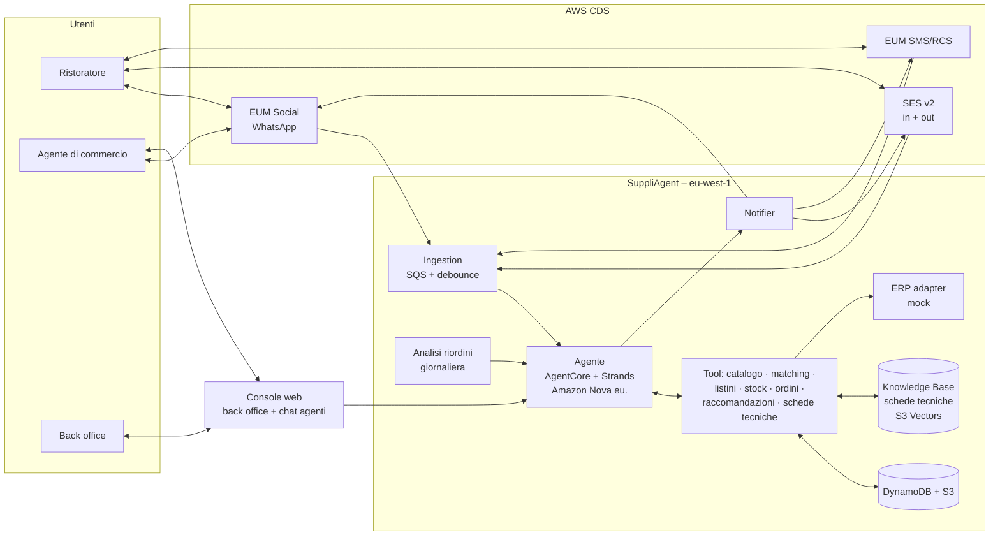

# SuppliAgent – Agente AI per gli ordini HoReCa via WhatsApp

> Documento di progetto · AWS CDS Agentic AI Partner Hackathon · Team beSharp
> Stato: **v0.3** · Ultimo aggiornamento: 27/10/2026
> Caso d'uso di un **cliente reale di beSharp**: un distributore di prodotti alimentari per la ristorazione (di seguito "il Distributore")

---

## 1. Sintesi

**SuppliAgent** è un agente AI che gestisce gli **ordini dei ristoranti** verso un distributore alimentare, sui canali che ristoratori e agenti di commercio usano già:

- il **ristoratore** ordina su **WhatsApp** come fa oggi: **foto del bigliettino scritto a mano**, vocale o testo libero (oppure via email);
- l'agente **legge l'ordine**, **riconosce i prodotti nel catalogo** (anche quando sono scritti in modo abbreviato o "come al solito"), verifica disponibilità, listino, minimi e giorni di consegna, **chiede chiarimenti solo dove serve** e propone sostituti o suggerimenti mirati;
- il ristoratore **conferma con un tap**; parte la **conferma via email (SES)** con il PDF dell'ordine e via **SMS/RCS**, poi gli avvisi di consegna;
- l'agente è **proattivo**: propone il riordino quando un cliente abituale "salta" un riordino;
- l'**agente di commercio** usa lo stesso assistente (WhatsApp o web) come **copilota**: consigli su cosa proporre al ristorante X, informazioni su catalogo e **schede tecniche**, briefing prima delle visite, ordini da verificare;
- il **back office** supervisiona tutto da una **console web** e interviene sulle eccezioni.

## 2. Il problema

| Problema | Effetto per il Distributore |
|---|---|
| Ordini che arrivano in modo informale (foto di bigliettini, vocali, messaggi agli agenti) | Inserimento manuale lento, errori di trascrizione, ordini persi |
| Abbreviazioni e "il solito" | Interpretazioni sbagliate, resi, clienti insoddisfatti |
| Disponibilità e prodotti mancanti scoperti tardi | Consegne incomplete, telefonate di rettifica |
| Agenti di commercio con poco tempo e catalogo vasto | Opportunità di vendita perse, risposte lente sulle schede tecniche |
| Nessun presidio sui riordini mancati | Clienti che comprano altrove senza che nessuno se ne accorga |

## 3. La soluzione

### 3.1 Flusso principale (scenario demo)

| # | Canale | Cosa succede |
|---|---|---|
| 1 | WhatsApp | Il ristoratore invia la **foto del bigliettino** + un vocale "aggiungi 2 kg di burro" |
| 2 | WhatsApp | L'agente legge le righe, le abbina ai prodotti del catalogo usando lo storico del cliente |
| 3 | WhatsApp | Chiede chiarimento con pulsanti solo sulle righe incerte ("mozzarella: fior di latte 1 kg o bufala 250 g?") |
| 4 | WhatsApp | Segnala un prodotto non disponibile e propone un **sostituto**; suggerisce **una** promozione pertinente |
| 5 | WhatsApp | Riepilogo con totale stimato e data di consegna → **Confermo / Modifica** |
| 6 | Email (SES) | Conferma d'ordine con **PDF** |
| 7 | SMS / RCS | Conferma breve con numero d'ordine e data di consegna |
| 8 | WhatsApp / web | L'agente di commercio riceve la notifica dell'ordine e, a richiesta, un **briefing** del cliente |
| 9 | RCS / SMS | Giorno di consegna: avviso con fascia oraria e pulsanti **Ricevuto / Segnala problema** |
| 10 | WhatsApp | Una settimana dopo: "Di solito riordinate l'olio ogni 10 giorni: vuole lo stesso ordine?" → **riordino con un tap** |
| 11 | Console | Il back office vede ordini, righe corrette, eccezioni e KPI in tempo reale |

### 3.2 Funzionalità principali

**Per il ristoratore**
- Ordine da **foto, vocale, testo o email**
- Abbinamento intelligente al catalogo con **storico e listino del cliente**
- Chiarimenti con pulsanti, **sostituti** per i prodotti mancanti
- Conferma esplicita, conferma via **email + SMS/RCS**
- Stato ordine e avvisi di consegna, **segnalazione problemi** con foto
- **Riordino proattivo** con un tap

**Per l'agente di commercio (copilota)**
- "Cosa propongo al ristorante X?" → suggerimenti basati su storico, prodotti smessi, prodotti comprati da locali simili, promozioni
- Domande su catalogo e **schede tecniche** (allergeni, formati, conservazione)
- **Briefing pre-visita** e ordini del suo portafoglio da verificare
- Inserimento ordine **per conto del cliente** (foto del bigliettino scattata in visita)

**Per il back office**
- Console con ordini, conversazioni, righe a bassa confidenza, problemi di consegna
- Presa in carico della conversazione (handoff)
- KPI di impatto

## 4. Architettura (sintesi)

Dettagli: [Infrastructure Design](./docs/INFRASTRUCTURE_DESIGN.md) · [Diagramma](./docs/architecture.drawio)

## 5. KPI e impatto misurabile

| KPI | Come si misura |
|---|---|
| **Tempo di inserimento ordine** | dalla foto alla conferma (vs inserimento manuale) |
| **% righe abbinate automaticamente** | righe confermate senza correzioni / totale |
| **Accuratezza dell'abbinamento** | correzioni del cliente o del back office |
| **% ordini senza intervento umano** | ordini confermati senza handoff |
| **Scontrino medio e suggerimenti accettati** | valore righe aggiunte da suggerimenti |
| **Riordini recuperati** | ordini nati da proposte proattive |
| **Tempo risparmiato dagli agenti** | briefing e risposte su schede tecniche |
| **Problemi di consegna** | segnalazioni / consegne |

> Con il cliente reale possiamo stimare la baseline (ordini/giorno, tempo medio di inserimento, % errori) e mostrare l'impatto in modo credibile.

## 6. Mappatura sui criteri di valutazione

| Criterio | Peso | Come lo copriamo |
|---|---|---|
| Esecuzione tecnica | 40% | 3 servizi CDS bidirezionali (WhatsApp, SES in/out, RCS/SMS) + AgentCore (Runtime, Memory, Gateway, Identity, Observability) + Knowledge Base, vision, ricerca ibrida; CDK riproducibile |
| Valore e impatto | 20% | **Cliente reale**, processo quotidiano ad alto volume, KPI misurabili |
| Demo | 20% | Foto del bigliettino → ordine verificato in pochi secondi; riordino con un tap; consegna con RCS |
| Creatività | 10% | Ordine da scrittura a mano, doppia persona (cliente + agente di commercio) sullo stesso agente, proattività |
| Funzionalità | 10% | Serverless, scalabile; i giudici possono ordinare da soli via WhatsApp |
| **Premio WhatsApp (Meta)** | $10k | Commercio conversazionale su WhatsApp: esattamente lo scenario che Meta promuove |

## 7. Rischi e mitigazioni

| Rischio | Mitigazione |
|---|---|
| Scrittura a mano poco leggibile | Nova Pro vision (Claude se abilitato sull'account) + domande di chiarimento + storico cliente; dataset di bigliettini veri per i test |
| Dati del cliente riservati | Catalogo **anonimizzato o sintetico** derivato da quello reale; nessun dato personale reale |
| Marchio del cliente nel video | Brand fittizio e dati sintetici (decisione del 27/10) |
| Integrazione ERP reale non fattibile in 2 settimane | ERP adapter con implementazione mock e interfaccia documentata |
| Approvazione template WhatsApp | Template inviati a Meta il 27/10; servono solo fuori dalla finestra di 24 h, che la demo non usa; fallback email |
| Costi | Account condiviso: costi isolati con i tag `Project`/`Env`; modelli più economici in dev, scale-to-zero |

## 8. Team, stato e decisioni

Team, stato del progetto, backlog, decisioni prese e aperte: [`START_HERE.md`](./START_HERE.md) (fonte unica).
