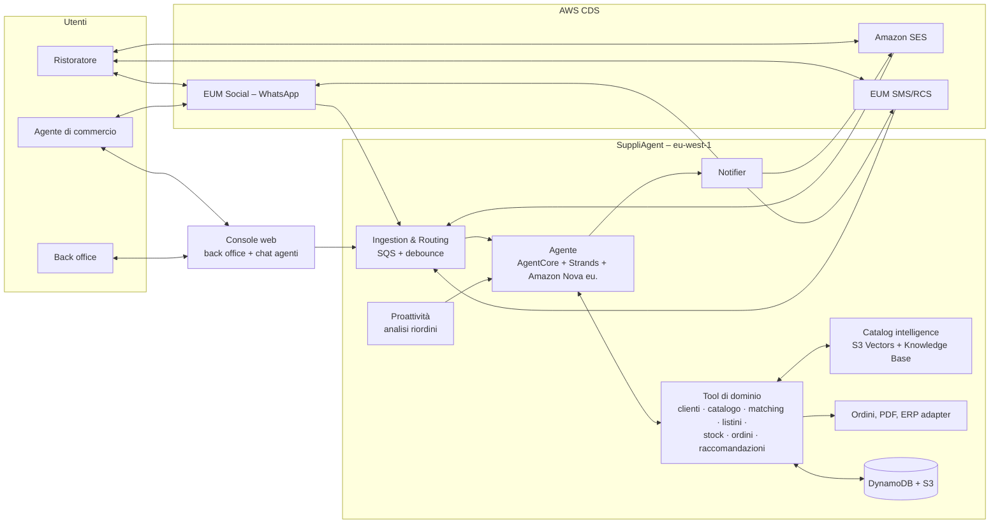
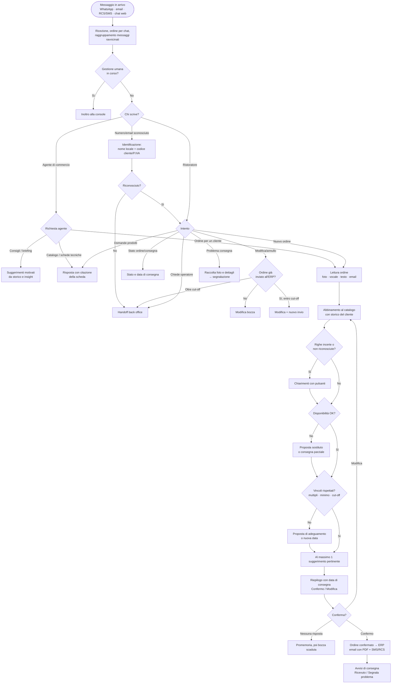

# SuppliAgent – Panoramica tecnica del progetto

> AWS CDS Agentic AI Partner Hackathon · Team beSharp
> Stato: **v0.2 – bozza da validare con il team** · Data: 12/10/2026
> Documenti collegati: [02 – Flussi tecnici](./02_TECHNICAL_FLOWS.md) · [03 – Specifica funzionale](./03_FUNCTIONAL_SPEC.md) · [Infrastructure design](./INFRASTRUCTURE_DESIGN.md) · [Diagramma](./architecture.drawio)

---

## 1. Scopo del documento

Descrivere a colpo d'occhio cosa fa SuppliAgent, chi lo usa, come è fatto e come si comporta nei casi principali. È il punto di ingresso alla documentazione.

## 2. Il problema

Il caso d'uso nasce da un **cliente reale di beSharp**: un distributore di prodotti alimentari per la ristorazione (HoReCa), di seguito "il Distributore".

| Problema | Effetto |
|---|---|
| Gli ordini arrivano in modo informale: foto di bigliettini scritti a mano, vocali, messaggi agli agenti di commercio | Inserimento manuale lento, errori di trascrizione, ordini dimenticati |
| Abbreviazioni, nomi generici, "il solito" | Prodotti sbagliati, resi, rettifiche telefoniche |
| Disponibilità e cut-off verificati a posteriori | Consegne incomplete o in ritardo |
| Agenti di commercio con catalogo vasto e poco tempo | Opportunità perse, risposte lente su schede tecniche e allergeni |
| Nessun presidio sui riordini mancati | Clienti che passano alla concorrenza senza che nessuno se ne accorga |

## 3. La soluzione in breve

**SuppliAgent** è un **agente AI multicanale** al servizio di due tipi di utente:

**Il ristoratore (cliente)**
1. Ordina su **WhatsApp** come fa oggi: **foto del bigliettino**, vocale o testo (oppure via email).
2. L'agente legge l'ordine, **riconosce i prodotti nel catalogo** usando lo storico del cliente, verifica **disponibilità, listino, multipli di confezione, cut-off e giorni di consegna**.
3. Chiede chiarimenti **solo sulle righe incerte**, con pulsanti; propone **sostituti** per i prodotti mancanti e al massimo **un suggerimento** pertinente.
4. Il ristoratore **conferma**; arrivano la conferma via **email con PDF** e via **SMS/RCS**, poi gli avvisi di consegna con la possibilità di **segnalare problemi**.
5. Quando un riordino abituale "salta", l'agente **propone di riordinare con un tap**.

**L'agente di commercio (copilota)**
- Chiede "cosa propongo al ristorante X?", informazioni sul catalogo e sulle **schede tecniche**, riceve un **briefing** prima delle visite e può **inserire ordini per conto del cliente** (foto del bigliettino scattata durante la visita), via WhatsApp o chat web.

**Il back office** supervisiona da una **console web**: ordini e righe a bassa confidenza, conversazioni, problemi di consegna, KPI, presa in carico.

### Valore atteso (KPI)
- Tempo di inserimento ordine: da minuti di lavoro manuale a **secondi**
- **% righe abbinate automaticamente** e accuratezza
- **% ordini senza intervento umano**
- **Valore dei suggerimenti accettati** e **riordini recuperati**
- Tempo risparmiato dagli agenti di commercio

## 4. Attori

| Attore | Ruolo | Canale / interfaccia |
|---|---|---|
| **Ristoratore** (titolare, chef, responsabile acquisti) | Ordina, conferma, riceve conferme e avvisi, segnala problemi | WhatsApp, email, RCS/SMS |
| **Agente di commercio** | Usa il copilota, inserisce ordini per conto dei clienti, riceve notifiche sul suo portafoglio | WhatsApp, chat web (console) |
| **Back office / customer service** | Gestisce eccezioni, ordini da verificare, problemi di consegna, handoff | Console web |
| **Agente SuppliAgent** | Conduce le conversazioni, usa i tool, crea e aggiorna gli ordini | AgentCore Runtime |
| **ERP del Distributore** | Riceve gli ordini confermati (simulato nell'hackathon) | ERP adapter (mock) |
| **Giudice hackathon** | Ordina da cliente di prova e consulta la console | WhatsApp, email, console (ruolo `judge`) |

## 5. Perimetro

**Nel perimetro (MVP)**
- Ordini dei ristoranti da foto, vocale, testo, email; chiarimenti, sostituti, suggerimenti, conferma.
- Conferme via email (PDF) e SMS/RCS; avvisi di consegna e segnalazione problemi.
- Riordino proattivo.
- Copilota per agenti di commercio: suggerimenti, catalogo, schede tecniche, briefing, ordini per conto del cliente.
- Console back office con chat web per gli agenti, KPI.
- Lingue: italiano e inglese.

**Fuori perimetro**
- Integrazione con l'ERP reale (si usa un **adapter mock** con interfaccia documentata).
- Pagamenti, fatturazione, gestione crediti e fidi.
- Logistica e pianificazione dei giri di consegna (simulati).
- Catalogo e prezzi reali non anonimizzati.

## 6. Architettura ad alto livello

| Blocco | Responsabilità | Tecnologie chiave |
|---|---|---|
| Canali | Ricevere e inviare messaggi | EUM Social, SES v2, EUM SMS/RCS v2 |
| Ingestion & Routing | Normalizzare, identificare contatto e **ruolo**, ordinare per chat, raggruppare messaggi ravvicinati | SNS, SQS, Lambda, DynamoDB |
| Agente | Ragionare, leggere i bigliettini, usare i tool, ricordare | AgentCore, Strands, Bedrock Amazon Nova `eu.`, Guardrails, Transcribe |
| Catalog intelligence | Trovare il prodotto giusto da testo impreciso; rispondere sulle schede tecniche | S3 Vectors, Titan Embeddings, Bedrock Knowledge Base |
| Ordini | Ciclo di vita, validazioni, PDF, invio all'ERP | Lambda, EventBridge, ERP adapter |
| Notifier | Unico punto di uscita, scelta del canale | Lambda + client CDS |
| Proattività | Insight clienti e proposte di riordino | EventBridge Scheduler, Lambda |
| Console & KPI | Supervisione, chat agenti, metriche | CloudFront, Cognito, API Gateway, Athena |

## 7. Flusso principale ad alto livello (con diramazioni)

### Diramazioni principali

| # | Caso | Comportamento | Dettaglio |
|---|---|---|---|
| D1 | Messaggi ravvicinati (foto + vocale + testo) | Attesa fine raffica, **una sola risposta** | 02 §3.3 |
| D2 | Contatto sconosciuto | Identificazione con nome locale + codice cliente o P.IVA | 02 F-02 |
| D3 | Contatto che gestisce più locali | Chiede per quale locale è l'ordine | 02 F-02 |
| D4 | Chi scrive è un agente di commercio | Modalità copilota, tool dedicati | 02 F-10 |
| D5 | Riga incerta (più prodotti possibili) | Domanda con pulsanti, opzioni ordinate per probabilità | 02 F-05 |
| D6 | Riga non riconosciuta | Richiesta di descrizione o foto del prodotto; altrimenti esclusa e segnalata | 02 F-05 |
| D7 | "Il solito …" / "come la settimana scorsa" | Risolto dallo storico ordini del cliente | 02 F-05 |
| D8 | Prodotto non disponibile | Sostituto, consegna parziale o attesa del riassortimento | 02 F-06 |
| D9 | Quantità non multipla della confezione / sotto il minimo | Proposta di arrotondamento o integrazione | 02 F-06 |
| D10 | Ordine dopo il cut-off | Nuova data di consegna proposta | 02 F-06 |
| D11 | Nessuna conferma | Promemoria a 2h; bozza scaduta a fine giornata | 02 F-07 |
| D12 | Modifica/annullo dopo la conferma | Consentito entro il cut-off; oltre → back office | 02 F-08 |
| D13 | Ordine via email | Stessa pipeline; conferma via email | 02 F-04 |
| D14 | Ordine inserito dall'agente di commercio | Conferma dell'agente; notifica al ristoratore | 02 F-10 |
| D15 | Dispositivo senza RCS | Fallback SMS | 02 F-11 |
| D16 | Finestra WhatsApp 24h chiusa | Template approvato | 02 F-11 |
| D17 | Problema alla consegna | Foto + descrizione → segnalazione in console | 02 F-12 |
| D18 | Riordino abituale mancato | Proposta proattiva con un tap (max 1/settimana) | 02 F-13 |
| D19 | Errori tecnici / ERP non disponibile | Retry, fallback, conferma di presa in carico | 02 §5 |
| D20 | Richiesta operatore / frustrazione / caso fuori ambito | Handoff al back office | 02 F-14 |

## 8. Ruolo di ciascun canale

| Canale | Usato per | Perché |
|---|---|---|
| **WhatsApp** | Ordini (foto, vocali, testo), chiarimenti con pulsanti, riordino proattivo, copilota agenti | È già il canale con cui i ristoratori ordinano |
| **Email (SES)** | Conferma d'ordine con PDF, ordini via email, briefing agenti | Documento formale e tracciabile |
| **RCS / SMS** | Conferma breve, avvisi di consegna con pulsanti, proposte per chi non usa WhatsApp | Raggiunge tutti; RCS con branding e pulsanti |
| **Console / chat web** | Back office, chat copilota da PC per gli agenti, KPI | Controllo umano e misura dell'impatto |

## 9. Principi di progetto

1. **Il ristoratore non cambia abitudini**: ordina come oggi, su WhatsApp, anche con un bigliettino.
2. **Chiedere poco e solo quando serve**: chiarimenti mirati, con pulsanti.
3. **Nessun ordine senza conferma esplicita**.
4. **Human in the loop**: back office e agenti di commercio vedono e correggono tutto.
5. **Proattività rispettosa**: niente spam, al massimo un suggerimento per ordine e una proposta di riordino a settimana.
6. **Dati in Europa** e **dati del cliente protetti** (anonimizzati per l'hackathon).
7. **Riproducibile e misurabile**.

## 10. Glossario

| Termine | Significato |
|---|---|
| **HoReCa** | Hotel, Restaurant, Café – il canale della ristorazione |
| **Bigliettino** | Lista d'ordine scritta a mano dal ristoratore |
| **SKU** | Codice univoco di prodotto a catalogo |
| **Matching** | Abbinamento di una riga scritta dal cliente a uno SKU del catalogo |
| **Confidenza** | Probabilità stimata che l'abbinamento sia corretto |
| **Listino** | Prezzi applicati a uno specifico cliente |
| **Multiplo di confezione** | Quantità minima vendibile (es. cartone da 6) |
| **Cut-off** | Orario limite per ricevere un ordine in tempo per la consegna successiva |
| **Riordino scaduto** | Prodotto che il cliente compra regolarmente e non ha riordinato nel solito intervallo |
| **Copilota** | Modalità dell'agente dedicata agli agenti di commercio |
| **ERP adapter** | Componente che invia gli ordini al gestionale del Distributore |
| **Debounce** | Attesa della fine della raffica di messaggi prima di rispondere |
| **CDS / EUM / RCS** | AWS Communication Developer Services / End User Messaging / Rich Communication Services |
| **Finestra 24h / Template** | Regole WhatsApp per i messaggi inviati dall'azienda |

## 11. Mappa della documentazione

| Documento | Contenuto | Per chi |
|---|---|---|
| 01 – Panoramica (questo) | Visione d'insieme e flusso principale | Tutti |
| [02 – Flussi tecnici](./02_TECHNICAL_FLOWS.md) | Stati, flussi dettagliati, casistiche, errori, contratti | Sviluppatori |
| [03 – Specifica funzionale](./03_FUNCTIONAL_SPEC.md) | Funzionalità, priorità, criteri di accettazione | Tutti / pianificazione |
| [Infrastructure Design](./INFRASTRUCTURE_DESIGN.md) | Architettura AWS, stack CDK, sicurezza, costi | Infra / sviluppatori |
| [architecture.drawio](./architecture.drawio) | Diagramma architetturale | Tutti / submission |
