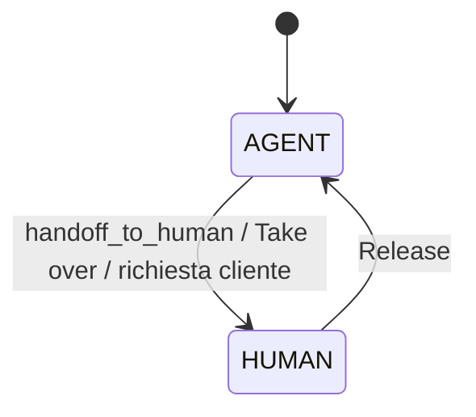
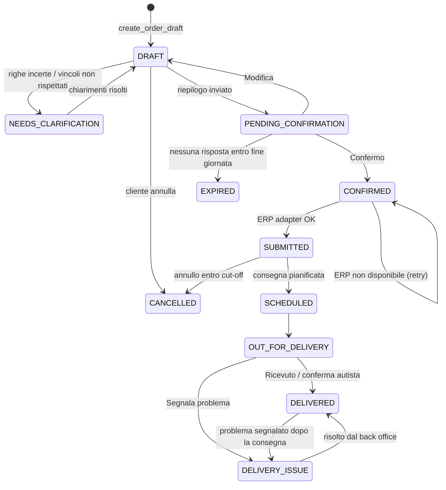
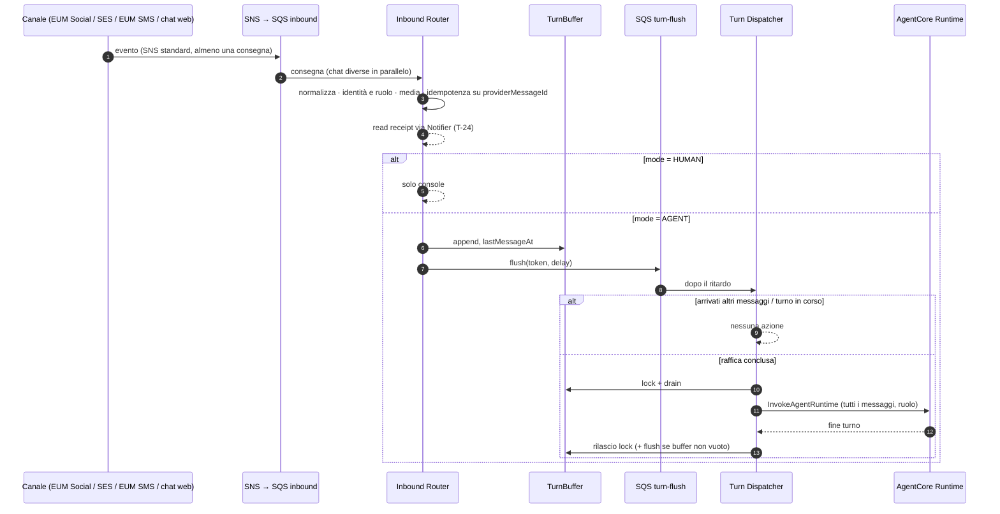

# SuppliAgent – Flussi tecnici e casistiche

> AWS CDS Agentic AI Partner Hackathon · Team beSharp
> Stato: **v0.2 – bozza da validare con il team** · Data: 12/10/2026
> Prerequisiti di lettura: [01 – Panoramica](./01_PROJECT_OVERVIEW.md) · [Infrastructure Design](./INFRASTRUCTURE_DESIGN.md)
> Riferimenti funzionali: gli ID `FN-xx` rimandano a [03 – Specifica funzionale](./03_FUNCTIONAL_SPEC.md)

---

## 1. Convenzioni

- **Flussi** `F-xx`; **casi** `F-xx.Cn`; **errori** `E-xx`.
- "Agente" = Strands agent su AgentCore Runtime; "agente di commercio" = persona umana (ruolo `SALES_REP`).
- Tempi e soglie sono **parametri configurabili** (SSM, §7).
- Ogni passaggio rilevante emette un **evento applicativo** (§6.4).
- Lingua delle risposte = lingua del contatto (default italiano).
- Gli importi mostrati al cliente sono **stime IVA esclusa** dal listino del cliente (decisione aperta: mostrare o no i prezzi).

## 2. Modelli di stato

### 2.1 Modalità della conversazione (`Conversations.mode`)



In `HUMAN` i messaggi vanno solo in console; al `Release` l'agente riprende con la sua storia di sessione (contesto completo, con i messaggi scambiati in `HUMAN`, con T-54).

### 2.2 Ruoli

| Ruolo | Come viene riconosciuto | Tool disponibili |
|---|---|---|
| `CUSTOMER_CONTACT` | `ChannelIdentities` → contatto associato a uno o più `Customers` | ordini, stato, consegne, catalogo (senza dati interni), riordino |
| `SALES_REP` | `ChannelIdentities` → `SalesReps` (o login console `sales_rep`) | tutto quanto sopra **limitato al proprio portafoglio** + briefing, agenda, insight, ordini per conto del cliente |
| `UNKNOWN` | indirizzo non censito | solo identificazione (F-02) |

### 2.3 Stato dell'ordine (`Orders.status`)



### 2.4 Stato della riga d'ordine (`Orders.lines[].status`)

| Stato | Significato |
|---|---|
| `MATCHED` | Abbinamento automatico (confidenza ≥ `matchAutoThreshold`) |
| `AMBIGUOUS` | Più candidati plausibili → chiarimento |
| `UNMATCHED` | Nessun candidato affidabile |
| `OUT_OF_STOCK` | Prodotto non disponibile per la data di consegna |
| `SUBSTITUTED` | Sostituto accettato dal cliente |
| `ADJUSTED` | Quantità adeguata (multipli/minimi) con consenso |
| `REMOVED` | Riga eliminata dal cliente o non risolta |
| `CONFIRMED` | Riga confermata nell'ordine finale |

Ogni riga conserva: `rawText`, `rawQuantity`, `sourceMessageId`, eventuale `imageRegion` (per mostrarla in console), `candidates[]`, `sku`, `quantity`, `unit`, `confidence`, `correctedBy` (`customer` | `rep` | `backoffice`; scritto dalla console alla correzione di una riga). L'evento `order.line_corrected` porta `by` = ruolo (`CUSTOMER_CONTACT` | `SALES_REP` | `BACKOFFICE`).

## 3. Pipeline comune di ingresso



### 3.1 Normalizzazione per canale

| Canale | Sorgente | Estrazione | Chat (conversazione) |
|---|---|---|---|
| WhatsApp | SNS da EUM Social | testo, image/audio/document, `interactive` reply (button/list), `context` | numero (E.164) |
| Email | SES receipt rule → S3 + SNS | mittente (identità solo con DMARC `PASS`), oggetto (non ripetuto all'agente se è una risposta: `Re:`, `R:`, `Rif:`, `AW:`, `SV:`), corpo pulito senza la parte citata, allegati (foto, PDF, Excel); oggetto e `Message-ID` restano sulla conversazione per rispondere nello stesso thread (T-26b) | indirizzo mittente |
| RCS / SMS | SNS two-way | testo, postback suggested reply, keyword STOP/HELP | numero |
| Chat web | WebSocket → `rep-chat` | testo, allegati caricati | `userId` Cognito |

### 3.2 Risoluzione identità e ruolo

| Caso | Condizione | Azione |
|---|---|---|
| C1 | indirizzo in `ChannelIdentities` come contatto cliente | `role = CUSTOMER_CONTACT`, `customerIds` noti |
| C2 | indirizzo di un agente di commercio | `role = SALES_REP`, portafoglio caricato |
| C3 | email a `ordine+<orderId>@` da indirizzo sconosciuto | contatto risolto dall'ordine, **associazione in attesa di conferma** |
| C4 | indirizzo sconosciuto | `role = UNKNOWN` → F-02 |
| C5 | contatto collegato a più locali | `customerIds[]` multipli → l'agente chiede il locale se non deducibile |

### 3.3 Debounce

| Parametro | Default |
|---|---|
| `debounceTextMs` / `debounceMediaMs` / `debounceMaxMs` | 3000 / 6000 / 15000 |
| `turnLockTtlMs` | 120000 |
| `turnMaxMessages` | 20 (messaggi presi da un turno, i più vecchi; gli altri al turno dopo) |

- **C1** messaggio singolo → risposta dopo `debounceTextMs`.
- **C2** raffica (foto bigliettino + vocale "aggiungi…" + testo) → **un turno** con tutti i messaggi in ordine.
- **C3** messaggi durante un turno → accumulati, nuovo turno unico a fine turno; l'agente sa che sono arrivati dopo la sua risposta (es. "ah, aggiungi anche…" dopo il riepilogo).
- **C4** raffica oltre `debounceMaxMs` → si risponde comunque.
- **C5** crash → lock scaduto, retry del flush, nessuna perdita.
- **C6** turno dell'agente fallito (T-67, E-05/E-12) → primo errore: messaggio di cortesia e retry del flush; secondo errore di fila: handoff `LOW_CONFIDENCE`, avviso al cliente, messaggi tolti dal buffer (restano in `Messages` per l'operatore).

### 3.4 Media

| Tipo | Gestione | Uso a valle |
|---|---|---|
| Immagine | → S3 | bigliettino (`extract_order_lines`), foto prodotto (ricerca a catalogo), foto problema consegna |
| Audio | → S3 | `transcribe` → testo nel turno |
| PDF / Excel | → S3 | ordine strutturato del cliente (estrazione righe) o documento generico |
| Video, sticker | non elaborati | richiesta cortese di foto o testo |

I media vengono salvati dall'Inbound Router prima di scrivere il messaggio (`attachments[].s3Uri`); tipi ammessi e limiti in [Infrastructure Design §5.2](./INFRASTRUCTURE_DESIGN.md). Un allegato rifiutato resta in `attachments` **senza `s3Uri`**: l'agente sa che c'era e chiede un altro formato (E-13).

## 4. Flussi

### F-01 – Primo contatto e informativa (FN-02)

**Trigger**: primo messaggio di un contatto senza informativa registrata (`identify_contact` → `privacy.noticeSent` falso; per un indirizzo sconosciuto, il primo messaggio della conversazione).

1. L'agente si presenta come **assistente virtuale del Distributore**, spiega in una riga cosa può fare ("puoi mandarmi l'ordine anche come foto del bigliettino").
2. Invia il link all'**informativa privacy** (trattamento dei dati del contatto per la gestione degli ordini; URL dal parametro `privacyNoticeUrl`, passato al Runtime e al prompt: finché è `UNSET` dice che l'informativa è disponibile presso l'ufficio del Distributore) e ne registra l'invio con `update_privacy(noticeSent)` (data e versione, `privacyNoticeSentAt` / `privacyNoticeVersion` su `Contacts`). Per le comunicazioni promozionali/proattive chiede il **consenso** specifico con una domanda *Sì / No* in testo (i pulsanti di T-25 servono al riepilogo e ai chiarimenti, non al consenso) e lo registra con `update_privacy(proactiveConsent)` (`proactiveConsent`, `proactiveConsentAt`, `proactiveConsentChannel`, `proactiveConsentVersion`). La domanda non va nello stesso messaggio di un'altra domanda sì/no (riepilogo ordine, chiarimento): si fa al primo messaggio successivo che non ne ha, una volta per conversazione.
3. Prosegue con la richiesta del cliente.

Un indirizzo `UNKNOWN` riceve l'informativa nel primo messaggio (saluto + richiesta di identificazione); `identify_contact(privacyNoticeSent)` la registra sul contatto creato, e la domanda sul consenso arriva dal messaggio successivo, da contatto noto. Gli agenti di commercio sono personale: nessuna informativa. Il consenso si può cambiare in ogni momento ("stop proposte" lo revoca).

| Caso | Comportamento |
|---|---|
| C1 consenso proattivo dato | Abilita riordini proattivi e suggerimenti |
| C2 consenso proattivo negato | Gli ordini funzionano normalmente; nessun messaggio proattivo |
| C3 il primo messaggio è già un ordine | Informativa in coda alla prima risposta, senza bloccare l'ordine |

### F-02 – Identificazione e ruolo (FN-03)

**Trigger**: `role = UNKNOWN`.

1. L'agente chiede **nome del locale** e **codice cliente** (o P.IVA).
2. `identify_contact(customerCode | vatNumber, venueName, address)`.
3. Se trovato: associa il nuovo indirizzo al cliente **in stato da confermare**; se il cliente ha un contatto già verificato, invia a quello una richiesta di conferma (o lo verifica il back office).

| Caso | Comportamento |
|---|---|
| C1 match univoco + contatto principale conferma | Contatto verificato → prosegue |
| C2 match univoco, nessun contatto verificato | Ordine accettato come **bozza**, verifica del back office prima dell'invio all'ERP |
| C3 nessun match | Probabile nuovo cliente → raccoglie dati minimi, **handoff** al back office/agente di zona (lead) |
| C4 dati incoerenti dopo 3 tentativi | Handoff `IDENTIFICATION_FAILED` |
| C5 contatto con più locali | Chiede il locale (lista con pulsanti) |
| C6 chi scrive è un agente di commercio non censito su quel numero | Verifica tramite console (login `sales_rep`) o back office |
| C7 clienti di prova dei giudici (`Customers.autoVerifyContacts = true`, codici `C90001`–`C90003` nel README) | Contatto creato già `VERIFIED` (`ChannelIdentity.verified = true`): ordina dal messaggio successivo. Per tutti gli altri clienti resta C1/C2. I giudici che usano lo stesso codice condividono il locale (storico e ordini); `seed/reset.py` cancella gli ordini |

### F-03 – Comprensione dell'intento (FN-04)

| Intento | Esempi | Instradamento |
|---|---|---|
| `NEW_ORDER` | foto di un bigliettino, "mi servono…", allegato ordine | F-04 |
| `MODIFY_ORDER` / `CANCEL_ORDER` | "aggiungi 2 casse di acqua", "annulla l'ordine di oggi" | F-08 |
| `ORDER_STATUS` | "quando arriva?", "è partito l'ordine?" | F-09 |
| `DELIVERY_ISSUE` | "manca un cartone", foto di merce danneggiata | F-12 |
| `PRODUCT_INFO` | "il fior di latte è senza lattosio?", "che formati avete di burrata?" | F-10.B (anche per i clienti, senza dati interni) |
| `REORDER` | "come la settimana scorsa" | F-04 con base l'ultimo ordine |
| `HUMAN_REQUEST` | "voglio parlare con qualcuno" | F-14 |
| Intenti agente di commercio | consigli, briefing, ordini per conto | F-10 |
| `OTHER` | saluti, fuori ambito | risposta breve e riorientamento |

| Caso | Comportamento |
|---|---|
| C1 nuovo ordine con una bozza aperta nello stesso giorno | "Aggiungo queste righe all'ordine in corso o è un ordine separato?" |
| C2 messaggio dopo un ordine `CONFIRMED` dello stesso giorno con prodotti | Interpreta come **integrazione** (F-08), chiede conferma |
| C3 più intenti | Priorità: handoff > problema consegna > ordine > modifica > stato > info |

### F-04 – Acquisizione dell'ordine (FN-05, FN-06)

**Obiettivo**: trasformare qualsiasi input in **righe grezze** `{rawText, rawQuantity, rawUnit, note}`.

| Input | Tool | Note |
|---|---|---|
| Foto bigliettino | `extract_order_lines(image)` – Nova Pro vision con output strutturato | gestisce abbreviazioni, cancellature, frecce, quantità prima/dopo il nome, unità ("cs", "kg", "pz", "ct") |
| Vocale | Transcribe → `extract_order_lines(text)` | "tre casse di pelati e due chili di burro" |
| Testo libero | `extract_order_lines(text)` | elenchi, frasi, mix |
| Email con corpo o allegato | come sopra; PDF/Excel strutturato → parsing diretto delle colonne | ordini da gestionali del ristorante |
| "Come l'ultima volta" | `get_customer_profile` → copia ultimo ordine come bozza | il cliente può modificare |
| Ordine inserito da agente di commercio | come sopra, `customerId` scelto dall'agente | F-10.D |

| Caso | Comportamento |
|---|---|
| C1 bigliettino leggibile | Tutte le righe estratte con confidenza di lettura |
| C2 parti illeggibili | Righe marcate `UNREADABLE` con ritaglio dell'immagine; chiarimento mirato ("la riga 4 non si legge bene: cosa c'è scritto?") |
| C3 foto non è un ordine (es. foto di un prodotto) | Ricerca a catalogo per immagine/descrizione ("intendi questo prodotto?") |
| C4 più foto (bigliettino su più pagine) | Unite in un'unica bozza nello stesso turno (debounce) |
| C5 foto + vocale con aggiunte/correzioni ("togli il burro") | Il vocale **modifica** le righe estratte dalla foto |
| C6 quantità mancante | Proposta della quantità abituale dallo storico ("di solito 2 cartoni, confermo?") |
| C7 note di consegna ("lasciare sul retro", "entro le 10") | Salvate in `Orders.deliveryNotes` |

### F-05 – Abbinamento al catalogo e chiarimenti (FN-07, FN-08)

1. Per ogni riga: `match_products(rawText, customerId)` → candidati con `confidence` (semantico S3 Vectors + fuzzy + storico cliente + compatibilità unità).
2. Classificazione: `MATCHED` (≥ 0,85) · `AMBIGUOUS` (0,5–0,85) · `UNMATCHED` (< 0,5).
3. Chiarimenti **raggruppati in un solo messaggio** quando possibile; per ogni riga incerta max 3 candidati + "Altro". Se il messaggio ha **una sola domanda**, l'agente chiama il tool locale `offer_choices` e su WhatsApp le opzioni diventano **pulsanti** (fino a 3 con titolo ≤ 20 caratteri) o una **lista** (fino a 10, titolo ≤ 24); con più domande le opzioni sono numerate nel testo (C7). Un tap arriva all'agente come `[button tapped: id=opt_N]` più l'etichetta, come contenuto non fidato (T-25).

| Caso | Comportamento |
|---|---|
| C1 tutte le righe `MATCHED` | Nessuna domanda → F-06 |
| C2 righe `AMBIGUOUS` | Pulsanti con i candidati (nome, formato, eventuale prezzo); il primo è quello che il cliente compra più spesso |
| C3 riga `UNMATCHED` | Chiede di descriverla meglio o mandare una foto; dopo 2 tentativi → riga esclusa e **segnalata in console** |
| C4 "il solito X" | Risolto dallo storico (prodotto X più acquistato); se lo storico è ambiguo → C2 |
| C5 marca richiesta non a catalogo | Propone l'equivalente a catalogo dichiarandolo come alternativa |
| C6 prodotto fuori catalogo / dismesso | Lo comunica, propone il sostituto ufficiale (`Stock.substitutes`) |
| C7 cliente risponde a testo invece che col pulsante ("il primo", "quello grande") | Interpretato nel contesto delle opzioni proposte |
| C8 molte righe incerte (> 5) | Prima le più importanti; il resto in un secondo messaggio, per non sommergere il cliente |

### F-06 – Disponibilità, vincoli e data di consegna (FN-09, FN-10)

`check_availability(skus, deliveryDate)`, `get_prices(customerId, skus)`, `get_delivery_options(customerId, orderTime)`.

| Caso | Comportamento |
|---|---|
| C1 tutto disponibile, vincoli ok | → F-07 |
| C2 prodotto non disponibile | Propone **sostituto** (stesso uso, formato simile, prezzo indicato) oppure consegna **senza quella riga** oppure **attesa** del riassortimento (data prevista) |
| C3 disponibilità parziale | Propone quantità disponibile + resto alla consegna successiva |
| C4 quantità non multipla della confezione | Propone arrotondamento ("il burro è a cartoni da 8 kg: metto 1 cartone?") |
| C5 sotto il minimo d'ordine | Indica quanto manca, eventualmente con un suggerimento (F-07) |
| C6 dopo il cut-off | Propone la prima data utile ("ordine dopo le 18: consegna giovedì invece di mercoledì, va bene?") |
| C7 giorno non servito nella zona | Propone il primo giorno servito |
| C8 richiesta di consegna in data specifica | Verificata con il calendario; se impossibile, alternativa |

### F-07 – Suggerimento, riepilogo e conferma (FN-11, FN-12, FN-13, FN-14, FN-15)

1. **Suggerimento** (opzionale, max 1 per ordine): `recommend_products(customerId, orderLines)` → solo se pertinente e con consenso proattivo. Priorità: prodotto abituale dimenticato > complementare > promozione > novità.
2. **Riepilogo**: `request_order_confirmation(orderId)` controlla l'ordine (righe risolte, multipli di confezione, data di consegna valida e prima del cut-off, minimo d'ordine) e, se è a posto, lo porta a `PENDING_CONFIRMATION` restituendo il riepilogo: righe confermate (nome, formato, quantità, prezzo da listino), eventuali sostituti, data di consegna, note, **totale stimato**; l'agente chiede **Confermo / Modifica**: su WhatsApp il codice dell'agente (non il modello) aggiunge i due pulsanti quando nel turno `request_order_confirmation` ha portato l'ordine in `PENDING_CONFIRMATION` (e nessuna modifica successiva nello stesso turno), e il Notifier registra l'id del messaggio inviato in `Orders.summaryMessageId` (solo su un ordine della stessa conversazione ancora in `PENDING_CONFIRMATION`). Su email il testo chiede di rispondere *Confermo* o *Modifica*. Senza questo passaggio un ordine non si può confermare.
3. **Conferma** → `confirm_order(orderId, idempotencyKey?, interactiveReply?)` solo da `PENDING_CONFIRMATION` → `CONFIRMED` → evento `order.confirmed` → ERP adapter → `SUBMITTED` con numero ordine. Un tap su pulsante vale solo se `interactiveReply.contextId` è il messaggio di riepilogo registrato sull'ordine (`summaryMessageId`): l'id del pulsante si può falsificare. `interactiveReply` lo mette il codice dell'agente dal tap *Confermo* (`order_confirm`) del turno, mai il modello; senza tap la conferma è a parole. Un tap su un riepilogo vecchio dà `CONFIRMATION_MISMATCH`: l'agente rimostra il riepilogo corrente. `confirm_order` richiede inoltre, lato server, un messaggio inbound della conversazione arrivato dopo il riepilogo (`Messages`): nello stesso turno del riepilogo risponde `NOT_CONFIRMABLE` con `reason = NEEDS_CUSTOMER_REPLY`. Una conferma ripetuta restituisce `ALREADY_CONFIRMED` senza un secondo ordine né un secondo evento.
4. **Notifiche di conferma**: WhatsApp (testo + PDF), **email SES con PDF** (Reply-To `ordine+<orderId>@`), **SMS/RCS** breve con numero ordine e data.
   *Email (T-26)*: `order.confirmed` → Order PDF scrive il file ed emette `order.pdf_ready` → Notifier. Destinatario: chi ha confermato (`confirmedBy`; per un ordine dell'agente di commercio, l'agente): `Contacts.orderEmail` se c'è, altrimenti la sua identità `EMAIL#` verificata. HTML + testo nella lingua del contatto (IT/EN), PDF allegato, tag SES `orderId`/`contactId`; una sola email per revisione dell'ordine (dopo una modifica entro il cut-off, `order.updated` → nuovo PDF → email "Ordine aggiornato"). Nessun indirizzo → `notification.skipped` (C7).
5. Notifica all'**agente di commercio** del cliente (WhatsApp o console).

| Caso | Comportamento |
|---|---|
| C1 il cliente dimentica un prodotto abituale | Suggerimento "Di solito ordini anche il parmigiano: lo aggiungo?" |
| C2 il cliente rifiuta il suggerimento | Nessuna insistenza; preferenza registrata in Memory |
| C3 "Modifica" | Chiede cosa cambiare; torna a F-05/F-06 sulle righe interessate |
| C4 nessuna risposta al riepilogo | Promemoria dopo 2h (`order_pending_reminder`); a fine giornata `EXPIRED` + messaggio. Li gestisce la Lambda `order-sweeper` (ogni 15 minuti, in silenzio nella fascia notturna); i messaggi escono dal Notifier a testo libero entro la finestra 24h (i template con T-29) |
| C5 conferma doppia (doppio tap) | Idempotenza: un solo ordine |
| C6 ERP non disponibile | Ordine `CONFIRMED`, invio in retry; il cliente riceve "ordine ricevuto, numero definitivo a breve" |
| C7 cliente senza email | `request_order_confirmation` restituisce `orderEmail = null`: nel riepilogo l'agente chiede un'email (facoltativa, non blocca la conferma) e la salva con `set_order_email` sul contatto, usata solo per le conferme d'ordine (mai un'identità di canale); senza, conferma solo in chat |

### F-08 – Modifica e annullamento (FN-16)

| Caso | Comportamento |
|---|---|
| C1 ordine in `DRAFT`/`PENDING_CONFIRMATION` | Modifica diretta |
| C2 ordine `SUBMITTED`, prima del cut-off | Modifica/annullo → nuovo invio all'ERP (`updateOrder`/`cancelOrder`), nuova conferma email/SMS. Anche rispondendo all'email di conferma (Reply-To `ordine+<orderId>@` → `activeOrderId`, T-26b). Implementato: modifica → `order.updated` (`revision` + 1) → ERP `updateOrder` e nuovo PDF → email "Ordine aggiornato" col PDF, una per revisione; l'annullo non manda email; SMS con T-27 |
| C3 dopo il cut-off o `SCHEDULED` | Spiega che non è più modificabile automaticamente → handoff back office |
| C4 integrazione ("aggiungi anche…") dopo la conferma | Proposta di **ordine integrativo** sulla stessa consegna se entro cut-off |

### F-09 – Stato ordine e consegna (FN-17)

`get_order_status(customerId | orderId)` → stato, data e fascia di consegna, righe modificate, eventuali ritardi. Più ordini aperti → elenco breve e domanda.

### F-10 – Copilota per l'agente di commercio (FN-20, FN-21, FN-22, FN-23)

Disponibile su WhatsApp e chat web; ogni risposta è limitata al **portafoglio** dell'agente.

**F-10.A – Consigli e briefing** – "cosa propongo alla Trattoria X?"
- `get_customer_briefing(customerId)` + `recommend_products` → risposta con: ultimi ordini e trend, **riordini scaduti**, **prodotti smessi**, **prodotti comprati da locali simili ma non da X**, promozioni attive, problemi recenti di consegna, 3 proposte **motivate**.
- C1 cliente fuori portafoglio → rifiuto cortese.
- C2 cliente nuovo senza storico → proposte per tipologia di cucina e zona.

**F-10.B – Catalogo e schede tecniche**
- `search_catalog` per ricerche ("burrate sotto i 300 g"), `ask_product_sheets` (Knowledge Base) per allergeni, ingredienti, conservazione, shelf life, origine.
- Risposte **con citazione della scheda** (nome documento) e senza inventare: se l'informazione non c'è, lo dice.
- Per i clienti (`CUSTOMER_CONTACT`) stessa funzione ma senza informazioni interne (margini, giacenze precise).

**F-10.C – Agenda** – "chi vedo domani?" → `get_rep_agenda` con priorità (clienti con riordini scaduti o problemi aperti).

**F-10.D – Ordine per conto del cliente**
1. L'agente di commercio invia foto/testo e indica il cliente (o l'agente lo deduce dall'agenda).
2. Stessi passi F-04…F-06; i chiarimenti vanno **all'agente di commercio**.
3. Conferma dell'agente di commercio → ordine `CONFIRMED` con `createdBy = repId`.
4. Il ristoratore riceve email/SMS di conferma (parametro: conferma anche del ristoratore sì/no – decisione aperta).

**F-10.E – Briefing giornaliero** (Could) – alle 07:30 dei giorni lavorativi, email/WhatsApp con le visite del giorno e i punti salienti.

### F-11 – Notifiche e regole di canale (FN-01, FN-14, FN-15, FN-18)

| Evento | Canali |
|---|---|
| Ordine confermato | Email con PDF + SMS/RCS + WhatsApp (se conversazione lì) |
| Ordine modificato/annullato | Stessi canali della conferma |
| Promemoria bozza non confermata | WhatsApp (template se fuori finestra) |
| Consegna in giornata | RCS con fascia oraria e pulsanti *Ricevuto / Segnala problema* (fallback SMS) |
| Proposta di riordino | WhatsApp template `reorder_suggestion`; RCS per chi non usa WhatsApp |
| Nuovo ordine di un cliente (per l'agente di commercio) | WhatsApp o console |

| Caso | Comportamento |
|---|---|
| C1 WhatsApp entro 24h | Messaggio libero |
| C2 WhatsApp oltre 24h | Template approvato |
| C3 Template non approvato | Fallback SMS/email |
| C4 RCS non supportato dal device (in Italia: tutti gli iPhone) | Fallback SMS automatico via pool; col sender ID alfanumerico (one-way) è solo una notifica, senza opzioni da rispondere ([RCS_SMS_SETUP](./RCS_SMS_SETUP.md)) |
| C5 STOP su SMS | Opt-out registrato |
| C6 Fascia notturna (21:00–07:00) | Proattivi rinviati; conferme d'ordine inviate comunque |
| C7 Invio fallito / bounce | Retry, poi canale alternativo; per email bounce → richiesta nuovo indirizzo (T-26: bounce permanente dell'email di conferma → `orderEmail` cancellato, `orderEmailBouncedAt`, messaggio nella conversazione dell'ordine che chiede un altro indirizzo; la risposta arriva all'agente, che chiama `set_order_email`) |

### F-12 – Consegna e problemi (FN-18)

1. Il giorno di consegna (ERP mock → `SCHEDULED`): RCS con fascia oraria.
2. Tap *Ricevuto* → `DELIVERED`.
3. Tap *Segnala problema* (o messaggio "manca un cartone") → l'agente chiede tipo (mancante, danneggiato, errato, scaduto), righe coinvolte e **foto** → `report_delivery_issue` → `DELIVERY_ISSUE` → console back office.

| Caso | Comportamento |
|---|---|
| C1 prodotto mancante | Proposta di reintegro alla consegna successiva (decisione del back office) |
| C2 prodotto danneggiato | Foto obbligatoria; segnalazione con priorità |
| C3 nessun tap entro fine giornata | Si assume consegnato (configurabile) |

### F-13 – Riordino proattivo (FN-19)

1. **Notte**: Analyzer calcola per ogni cliente gli intervalli medi per prodotto → `CustomerInsights.expectedReorders` (regole in INFRASTRUCTURE_DESIGN §5.6).
2. **Mattina** (fascia consentita): Proactive Trigger, per i clienti con consenso e un riordino scaduto (oltre `reorderDueFactor` × intervallo), emette `reorder.due`, che avvia un **turno proattivo**; il cooldown di 7 giorni parte dalla proposta (`CustomerInsights.lastProposalAt`).
3. Messaggio template `reorder_suggestion`: "Buongiorno! Di solito a quest'ora avete già riordinato olio EVO e pelati. Vuole lo stesso ordine dell'ultima volta?" → *Riordina uguale / Modifica / No grazie*.
4. *Riordina uguale* → bozza dall'ultimo ordine → F-06 → F-07.

| Caso | Comportamento |
|---|---|
| C1 il cliente ha già un ordine in corso | Nessuna proposta |
| C2 "No grazie" | Nessuna nuova proposta per 7 giorni; motivo opzionale registrato |
| C3 nessuna risposta | Nessun sollecito; segnalazione all'agente di commercio (possibile cliente a rischio) |
| C4 cliente senza consenso proattivo | Nessun messaggio; solo segnalazione all'agente di commercio |

### F-14 – Handoff (FN-24)

| Motivo | Origine |
|---|---|
| `CUSTOMER_REQUEST` | richiesta esplicita |
| `IDENTIFICATION_FAILED` / `NEW_CUSTOMER` | F-02 |
| `UNRESOLVED_LINES` | righe non risolte dopo i tentativi su ordine importante |
| `ORDER_LOCKED` | modifica dopo il cut-off |
| `DELIVERY_ISSUE` | problemi che richiedono decisione |
| `NEGATIVE_SENTIMENT` / `LOW_CONFIDENCE` | rilevati dall'agente |
| `OUT_OF_SCOPE` | prezzi speciali, sconti, crediti, reclami commerciali |
| `OPERATOR_TAKEOVER` | *Take over* in console |

`handoff_to_human(reason, summary)` → `mode = HUMAN`, notifica in console (e all'agente di commercio del cliente). Il back office risponde dalla console sullo stesso canale; *Release* riporta all'agente.

Implementazione (T-49): logica in `suppliagent_shared.handoff` (`start_handoff`, `release_handoff`), usata dal tool e dalla console (*Take over* con `OPERATOR_TAKEOVER`, *Release*: T-63, vedi sotto). La conversazione è quella del `caller`, mai scelta dal modello; il tool è disponibile a tutti i ruoli, anche `UNKNOWN` (F-02.C3/C4); `OPERATOR_TAKEOVER` solo dalla console. Un secondo handoff mentre è già `HUMAN` non cambia nulla (`ALREADY_HANDED_OFF`). La risposta del turno in cui avviene l'handoff parte normalmente; i messaggi successivi restano in `Messages`. Limiti: niente avviso all'agente di commercio; al *Release* l'agente non vede i messaggi scambiati in `HUMAN` (solo la sua storia di sessione, fino a T-54); l'`order-sweeper` manda promemoria e scadenze delle bozze anche in `HUMAN`. `seed/reset.py` riporta comunque ad `AGENT` le conversazioni in `HUMAN`.

Console (T-63, `console_api`): `POST /conversations/{id}/takeover` (handoff `OPERATOR_TAKEOVER`, `by = BACKOFFICE`; se è già `HUMAN` resta il primo motivo), `POST .../reply` (`{text ≤ 1000, idempotencyKey}`, solo in `HUMAN`, altrimenti `409 not_in_handoff`) e `POST .../release`. La risposta passa dal Notifier (`kind = reply`, `sentBy = OPERATOR`, chiave `console#<conversationId>#<idempotencyKey>`): stesso canale dell'ultimo messaggio del contatto, mai un destinatario scelto dalla console; fuori dalla finestra WhatsApp di 24 h il Notifier risponde `ChannelUnavailable` (`409 channel_unavailable`, template con T-29). Solo `backoffice` scrive; `judge` e `sales_rep` leggono o sono rifiutati (vedi INFRASTRUCTURE_DESIGN §5.8).

### F-15 – Cambio di canale (FN-25)

Identità unica (`contactId`) e Memory condivisa: un ordine iniziato su WhatsApp può essere confermato rispondendo all'email, e un tap RCS sulla consegna è collegato all'ordine giusto. La risposta va sempre sul canale da cui arriva il messaggio.

## 5. Gestione errori e fallback

| ID | Errore | Gestione |
|---|---|---|
| E-01 | Evento duplicato | Idempotenza su `providerMessageId`: scrittura in transazione del messaggio e di una guardia `dedup#<messageId>` (TTL 7 giorni nel TurnBuffer), quindi anche con timestamp diverso; la coda standard consegna almeno una volta |
| E-02 | Download media fallito | Retry ×3 (riconsegna SQS), poi DLQ; richiesta di reinvio al cliente quando c'è il Notifier (T-24) |
| E-03 | Lettura bigliettino fallita (immagine troppo scura/sfocata) | Richiesta di nuova foto con consigli (luce, inquadratura dall'alto) |
| E-04 | Tool in errore / timeout | Retry ×1; poi messaggio di cortesia, bozza salvata |
| E-05 | Throttling/errore Bedrock | Retry con backoff; "ti rispondo tra un attimo" e flush ritardato (T-67: cortesia una volta per raffica; il lock resta preso per metà di `turnLockTtlMs` (backoff di 60 s, così gli altri flush della raffica non riprovano subito), poi retry SQS dopo il visibility timeout di 120 s; il contatore `turnFailures` nel TurnBuffer si azzera al primo turno riuscito) |
| E-06 | Guardrail interviene | Risposta sicura predefinita nella lingua del contatto ("non posso aiutarti con questa richiesta…"); il messaggio bloccato non resta nello storico |
| E-07 | Errore indice prodotti / KB | Fallback su ricerca lessicale in DynamoDB; risposte sulle schede rimandate all'agente di commercio |
| E-08 | ERP adapter non disponibile | Ordine `CONFIRMED`, retry con backoff, allarme; cliente informato della presa in carico |
| E-09 | Invio CDS fallito | Retry ×3, fallback di canale |
| E-10 | Messaggio in DLQ | Allarme; redrive; blocca solo quella chat |
| E-11 | Lock orfano | Scadenza `turnLockTtlMs` |
| E-12 | Turno oltre il tempo massimo | Cortesia, retry una volta, poi handoff `LOW_CONFIDENCE` (T-67: vale per ogni errore dell'invocazione del Runtime; il secondo errore di fila passa la conversazione a `HUMAN`, avvisa il cliente e scarta i messaggi dal buffer, quindi niente DLQ) |
| E-13 | Allegato non consentito/malevolo | Non salvato (tipo fuori whitelist, firma dei byte diversa dal tipo dichiarato, oltre 10 MB, virus scan SES diverso da `PASS`): resta nel messaggio senza `s3Uri` e il cliente viene informato. I media WhatsApp non passano da un antivirus |

## 6. Contratti

### 6.1 NormalizedMessage
Vedi [Infrastructure Design §5.2](./INFRASTRUCTURE_DESIGN.md).

### 6.2 Richiesta di turno (Dispatcher → Runtime)

```json
{
  "conversationId": "conv_456",
  "contactId": "con_123",
  "role": "CUSTOMER_CONTACT",
  "channelAddress": "WHATSAPP#+393330000001",
  "customerIds": ["cus_45"],
  "activeCustomerId": "cus_45",
  "channel": "WHATSAPP",
  "locale": "it-IT",
  "activeOrderId": null,
  "whatsappWindowOpen": true,
  "proactive": false,
  "messages": [
    { "messageId": "m1", "ts": "2026-10-20T07:41:00Z", "attachments": [{ "type": "image", "s3Uri": "s3://.../m1.jpg" }] },
    { "messageId": "m2", "ts": "2026-10-20T07:41:04Z", "attachments": [{ "type": "audio", "s3Uri": "s3://.../m2.ogg" }] }
  ],
  "arrivedDuringPreviousTurn": false
}
```

Invocazione (implementata in T-41; riferimento eseguibile: `scripts/invoke_agent.py`):
- `bedrock-agentcore:InvokeAgentRuntime` sull'ARN letto da SSM `/suppliagent/<env>/agentRuntimeArn` (il Dispatcher ha bisogno di questo solo permesso).
- `runtimeSessionId = uuid5(NAMESPACE_URL, "suppliagent:" + conversationId)`: stessa conversazione → stessa sessione → stesso storico (fino a T-54 lo storico vive nella sessione del Runtime).
- `messages[].text` porta il testo del messaggio (assente per i soli allegati); `channelAddress` è il mittente verificato (INFRASTRUCTURE_DESIGN §5.3.2). Campi non previsti vengono ignorati.
- `messages[].interactiveReply` (`id`, `title`, `contextId`) è il tap su un pulsante o una riga di lista (T-25).
- `activeOrderId` (T-26b): l'ordine a cui risponde l'ultimo messaggio che ne porta uno (email a `ordine+<orderId>@`, cioè la risposta all'email di conferma). L'agente lo riceve nel contesto di sistema ("Order this message replies to") solo se ha la forma `ord_…`, e lo usa per modifiche, annullo e stato; i tool controllano comunque che l'ordine sia del chiamante.
- Risposta: `{"conversationId", "reply", "interactive"?}` con il testo da inviare tramite il Notifier, oppure `{"error": "INVALID_REQUEST"}`. `interactive` (T-25) sono le opzioni della risposta, che il Dispatcher passa al Notifier così com'è: `{"kind": "ORDER_SUMMARY", "orderId": "ord_…", "options": [{"id": "order_confirm", "title": "Confermo"}, {"id": "order_modify", "title": "Modifica"}]}` oppure `{"kind": "CHOICE", "options": [{"id": "opt_1", "title": "…"}, …]}` (2–10 opzioni, titolo ≤ 24 caratteri). Il Notifier le usa solo su WhatsApp. Un errore dell'invocazione (eccezione nel Runtime, throttling Bedrock, Gateway non raggiungibile) arriva come errore di `InvokeAgentRuntime`: il Dispatcher lo tratta come E-05 / E-12.

### 6.3 Riga d'ordine (estratto di `Orders`)

```json
{
  "lineId": "l3",
  "rawText": "mozz fdl",
  "rawQuantity": "3",
  "rawUnit": "kg",
  "sourceMessageId": "m1",
  "imageRegion": { "x": 0.12, "y": 0.41, "w": 0.6, "h": 0.07 },
  "candidates": [
    { "sku": "LAT-0142", "name": "Mozzarella fior di latte 1 kg", "confidence": 0.78, "boughtBefore": true },
    { "sku": "LAT-0150", "name": "Fior di latte julienne 3 kg", "confidence": 0.64, "boughtBefore": false }
  ],
  "status": "AMBIGUOUS",
  "sku": null,
  "quantity": null,
  "unit": null,
  "correctedBy": null
}
```

### 6.4 Eventi applicativi (EventBridge → Firehose)

| `detail-type` | Campi principali | Uso |
|---|---|---|
| `conversation.started` | contactId, role, channel | KPI |
| `contact.identified` | contactId, method | audit |
| `contact.privacy_updated` | contactId, channel, noticeSent?, proactiveConsent? | audit del consenso (FN-02) |
| `contact.order_email_set` | contactId (mai l'indirizzo) | email per le conferme (FN-14) |
| `order.draft_created` | orderId, source (photo/voice/text/email/reorder/rep) | KPI |
| `order.lines_extracted` | conversationId (l'`orderId` non esiste ancora: la bozza nasce dopo la lettura), source (photo/voice/text), lines, unreadable | qualità lettura |
| `order.line_matched` | conversationId (l'`orderId`/`lineId` non esistono ancora: la bozza nasce dopo l'abbinamento), status, confidence | qualità matching |
| `order.line_corrected` | orderId, lineId, by, fromSku, toSku | accuratezza |
| `order.updated` | orderId, revision | modifica di un ordine confermato entro il cut-off (F-08.C2): reinvio all'ERP e nuovo PDF |
| `order.suggestion` | orderId, sku, reason, accepted | upsell |
| `order.status_changed` | orderId, from, to, ts | tempi |
| `order.confirmed` | orderId, value, lines, createdBy | KPI principali |
| `order.pdf_ready` | orderId, reason (`confirmed` \| `updated`), revision | PDF scritto: parte l'email di conferma (T-26) |
| `erp.submitted` / `erp.failed` | orderId, erpOrderNumber | integrazione |
| `reorder.proposed` / `reorder.accepted` | customerId, orderId | proattività |
| `reorder.due` / `reorder.skipped` | customerId, contactIds, skus / reason (`NO_CONSENT`) | Proactive Trigger: proposta da fare (turno proattivo, T-52) o saltata (segnalazione all'agente di commercio) |
| `delivery.issue_reported` | orderId, type | qualità consegne |
| `rep.query` | repId, type (briefing, sheets, catalog, order) | uso copilota |
| `handoff.started` / `handoff.released` | conversationId, reason, by (`AGENT` o operatore) | automazione |
| `notification.sent` / `notification.failed` / `notification.skipped` | channel, template (+ orderId, reason `NO_EMAIL` \| `BOUNCED` per l'email di conferma) | delivery |
| `agent.turn` | latencyMs, tokens, toolCount | costi e performance |

### 6.5 Tool (sintesi I/O)

| Tool | Input | Output |
|---|---|---|
| `identify_contact` | (indirizzo dal `caller`, INFRASTRUCTURE_DESIGN §5.3.2) \| customerCode \| vatNumber, venueName, privacyNoticeSent? | `status` (`KNOWN` \| `MATCHED` \| `NOT_FOUND` \| `IDENTIFICATION_FAILED`), contact, role, customers[] (customerId, venueName), `privacy` (`noticeSent`, `proactiveConsent`: `null` = mai chiesto; solo contatti cliente) |
| `update_privacy` | noticeSent?, proactiveConsent? (almeno uno; il contatto è quello del `caller`) | `status` `UPDATED`, `privacy`. Solo `CUSTOMER_CONTACT`; errori `ACCESS_DENIED`, `NOT_FOUND` |
| `set_order_email` | email (il contatto è quello del `caller`) | `status` `UPDATED`, `orderEmail` normalizzato. Solo `CUSTOMER_CONTACT`; errori `INVALID_INPUT` (non un indirizzo singolo valido), `ACCESS_DENIED`, `NOT_FOUND` |
| `get_customer_profile` | customerId | dati del locale; ultimi 5 ordini (contatto verificato o agente); ragione sociale, zona, listino e insight (solo agente) |
| `extract_order_lines` | s3Uri (foto o vocale del chiamante) \| text | `status` (`OK` \| `NOT_AN_ORDER` \| `UNREADABLE_MEDIA`), `source` (photo/voice/text), `lines[]` (rawText, rawQuantity, rawUnit, note, readConfidence, status `READ`/`UNREADABLE`, imageRegion solo per le foto), `struckOut[]`, `deliveryNotes`, `ignoredNotes[]`, `transcript` (solo vocali). Errori: `ACCESS_DENIED` (media non del chiamante), `UNSUPPORTED_MEDIA` (es. PDF, HEIC), `EXTRACTION_FAILED` (E-04) |
| `match_products` | lines[], customerId | per riga: candidates[] con confidence |
| `search_catalog` | query, filters | products[] |
| `ask_product_sheets` | question, sku? | answer, citations[] |
| `check_availability` | lines[] (sku, quantity), deliveryDate | per SKU: `status` (`AVAILABLE` \| `PARTIAL` \| `OUT_OF_STOCK` \| `DISCONTINUED` \| `UNKNOWN_SKU`), `availableQuantity` (parziale), `nextArrival`, `multiple` e `roundedQuantity` (non multiplo), `substitutes[]` disponibili; `stockQuantity` solo per l'agente di commercio |
| `get_prices` | customerId, skus[] | per SKU: `unitPrice` del listino del cliente, `promo` valida oggi, `finalPrice` (EUR, IVA esclusa) o `NO_PRICE` |
| `get_delivery_options` | customerId, orderTime?, requestedDate? | nextDeliveryDate, options[] (3 date), servedDays, cutoff, afterCutoff (+ missedDeliveryDate), minOrderValue, requestedDateServed |
| `recommend_products` | customerId, context(lines) | suggestions[] con reason |
| `create_order_draft` | customerId, lines[] (sku, quantity, rawText, status?, candidates?…), source, deliveryDate?, deliveryNotes? | `existing`, order. Nome, unità, prezzi e totale li calcola il tool, mai il modello; se la conversazione ha già una bozza aperta la restituisce invariata |
| `update_order_draft` | orderId, ops[] (`add` \| `update` \| `remove` + campi della riga), deliveryDate?, deliveryNotes? | `status`, order. Modificare un riepilogo lo riporta a bozza; un ordine `CONFIRMED`/`SUBMITTED` si modifica fino al cut-off (`UPDATED`, evento `order.updated`), oltre `ORDER_LOCKED`; `NEEDS_FIXES` non salva |
| `request_order_confirmation` | orderId | `PENDING_CONFIRMATION` + summary + `orderEmail` (dove andrà l'email di conferma, `null` = nessun indirizzo), oppure `NEEDS_FIXES` + issues[] (`UNRESOLVED_LINES`, `NO_LINES`, `NOT_A_MULTIPLE`, `NO_PRICE`, `NO_DELIVERY_DATE`, `INVALID_DELIVERY_DATE` con `options`, `BELOW_MINIMUM` con `missing`) |
| `confirm_order` | orderId, idempotencyKey?, interactiveReply? (`contextId`) | `CONFIRMED` \| `ALREADY_CONFIRMED` \| `NOT_CONFIRMABLE` (+ `orderStatus`) \| `NEEDS_FIXES`; errore `CONFIRMATION_MISMATCH` |
| `cancel_order` | orderId | order (`CANCELLED`); errore `ORDER_LOCKED` oltre il cut-off o dopo la pianificazione |
| `get_order_status` | customerId \| orderId (uno solo) | orders[] (ultimi 5, dal più recente): status, deliveryDate, erpOrderNumber, righe, totale, fascia di consegna |
| `report_delivery_issue` | orderId, type (`MISSING` \| `DAMAGED` \| `WRONG` \| `EXPIRED`), lineIds[], note?, s3Uris[] (foto del solo chiamante) | issueId; ordine → `DELIVERY_ISSUE`, priorità `HIGH` per `DAMAGED`/`EXPIRED` |
| `get_rep_agenda` | repId, date | visite[] con priorità |
| `get_customer_briefing` | repId, customerId | briefing strutturato |
| `send_notification` | contactId, channel?, template \| content, attachments | messageId, channelUsed |
| `handoff_to_human` | reason, summary (conversazione dal `caller`) | `HANDED_OFF` \| `ALREADY_HANDED_OFF`; errore `NOT_FOUND` se la conversazione non esiste |

## 7. Parametri configurabili (SSM)

| Parametro | Default |
|---|---|
| `debounceTextMs` / `debounceMediaMs` / `debounceMaxMs` | 3000 / 6000 / 15000 |
| `turnLockTtlMs` | 120000 |
| `turnMaxMessages` | 20 |
| `matchAutoThreshold` / `matchAskThreshold` | 0.85 / 0.5 |
| `maxClarificationsPerMessage` | 5 |
| `unmatchedMaxAttempts` | 2 |
| `maxSuggestionsPerOrder` | 1 |
| `pendingReminderHours` / `draftExpiry` | 2 / fine giornata (mezzanotte `Europe/Rome` del giorno del riepilogo) |
| `deliveryCutoff` | 18:00 (`Europe/Rome`): un ordine dopo il cut-off ha la consegna un giorno più tardi; un ordine resta modificabile fino al cut-off del giorno prima della consegna |
| `minOrderValue` | 80 (EUR): sotto questo valore il riepilogo non si produce (`BELOW_MINIMUM`) |
| `reorderDueFactor` | 1.5 (× intervallo medio) |
| `reorderCooldownDays` | 7 |
| `quietHours` | 21:00–07:00 |
| `deliveryAutoConfirm` | true (fine giornata) |
| `identificationMaxAttempts` | 3 |
| `privacyNoticeUrl` / `privacyNoticeVersion` | `UNSET` (da impostare con l'URL dell'informativa del Distributore, azione manuale) / `2026-10-28` (registrata con ogni consenso) |
| `notifierSandbox` | `true` = il Notifier registra le uscite invece di inviarle (simulatore); `false` = invio reale, necessario per i giudici (T-68). Il valore sta in `infra/config/environments.ts`: un deploy sovrascrive il parametro SSM |
| `erpMockFailure` | `false` (con `true` l'ERP mock risponde "non disponibile": ordine resta `CONFIRMED`, retry e poi DLQ, E-08; letto a runtime, cache 60 s) |

## 8. Tracciabilità e logging

- `correlationId` = `conversationId` (+ `orderId` quando presente) propagato su Router, Dispatcher, AgentCore, tool, Notifier, ERP adapter.
- Log JSON senza contenuto dei messaggi; contenuto in `Messages` (cifrato).
- Tracce AgentCore per ogni turno.

## 9. Punti da validare con il team (e con il cliente)

Domande aperte e decisioni prese sono in [`START_HERE.md`](../START_HERE.md) §6 (fonte unica).
