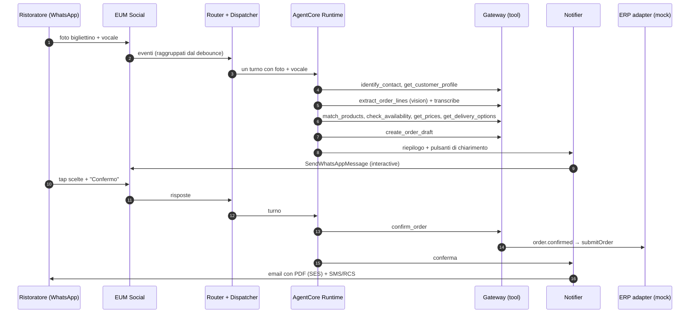

# SuppliAgent – Infrastructure Design

> AWS CDS Agentic AI Partner Hackathon · Team beSharp
> Stato: **v0.2 (draft)** · IaC: **AWS CDK (TypeScript)** · Agent: **Strands Agents su Amazon Bedrock AgentCore** · Region: **eu-west-1**
> Diagramma: [`architecture.drawio`](./architecture.drawio)

---

## 1. Obiettivi e principi di design

| Obiettivo | Scelta progettuale |
|---|---|
| Punteggio "Technical Execution" (40%) | 3 servizi CDS **bidirezionali** + AgentCore (Runtime, Memory, Gateway, Identity, Observability) + Bedrock Knowledge Base |
| Riproducibilità | Tutto in CDK, deploy con `npx cdk deploy --all`; prerequisiti di canale documentati (§11) |
| Serverless / scale-to-zero | Nessun server sempre acceso; nessun servizio con costo fisso orario elevato (es. niente OpenSearch cluster) |
| Scalabilità + ordine per chat | **SQS standard** + idempotenza su `providerMessageId`: chat diverse in **parallelo**; l'ordine nella chat viene dal timestamp di ricezione AWS e il lock per conversazione del debounce serializza i turni (SNS standard non consegna a code FIFO, decisione del 26/10) |
| Una risposta per raffica | **Debounce applicativo** per conversazione (§5.2.2) |
| Due tipi di utente, un solo agente | Ruolo risolto dall'identità (`CUSTOMER_CONTACT` / `SALES_REP` / `BACKOFFICE`) → set di tool e istruzioni diversi |
| Contesto cross-canale | Identità canonica come `actorId` di AgentCore Memory |
| Integrazione futura con l'ERP reale | **ERP adapter** dietro interfaccia; implementazione mock per l'hackathon |
| Dati in Europa | `eu-west-1`, Amazon Nova via inference profile **`eu.`** |
| Sicurezza by default | KMS, IAM least privilege, Guardrails, Cognito, dati anonimizzati |

## 2. Account, region e ambienti

- **Account** AWS `471112860008` (decisione del 24/10): account **condiviso** con altri progetti beSharp, già con bootstrap CDK. Per questo il CDK **non crea AWS Budgets** (un budget conterebbe la spesa di tutto l'account); i costi SuppliAgent si isolano con i tag obbligatori (`Project`, `Owner`, `Env`) in Cost Explorer.
- **Region: `eu-west-1` (Irlanda)**. Vincolo: **dati e inferenza restano in Europa**.
- **Modello**: **Amazon Nova** tramite inference profile **`eu.`**: `eu.amazon.nova-pro-v1:0` (ragionamento, tool use, vision) e `eu.amazon.nova-lite-v1:0` (classificazioni veloci); il profilo `global.` **non** si usa. *Decisione del 25/10*: sull'account `471112860008` (in *channel program*) Claude non è invocabile; se verrà abilitato, il passaggio a Claude sarà un task pianificato (cambio di `modelId`/`fastModelId` + eval di confronto).
- **Ambienti**: `dev` e `demo` (congelato per video e judging, attivo fino al 12/11/2026). Parametri via CDK context (`-c env=demo`).
- **Naming**: `suppliagent-<env>-<componente>`; tag: `Project=Hackathon AWS CDS`, `Owner=matteo.goretti@besharp.it`, `Env=<env>` (decisione del 24/10: i primi due sono obbligatori su **tutte** le risorse dell'account).

Disponibilità servizi verificata il 09–12/10/2026:

| Servizio | eu-west-1 |
|---|---|
| AgentCore Runtime, Memory, Gateway, Identity, Observability | ✅ |
| EUM Social (WhatsApp), EUM SMS v2, RCS (Italia supportata) | ✅ |
| SES v2 + email receiving (receipt rules) | ✅ |
| Bedrock Amazon Nova Pro/Lite (profilo `eu.`, verificato il 25/10), Titan Text Embeddings V2, Cohere Embed Multilingual | ✅ |
| Bedrock Knowledge Bases, **S3 Vectors** | ✅ |
| Transcribe, Textract | ✅ |

## 3. Vista d'insieme

1. **Channels (CDS)** – EUM Social (WhatsApp), SES v2 (outbound + inbound), EUM SMS/RCS v2.
2. **Ingestion & Routing** – SNS → SQS `inbound` → Inbound Router → TurnBuffer + `turn-flush` → Turn Dispatcher.
3. **Agent** – AgentCore Runtime (Strands) + Memory + Gateway (tool MCP su Lambda) + Identity + Observability; Bedrock Amazon Nova `eu.` + Guardrails; Transcribe.
4. **Catalog intelligence** – indice prodotti su **S3 Vectors** (ricerca semantica) + matching ibrido; **Bedrock Knowledge Base** sulle schede tecniche.
5. **Order & Outbound** – servizio ordini, generazione PDF, **ERP adapter** (mock), **Notifier** con policy di canale, EventBridge Scheduler.
6. **Proactive** – job giornaliero di **analisi riordini e insight cliente**.
7. **Data** – DynamoDB (anagrafiche, catalogo, listini, stock, ordini, conversazioni), S3.
8. **Console & Analytics** – CloudFront + S3 (React), Cognito, API Gateway REST + WebSocket (anche **chat web agenti**), Firehose → S3 → Glue/Athena.

## 4. Stack CDK

| # | Stack | Risorse principali | Dipende da |
|---|---|---|---|
| 1 | `FoundationStack` | KMS CMK, bucket S3 (media, inbound-mail, documents, catalog-assets, analytics, access-logs), event bus applicativo, parametri SSM | – |
| 2 | `DataStack` | Tabelle DynamoDB (§5.7) con Streams e PITR, custom resource di seed (rinviata a T-04) | Foundation |
| 3 | `CatalogStack` | S3 Vectors bucket + indice `products`, Lambda di indicizzazione catalogo, **Bedrock Knowledge Base** (schede tecniche, vector store S3 Vectors) + data source S3 | Foundation, Data |
| 4 | `ChannelsStack` | SES (identity dominio, configuration set, receipt rule set → S3 + SNS), EUM SMS/RCS (configuration set, event destinations, opt-out list), EUM Social (event destination SNS), topic SNS inbound | Foundation |
| 5 | `AgentStack` | AgentCore Runtime (zip, code deploy), AgentCore Gateway + target Lambda dei tool, ruoli IAM; con T-54: AgentCore Memory, Bedrock Guardrail | Foundation, Data, Catalog |
| 6 | `MessagingStack` | SQS `inbound` + DLQ, SQS `turn-flush` + DLQ, Lambda Inbound Router (con il download dei media), Turn Dispatcher, Notifier, Order PDF Generator, ERP Adapter, EventBridge Scheduler | Foundation, Channels, Agent, Data |
| 7 | `ProactiveStack` | EventBridge Scheduler giornaliero, Lambda **Insights & Reorder Analyzer**, Lambda **Proactive Trigger** | Data, Messaging |
| 8 | `ConsoleStack` | Cognito (gruppi `backoffice`, `sales_rep`, `judge`), API Gateway REST + WebSocket, Lambda API/broadcaster/rep-chat, S3 + CloudFront (OAC) + WAF | Data, Messaging, Agent |
| 9 | `AnalyticsStack` | Firehose (eventi CDS + applicativi) → S3 Parquet, Glue Catalog, Athena workgroup e viste KPI, CloudWatch Dashboard + allarmi | Channels, Foundation |

> Verificato il 23/10/2026 su `aws-cdk-lib` 2.274.0:
> - **AgentCore**: L2 **stabili** in `aws-cdk-lib/aws-bedrockagentcore` (`Runtime`, `RuntimeEndpoint`, `Gateway`, `GatewayTarget`, `WorkloadIdentity`, `Memory`); il pacchetto `@aws-cdk/aws-bedrock-agentcore-alpha` serve solo per Policy e non si usa.
> - **S3 Vectors**: solo L1 (`CfnVectorBucket`, `CfnIndex`). **Knowledge Base**: L1 `CfnKnowledgeBase` con `storageConfiguration.type = S3_VECTORS` (l'L2 alpha supporta solo OpenSearch).
> - **cdk-nag v3** gira come plugin di policy validation (`Validations.of(app).addPlugins(...)`): un errore non riconosciuto fa fallire `cdk synth`; le eccezioni si dichiarano con `Validations.of(scope).acknowledge({ id, reason })`.
> - Stack env-agnostic sull'account (region fissa `eu-west-1`), così `cdk synth` gira in CI senza credenziali. Gli stack 3–9 sono per ora vuoti e collegati nell'ordine di dipendenza.

## 5. Dettaglio componenti

### 5.1 Canali CDS

#### WhatsApp – AWS End User Messaging Social
- **Prerequisito**: WABA già verificata collegata a EUM Social + numero dedicato.
- **Inbound**: eventi su SNS `suppliagent-wa-events`.
- **Media**: `GetWhatsAppMessageMedia` con `destinationS3File` → S3 `media/<contactId|conversationId>/<messageId>/<mediaId>.<ext>` (foto bigliettini, vocali, PDF). Il servizio scrive con i permessi del chiamante (Inbound Router: `s3:PutObject` su `media/*` + CMK); ID del numero letto a runtime da SSM `waPhoneNumberId`.
- **Outbound**: `SendWhatsAppMessage` (testo, immagini, **interactive buttons/list** per chiarimenti e conferma, documento PDF dell'ordine, template).
- **Template** (fuori finestra 24h): `order_confirmation`, `reorder_suggestion`, `delivery_update`, `order_pending_reminder`.
- Usato da **due ruoli**: ristoratori (ordini) e agenti di commercio (copilota).

#### Email – Amazon SES v2
- **Identity**: dominio dedicato (es. `ordini.<dominio-demo>`), Easy DKIM, SPF, DMARC, custom MAIL FROM.
- **Outbound**: `SendEmail` – conferma d'ordine con **PDF allegato**, briefing agenti, riepiloghi; configuration set `suppliagent-cs`.
- **Inbound**: MX → receipt rule set → S3 `inbound-mail` + SNS. Casi: **ordini inviati via email** (testo, foto, PDF) e risposte alle conferme. Reply-To `ordine+<orderId>@ordini.<dominio>` per la correlazione.
- **Eventi**: send, delivery, open, click, bounce, complaint.

#### RCS / SMS – AWS End User Messaging SMS v2
- **Outbound**: `SendRcsMessage` (conferma d'ordine, avviso di consegna con **suggested replies** *Ricevuto / Segnala problema*, proposta di riordino per chi non usa WhatsApp) con **fallback** `SendTextMessage`.
- **Inbound two-way** → SNS `suppliagent-sms-inbound` (risposte, postback, STOP).
- Configuration set con event destinations (Firehose + SNS). Agente RCS registrato, device tester invitati, registrazione Italia (`IT_RCS_LAUNCH_REGISTRATION`).

### 5.2 Ingestion & Routing

```
SNS (wa-events | sms-inbound | mail-inbound)
   → SQS standard "inbound"   (SSE-KMS, DLQ dopo 3 ricezioni; envelope SNS conservato)
   → Lambda Inbound Router     (batch size 1, scala con i messaggi in coda)
        ├─ append su DynamoDB "TurnBuffer"
        └─ SQS standard "turn-flush" (DelaySeconds = finestra di attesa)
   → Lambda Turn Dispatcher    (debounce + lock per conversazione)
   → AgentCore Runtime         (un turno con tutti i messaggi raccolti)
   DLQ su entrambe le code (maxReceiveCount = 3)
```

La chat web degli agenti di commercio entra dalla console (WebSocket → Lambda `rep-chat`) e usa lo **stesso** TurnBuffer/Dispatcher, con `channel = WEB`.

**Inbound Router** (`services/inbound_router`; stato al 26/10 tra parentesi)
1. **Normalizza** l'evento nel `NormalizedMessage` (WhatsApp ed email in T-21; SMS/RCS con T-27, chat web con T-64).
2. **Risolve l'identità e il ruolo**: `ChannelIdentities` → `contactId`, `role` (`CUSTOMER_CONTACT` | `SALES_REP`), `customerIds[]` (un contatto può gestire più locali; un agente ha un portafoglio). Fail-closed come `caller_scope`: un contatto `PENDING_VERIFICATION` ha `customerIds` vuoto, altri stati → `UNKNOWN`. Email: identità solo con DMARC `PASS` e un solo indirizzo `From` uguale a quello valutato da SES (§5.3.2), altrimenti `senderVerified = false`; `orderId` da `ordine+<id>@` solo sul dominio SES e da mittente verificato. Una conversazione per contatto su tutti i canali (`conv_<contactId>`, F-15), oppure quella in cui l'indirizzo è stato identificato (`ChannelIdentities.conversationId`, scritto da `identify_contact`); mittenti sconosciuti: una per indirizzo, separata per le email non verificate; evento `conversation.started` alla creazione.
3. **Idempotenza** su `providerMessageId` (E-01): `TransactWriteItems` del messaggio e di una guardia `dedup#<messageId>` con TTL nel TurnBuffer.
4. **Media** → S3 `media/<contactId|conversationId>/<messageId>/`, **dentro il Router** (deciso il 26/10, T-23: niente Lambda Media Fetcher separata, così il messaggio entra nel TurnBuffer solo con i media già salvati e senza coordinamento asincrono col debounce). WhatsApp: `GetWhatsAppMessageMedia` per immagini, audio e documenti ammessi, max 10 MB (`fileSize` della risposta). Email: immagini JPEG/PNG/WebP/GIF/HEIC, PDF, XLSX, CSV, solo se la firma dei primi byte corrisponde al tipo, max 10 MB e 10 allegati, solo con virus scan SES `PASS`; chiave `<indice>.<estensione del tipo>` (mai il nome file), documenti con `Content-Disposition: attachment`. Niente SVG né `.xls`. Un allegato rifiutato resta senza `s3Uri` (E-13). Video e sticker non scaricati. Download fallito → errore, retry SQS ×3, poi DLQ (E-02, allarme `suppliagent-<env>-inbound-dlq`); niente scritture prima del download. Testo email troncato a 4000 caratteri; dall'HTML sono tolti script, stili e commenti.
5. **Read receipt** WhatsApp per ogni messaggio nuovo: invoke asincrono del Notifier (unico che chiama le API di invio), best effort (un errore non fa riconsegnare il messaggio). Il Notifier lo invia solo se `providerMessageId` è un messaggio WhatsApp in ingresso di *quella* conversazione.
6. **Handoff check**: `mode = HUMAN` → solo `Messages` e console (il Router non azzera mai `mode`). Stessa regola per le email con `senderVerified = false`: nessun turno, quindi nessuna risposta (backscatter).
7. **Accoda nel TurnBuffer** e programma il flush (T-22): `Put` del messaggio, guardia di dedup e `Update` del TurnBuffer sono **una sola transazione**, quindi una riconsegna non aggiunge due volte il messaggio né lo perde. Il flush (`turn-flush`, `DelaySeconds` = debounce testo o media) parte anche su un duplicato: costa poco e copre un crash tra transazione e invio.
8. Sulla conversazione registra, solo per mittenti verificati e solo se il messaggio è più recente di quanto già scritto (una riconsegna o un vecchio messaggio in redrive non fa tornare indietro i valori), dove rispondere (`lastInboundAt`, `lastInboundChannel`, `lastInboundFrom`, `lastInboundLocale`) e l'inizio della finestra WhatsApp 24h (`lastWhatsappInboundAt`): sono gli unici dati che il Notifier usa come destinatario.
9. Scrive in `Messages` → Stream → console live.

**NormalizedMessage** (`suppliagent_shared.messages`; campi assenti = `null`)

```json
{
  "messageId": "msg_<uuid5 di providerMessageId>",
  "providerMessageId": "wamid.HBg...",
  "channel": "WHATSAPP | EMAIL | RCS | SMS | WEB",
  "direction": "INBOUND",
  "contactId": "con_123 | rep_001 | assente se UNKNOWN",
  "role": "CUSTOMER_CONTACT | SALES_REP | UNKNOWN",
  "customerIds": ["cus_45"],
  "conversationId": "conv_456",
  "orderId": "ord_789 | null",
  "from": "+39333...",
  "senderVerified": true,
  "text": "aggiungi 2 kg di burro",
  "attachments": [{ "type": "image | audio | document | video | sticker", "s3Uri": "s3://... (assente se non salvato)", "mimeType": "image/jpeg", "mediaId": "id WhatsApp" }],
  "interactiveReply": { "id": "line_3_opt_1", "title": "Fior di latte 1 kg", "contextId": "wamid del messaggio con il pulsante" },
  "receivedAt": "2026-10-20T07:41:00.123Z",
  "locale": "it-IT"
}
```

`interactiveReply.id` si può falsificare: le azioni (es. `confirm_order`) devono verificare `contextId` contro il messaggio inviato e l'ordine contro lo scope del contatto.

#### 5.2.1 Parallelismo e ordinamento
- **Perché non FIFO** (decisione del 26/10, T-21): SES e EUM Social pubblicano solo su topic SNS **standard** (EUM Social non supporta topic FIFO) e un topic standard non consegna a code FIFO. Un forwarder verso una FIFO aggiungerebbe una Lambda per un ordinamento che il debounce già garantisce.
- Chat diverse sono elaborate **in parallelo**; due messaggi della stessa chat possono essere elaborati in parallelo dal Router, ma: `Messages` ha sort key `receivedAt#messageId` (timestamp di ricezione AWS, 1 ms tra i messaggi dello stesso evento), il TurnBuffer va riletto in ordine di `receivedAt`, il lock del Dispatcher serializza i turni. Le scritture del Router sono atomiche (creazione conversazione con `UpdateItem`, `PutItem` condizionata).
- Un messaggio in errore viene ritentato 3 volte e poi finisce in DLQ senza bloccare altre chat (E-10).

#### 5.2.2 Debounce
- Tabella `TurnBuffer` (PK `conversationId`; stessa tabella ospita le guardie `dedup#…`): `pending` (messaggi in attesa: `messageId`, `ts` del provider, `at` = istante di arrivo in epoch ms, `text`, `attachments`, `interactiveReply`, `orderId`), `caller` (canale, mittente, ruolo, `contactId`, `customerIds`, `locale` dell'ultimo messaggio), `lockUntil` (lock con scadenza), `afterTurn` (i messaggi in coda sono arrivati durante il turno precedente), `expiresAt` (TTL, 24 h).
- Il Router accoda e invia un flush ritardato. Un flush è solo un invito a guardare la conversazione, ne possono esistere molti: il Dispatcher agisce solo se la raffica è finita (silenzio per il debounce, testo o media, oppure `debounceMaxMs` dal primo messaggio) e il lock è libero; il debounce si calcola dagli `at` dei messaggi in attesa (niente contatori separati: i messaggi rimasti dopo un turno conservano la loro età); se è troppo presto si rimette in coda per il tempo mancante, se il lock è preso si rimette in coda alla sua scadenza (copre un titolare crashato, E-11).
- Presa del lock con `UpdateItem` condizionale (`lockUntil` assente o scaduto); l'item com'era (con `pending`) è lo snapshot del turno, ordinato per `receivedAt`. A fine turno `REMOVE pending[0..n-1]` + lock in un solo update condizionato al proprio `lockUntil`; se restano messaggi (arrivati nel frattempo) lo stesso update imposta `afterTurn` e un nuovo flush li raggruppa in **un solo** turno (`afterTurn` si legge alla presa del lock e si cancella solo quando un turno si completa, così sopravvive a un retry). Un errore (agente, Notifier) rilascia il lock **senza** rimuovere i messaggi e fa riprovare il flush (SQS ×3, poi DLQ con allarme).
- Il turno dura meno del lock (Lambda 115 s < `turnLockTtlMs` 120 s) e la coda ha visibilità 120 s. Chiave di idempotenza della risposta = id del primo e dell'ultimo messaggio del turno: un turno ritentato non invia due risposte. **Limiti noti**: un messaggio con `receivedAt` precedente che arriva dopo la presa del lock finisce nel turno successivo; se il Notifier fallisce per un errore *transitorio* il turno è ritentato e l'agente rieseguito sugli stessi messaggi (gli errori permanenti — `AccessDenied`, `ChannelUnavailable`, `InvalidInput` — chiudono il turno senza retry); `pending` non ha un tetto (con flush in DLQ per ore cresce fino a 400 KB e il Router fallirebbe: allarme sulla DLQ `turn-flush`); un messaggio su un altro canale arrivato a metà turno può far uscire la risposta su quel canale (il Notifier usa l'ultimo indirizzo verificato).
- Finestre: testo ~3 s, media ~6 s, massimo 15 s dal primo messaggio. Il batching window nativo di Lambda non raggruppa per chat, quindi il debounce è applicativo.
- Dettaglio dei casi: [02 §3.3](./02_TECHNICAL_FLOWS.md).

### 5.3 Agent layer – Amazon Bedrock AgentCore

| Componente | Configurazione |
|---|---|
| **Runtime** | **Code deploy** (zip ARM64, Python 3.12, Strands), niente container né ECR: dipendenze dal `uv.lock` installate per `aarch64` al `cdk synth` (`infra/lib/constructs/uv-bundling.ts`, serve `uv`); `runtimeSessionId` derivato da `conversationId` (02 §6.2); env: `GATEWAY_URL`, `MODEL_ID` (+ `MEMORY_ID`, `GUARDRAIL_ID` con T-54); ARN pubblicato su SSM `/suppliagent/<env>/agentRuntimeArn` |
| **Modello** | **Nova Pro** (`eu.amazon.nova-pro-v1:0`) per ragionamento e **lettura dei bigliettini** (vision); **Nova Lite** (`eu.amazon.nova-lite-v1:0`) per classificazioni veloci. Claude è il target futuro se abilitato (vedi §2) |
| **Ruoli** | Il Dispatcher passa `role`; il Runtime carica istruzioni e **sottoinsieme di tool** per ruolo (§5.3.1) |
| **Memory** | **T-54**. `actorId = contactId`; strategie *semantic* (preferenze, prodotti abituali, note), *summary*, *user preference* (canale, lingua, orari). Fino ad allora lo storico della conversazione resta nella memoria della sessione del Runtime |
| **Gateway** | Endpoint MCP con target Lambda; autenticazione in ingresso **AWS IAM (SigV4)** (deciso il 26/10: solo il ruolo del Runtime ha `bedrock-agentcore:InvokeGateway`, niente Cognito né Identity); nessuna ricerca semantica (sarebbe un tool in più per il modello); **autorizzazione per ruolo** sui tool |
| **Identity** | Workload identity del Runtime (default); nessun provider di credenziali: il Gateway usa IAM |
| **Observability** | **T-54** (ADOT). Tracce OTel → CloudWatch GenAI Observability: latenza per turno, token, tool, errori; con T-54 anche retention e CMK del log group del Runtime (oggi creato dal servizio) |
| **Evaluations** | AgentCore Evaluations (GA, disponibile in eu-west-1): valutazioni on-demand sul dataset di progetto (lettura bigliettini, matching, intento, uso dei tool) ed evaluator built-in di qualità/sicurezza; usabile anche in CI |
| **Guardrails** | **T-54**. PII, topic negati (prezzi di altri clienti, sconti non autorizzati, consigli sanitari), filtri contenuti |
| **AI services** | **Transcribe** per i vocali; **Nova Pro vision** per bigliettini e foto; **Textract** come fallback per documenti stampati (DDT, PDF) |

#### 5.3.1 Tool esposti dal Gateway

| Tool | Lambda | Ruoli | Dati |
|---|---|---|---|
| `identify_contact` | `tool-customers` | tutti | Contacts, Customers |
| `get_customer_profile` | `tool-customers` | tutti (agente: solo portafoglio) | Customers, CustomerInsights |
| `extract_order_lines` | `tool-order-intake` | tutti | S3 media → Nova Pro vision / testo |
| `match_products` | `tool-catalog` | tutti | S3 Vectors + Products + storico ordini |
| `search_catalog` | `tool-catalog` | tutti | S3 Vectors + Products |
| `ask_product_sheets` | `tool-catalog` | tutti | Bedrock Knowledge Base (schede tecniche) |
| `check_availability` | `tool-inventory` | tutti | Stock |
| `get_prices` | `tool-pricing` | tutti (solo listino del cliente) | PriceLists, Promotions |
| `get_delivery_options` | `tool-orders` | tutti | DeliveryCalendar |
| `recommend_products` | `tool-reco` | tutti | CustomerInsights, Promotions, Products |
| `create_order_draft` / `update_order_draft` | `tool-orders` | tutti | Orders |
| `confirm_order` / `cancel_order` | `tool-orders` | cliente; agente con delega | Orders → ERP adapter |
| `get_order_status` | `tool-orders` | tutti | Orders, Deliveries |
| `report_delivery_issue` | `tool-orders` | cliente | Issues |
| `get_rep_agenda` / `get_customer_briefing` | `tool-sales` | `SALES_REP` | Customers, CustomerInsights, Orders |
| `send_notification` | `notifier` | tutti | → canali CDS |
| `handoff_to_human` | `tool-orders` | tutti | Conversations |

#### 5.3.2 Contesto chiamante e autorizzazione nei tool (deciso il 26/10, T-42)

- Ogni tool del Gateway riceve, oltre ai propri argomenti, un argomento **`caller`** = `{role, contactId, channelAddress, conversationId}`. Lo imposta il **codice dell'agente** (T-41) dalla richiesta di turno del Dispatcher (02 §6.2): è tolto dallo schema mostrato al modello e **sovrascritto** a ogni chiamata (`{**argomenti_del_modello, "caller": contesto}`, con test in T-41), quindi il modello non può né vederlo né cambiarlo. Dopo un `identify_contact` → `MATCHED` l'agente rilegge il contesto da `ChannelIdentities` (o al turno successivo dal Dispatcher), mai dall'output del tool.
- `channelAddress` è il **mittente verificato** normalizzato dal Dispatcher (`CANALE#indirizzo`, telefono E.164), mai testo del messaggio o `Reply-To`. **Requisito per T-21** (fatto: il Router associa un'identità a un'email solo con `dmarcVerdict = PASS`, l'unico verdetto che verifica l'allineamento con il `From`; altrimenti `UNKNOWN`): le email in ingresso senza verdetti SES `PASS` di SPF/DKIM (o DMARC) non vengono associate a un'identità (resta `UNKNOWN`), altrimenti basta falsificare il `From` per avere lo scope di un contatto.
- Il tool si fida solo di **chi** è il chiamante (`role` + `contactId`); **cosa** può vedere lo ricava sempre da DynamoDB (`suppliagent_shared.auth.caller_scope`): `Contacts.customerIds` per un contatto, `Customers.repId` (GSI `by-repId`) per un agente; mai da `customerIds` passati nella chiamata. Campi in più in `caller` → `INVALID_INPUT`.
- **Fail-closed**: `Scope.customer_ids` contiene solo i locali di un contatto `VERIFIED` (o il portafoglio dell'agente); i locali di un contatto `PENDING_VERIFICATION` stanno in `Scope.pending_customer_ids`, che un tool usa **solo se lo dichiara** (oggi: profilo base del locale; in T-46 le bozze d'ordine, F-02.C2). Prezzi, ordini e storico: solo `customer_ids`. Qualsiasi altro stato del contatto → nessun accesso.
- Identificazione (`identify_contact`, chiamante `UNKNOWN`): servono codice cliente o P.IVA **e** nome del locale; massimo **3 tentativi per conversazione** (contatore `Conversations.identifyAttempts`), poi `IDENTIFICATION_FAILED` → handoff (F-02.C4). Un indirizzo già registrato non viene mai riassegnato. Limite residuo: chi usa indirizzi email sempre nuovi ottiene conversazioni nuove (aggiungere un limite per dominio o globale se serve).
- Confine di fiducia: solo il ruolo del Runtime può invocare il Gateway (IAM); le Lambda dei tool sono invocabili solo dal ruolo del Gateway. Limite: un principal dell'account con `bedrock-agentcore:*` su `*` può invocare Runtime o Gateway con un `caller` arbitrario; con T-22 limitare `InvokeAgentRuntime` al ruolo del Dispatcher (resource policy, se disponibile). Lo storico in sessione è legato a `conversationId` **e** `channelAddress`; il Dispatcher deriva `runtimeSessionId` solo da `conversationId` (02 §6.2).
- Errori verso l'agente solo come codice (`{"error": "ACCESS_DENIED" | "NOT_FOUND" | "INVALID_INPUT" | "UNKNOWN_TOOL" | "INTERNAL_ERROR"}`), mai stack trace; nei log ID e codici, mai contenuti o indirizzi.
- Eventi applicativi con `Source = suppliagent.<componente>` (es. `suppliagent.tool-customers`).

### 5.4 Catalog intelligence

**Indice prodotti (S3 Vectors)**
- Per ogni SKU un documento testuale: nome, marca, categoria, formato/pezzatura, unità di vendita, **sinonimi e abbreviazioni** (es. "fdl" → fior di latte, "pelati" → pomodori pelati), descrizione breve.
- Embedding **Titan Text Embeddings V2** (o Cohere Embed Multilingual), indice `products` con metadati filtrabili (categoria, attivo, unità).
- Lambda `catalog-indexer` reindicizza su modifica del catalogo (S3 event / custom resource al seed).

**Matching ibrido (`match_products`)**
1. Candidati semantici da S3 Vectors (top-k 10).
2. Punteggio lessicale (fuzzy match su nome, codici, sinonimi).
3. **Boost storico**: prodotti già acquistati dal cliente, frequenza e recency ("il solito olio" → olio acquistato più spesso).
4. Compatibilità unità/quantità (es. "3 casse" vs prodotto venduto a cartone da 6).
5. Output per riga: candidati ordinati con `confidence`; soglie: ≥ 0,85 abbinamento automatico, 0,5–0,85 **chiarimento con pulsanti**, < 0,5 riga non riconosciuta.

**Schede tecniche (Bedrock Knowledge Base)**
- Data source S3 `catalog-assets/sheets/` (PDF schede tecniche, allergeni, conservazione).
- Vector store **S3 Vectors**; chunking semantico; metadati `sku`, `category`.
- `ask_product_sheets` usa `RetrieveAndGenerate`/`Retrieve` con filtro per SKU quando noto, risposta con **citazione della scheda**.

### 5.5 Ordini, ERP e outbound

**Servizio ordini** (`tool-orders`): ciclo di vita e regole in [02 §2.3](./02_TECHNICAL_FLOWS.md); validazioni: disponibilità, multipli di confezione, minimo d'ordine, **cut-off** e giorni di consegna per zona.

**ERP adapter**
- Su `order.confirmed` (EventBridge) → Lambda `erp-adapter`.
- Interfaccia: `submitOrder(order) → { erpOrderNumber, status }`, `getOrderStatus(erpOrderNumber)`.
- **Implementazione hackathon: mock** (scrive su DynamoDB/S3, simula numero d'ordine, genera eventi di avanzamento e consegna).
- Implementazioni future possibili: API REST dell'ERP, EDI, file CSV/XML su SFTP (AWS Transfer Family).

**Order PDF Generator**: Lambda che genera il PDF dell'ordine (S3 `documents/`), usato da email e WhatsApp.

**Notifier** – unico punto di uscita (agente, console, scheduler, proattività):
1. Risposta → **stesso canale** del messaggio.
2. Conferma d'ordine → **email con PDF** + **RCS/SMS** breve (+ WhatsApp se la conversazione è lì).
3. Azioni rapide (consegna, riordino per chi non usa WhatsApp) → **RCS** con suggested replies, fallback **SMS**.
4. WhatsApp fuori finestra 24h → **template**.
5. Preferenze, opt-out, fasce orarie.

*Stato (T-24 base):* Lambda `notifier`, invocata solo da Dispatcher e Router, due richieste: `reply` (`conversationId`, `idempotencyKey`, `text`) e `read_receipt`. Il **destinatario non è mai nella richiesta**: canale e indirizzo sono quelli verificati salvati dal Router sulla conversazione (`lastInbound*`); senza, o con conversazione ignota, `AccessDenied`. WhatsApp: testo libero dentro la finestra 24h (`lastWhatsappInboundAt`), fuori `ChannelUnavailable` (template con T-29); email: SES v2 con mittente e configuration set da SSM; SMS/RCS con T-27. Idempotenza con un claim `dedup#out#<key>` nel TurnBuffer: rilasciato se l'invio fallisce, marcato `sent` (7 giorni) subito dopo l'invio, prima di registrare il messaggio (un errore nella registrazione è solo loggato: meglio perdere il record che inviare due volte); un secondo tentativo con il claim ancora in corso riceve `SendInProgressError` (ritentabile), non `DUPLICATE`. Il read receipt legge il messaggio con la sua chiave (lettura consistente) e verifica `providerMessageId`, canale e direzione. Ogni uscita è registrata in `Messages` (`direction = OUTBOUND`, `status = SENT | SANDBOX`) ed emette `notification.sent` / `notification.failed`. **Sandbox**: parametro SSM `/suppliagent/<env>/notifierSandbox` (default `true` in `dev`, `false` in `demo`; se manca vale `true`): niente invii, solo la registrazione in `Messages`; si cambia senza redeploy (cache 60 s).

**EventBridge Scheduler**: promemoria bozze non confermate (T+2h), avviso di consegna (giorno di consegna 07:00), briefing agenti (giorni lavorativi 07:30).

### 5.6 Proattività

- **Insights & Reorder Analyzer** (Lambda, ogni notte): sullo storico ordini calcola per cliente:
  - frequenza di riordino per prodotto e **riordini scaduti** (oltre 1,5× l'intervallo medio);
  - **prodotti smessi** (acquistati regolarmente, assenti da > 2 intervalli);
  - **prodotti mancanti** rispetto a locali simili (stessa tipologia di cucina/zona);
  - promozioni pertinenti.
  Risultato in `CustomerInsights`.
- **Proactive Trigger**: per i riordini scaduti (max 1 proposta/settimana per cliente, rispettando fasce orarie e opt-out) avvia un **turno proattivo** dell'agente → messaggio `reorder_suggestion` con pulsanti *Riordina uguale / Modifica / No grazie*.
- Gli stessi insight alimentano `recommend_products` e i briefing agenti.

### 5.7 Data layer

**DynamoDB** (on-demand, PITR, SSE-KMS con la CMK del `FoundationStack`; nome fisico `suppliagent-<env>-<tabella-in-kebab-case>`, es. `suppliagent-dev-turn-buffer`):

| Tabella | PK | SK | GSI | Note |
|---|---|---|---|---|
| `Customers` | `customerId` | – | `repId`, `zone` | locali: ragione sociale, tipologia, zona, giorni consegna, agente, listino |
| `Contacts` | `contactId` | – | `customerId` | persone: ruolo, lingua, preferenze, consenso |
| `ChannelIdentities` | `channelAddress` (`channel#address`) | – | `contactId` | phone/email → contatto; include agenti di commercio |
| `SalesReps` | `repId` | – | – | agenti: portafoglio, zona |
| `Products` | `sku` | – | `category` | catalogo, sinonimi, unità, multipli, attivo |
| `PriceLists` | `priceListId` | `sku` | – | prezzi per listino |
| `Promotions` | `promoId` | – | `sku` | promozioni con validità |
| `Stock` | `sku` | – | – | disponibilità, prossimo arrivo, sostituti suggeriti |
| `DeliveryCalendar` | `zone` | `date` | – | giorni di consegna, cut-off |
| `Orders` | `orderId` | – | `customerId`+`createdAt`, `status`+`updatedAt`, `repId` | testata + righe (raw text, candidati, SKU scelto, confidence, stato riga); **Stream** |
| `OrderHistory` | `customerId` | `dateOrderId` (`date#orderId`) | – | storico (seed sintetico) per insight e matching |
| `CustomerInsights` | `customerId` | – | – | riordini attesi, prodotti smessi, suggerimenti |
| `Deliveries` | `orderId` | – | `date` | fascia oraria, stato consegna |
| `Issues` | `issueId` | – | `orderId` | problemi di consegna con foto |
| `Conversations` | `conversationId` | – | `contactId` | `mode = AGENT \| HUMAN`, ruolo |
| `Messages` | `conversationId` | `tsMessageId` (`ts#messageId`) | `providerMessageId` | storico multicanale; **Stream** |
| `TurnBuffer` | `conversationId` | – | – | debounce e lock |
| `WsConnections` | `connectionId` | – | `userId` | connessioni console/chat web; TTL |

Convenzioni implementate (T-03): attributi chiave tutti stringa; GSI chiamati `by-<partition key>` (es. `by-customerId`); `a`+`b` = partition key `a`, sort key `b`; TTL su `TurnBuffer` e `WsConnections` con attributo `expiresAt` (epoch seconds); Streams `NEW_AND_OLD_IMAGES` su `Orders` e `Messages`. `date` e `status` sono parole riservate DynamoDB: nelle espressioni usare `ExpressionAttributeNames`. **Removal policy `DESTROY`** su tabelle e bucket in tutti gli ambienti: i dati sono sintetici e si ripopolano con `seed/seed.py` / `seed/reset.py` (T-04); PITR resta attivo.

**S3** (Block Public Access, SSE-KMS; eccezione: `access-logs` usa SSE-S3 perché la destinazione dei server access log S3 non supporta SSE-KMS):

| Bucket | Contenuto | Lifecycle |
|---|---|---|
| `media` | foto bigliettini, vocali, foto problemi di consegna | 90 gg |
| `inbound-mail` | email grezze | 90 gg |
| `documents` | PDF ordini | 365 gg |
| `catalog-assets` | export catalogo, schede tecniche PDF, immagini prodotto | – |
| `analytics` | eventi Parquet | 365 gg |
| `console-site` | build React | – |
| `access-logs` | log | 30 gg |

**S3 Vectors**: vector bucket `suppliagent-vectors` con indici `products` e `product-sheets` (Knowledge Base).

### 5.8 Console (back office + chat agenti)

- **Frontend** React (Vite) su S3 + CloudFront (OAC) + WAF.
- **Auth** Cognito: `backoffice` (tutto + handoff), `sales_rep` (chat copilota + propri clienti e ordini), `judge` (sola lettura + chat demo).
- **Viste**: inbox ordini (stato, confidenza, righe corrette, **immagine originale del bigliettino affiancata alle righe**), conversazioni live, problemi di consegna, clienti, KPI.
- **Chat web agenti**: WebSocket → `rep-chat` → TurnBuffer/Dispatcher → stesso agente con `role = SALES_REP`; risposte in streaming via WebSocket.
- **Real-time**: Streams di `Messages`/`Orders` → Broadcaster → WebSocket.
- **Handoff**: `mode = HUMAN`, risposta del back office via Notifier, *Release* all'agente.

Stato (T-60, 26/10): implementati Cognito (utenti creati dall'admin; per un `sales_rep` impostare l'attributo `custom:repId`), S3 + CloudFront (OAC) e API REST `/v1/orders` in sola lettura (`services/console_api`, ruolo dai claim del token). **Non ancora**: WAF (costo fisso, da decidere prima della demo), WebSocket/broadcaster (T-63), `rep-chat` (T-64). L'ordine espone la foto del bigliettino come `imageS3Uri`.

### 5.9 Analytics & Observability

- Eventi CDS (SES, EUM SMS/RCS, EUM Social) + eventi applicativi ([02 §6.4](./02_TECHNICAL_FLOWS.md)) → Firehose → S3 Parquet → Glue → Athena.
- **Viste KPI**: tempo foto→conferma, % righe auto-abbinate, correzioni, % ordini senza intervento umano, valore suggerimenti accettati, conversione riordini proattivi, delivery/read rate per canale, problemi di consegna.
- CloudWatch: dashboard unica e allarmi (DLQ, errori Notifier, errori ERP adapter). Log JSON (Powertools) con `conversationId`/`orderId`, senza contenuti dei messaggi.

## 6. Flussi principali (sintesi)

Dettaglio completo in [02 – Flussi tecnici](./02_TECHNICAL_FLOWS.md).

### 6.1 Ordine da foto su WhatsApp



### 6.2 Copilota agente di commercio

`Agente (WhatsApp o web) → "cosa propongo domani alla Trattoria X?" → get_customer_briefing + recommend_products + ask_product_sheets → risposta con 3 proposte motivate e link alle schede`

### 6.3 Riordino proattivo

`Scheduler notturno → Analyzer → CustomerInsights → Proactive Trigger → Agent (turno proattivo) → template reorder_suggestion → tap "Riordina uguale" → create_order_draft da ultimo ordine → conferma → flusso 6.1`

### 6.4 Consegna e problemi

`ERP mock: consegna pianificata → Notifier RCS (fascia oraria + "Ricevuto / Segnala problema") → tap → se problema: richiesta foto → report_delivery_issue → console`

## 7. Sicurezza e IAM

- Ruoli Lambda dedicati e minimi; solo il Notifier può inviare su canali CDS.
- **Autorizzazione per ruolo** nei tool: un ristoratore vede solo i propri ordini e il proprio listino; un agente solo il proprio portafoglio. I controlli sono **nel tool** (non solo nel prompt).
- AgentCore Runtime: `bedrock:InvokeModel*` solo su profili `eu.` scelti, `ApplyGuardrail`, accesso a Memory, Gateway e Knowledge Base.
- KMS su DynamoDB, S3, SQS, SNS, EventBridge (event bus applicativo), log; Secrets Manager; CloudTrail; WAF; CORS ristretto; **cdk-nag** in pipeline.
- **Dati del cliente**: catalogo anonimizzato o sintetico, nessun dato personale reale, nessun prezzo reale se non autorizzato.

## 8. Resilienza e scalabilità

- Coda inbound idempotente + debounce con lock per conversazione; DLQ con allarmi; idempotenza su `providerMessageId` e su `confirm_order` (chiave di idempotenza per evitare ordini doppi).
- Retry con backoff su CDS, Bedrock, ERP adapter; fallback di canale.
- ERP non disponibile → ordine `CONFIRMED` con invio all'ERP in coda (retry), il cliente riceve comunque conferma di presa in carico.
- Tutto serverless/managed; nessuna capacità fissa.

## 9. Stima costi (ordini di grandezza, da validare con AWS Pricing Calculator)

| Voce | Driver | Peso atteso |
|---|---|---|
| Bedrock Amazon Nova (testo + vision) | token per turno, immagini dei bigliettini | **Alto** |
| AgentCore | consumo per sessione/chiamata | Medio |
| Embedding + S3 Vectors + Knowledge Base | indicizzazione catalogo, query | Basso |
| WhatsApp | tariffe Meta + fee AWS | Basso–medio |
| SMS/RCS | per messaggio | Basso |
| SES, Lambda, DynamoDB, SQS, SNS, API GW, S3, Firehose, Athena | pay-per-use | Trascurabile |
| CloudFront + WAF | costo fisso WAF | Basso |

> Scelta deliberata di **S3 Vectors** invece di OpenSearch Serverless: nessun costo minimo orario, adatto ai crediti dell'hackathon.

## 10. CI/CD e struttura del repository

```
SuppliAgent/
├── infra/                     # CDK app (TypeScript): 9 stack
├── agent/                     # Strands agent (Python), prompt per ruolo in src/suppliagent_agent/prompts/, eval
├── services/                  # Lambda: router (con media), dispatcher, notifier, pdf, erp-adapter,
│                              #         tools/*, insights, proactive, console-api, rep-chat, broadcaster
├── console/                   # React (Vite): back office + chat agenti
├── seed/                      # catalogo anonimizzato, listini, clienti, storico ordini, bigliettini di test
├── docs/
├── .github/workflows/         # lint, test, cdk synth + cdk-nag, deploy
├── LICENSE
└── README.md
```

- GitHub Actions: CI (T-02, `.github/workflows/ci.yml`) su PR e push su `main` con lint, type check, test e `cdk synth` + cdk-nag, senza credenziali AWS.
- **Deploy da locale** (decisione del 25/10): `cd infra && npx cdk deploy --all -c env=<env>` con il profilo AWS dello sviluppatore; nessuna pipeline di deploy (OIDC) per l'hackathon. La CI resta un controllo automatico e non blocca il deploy.

## 11. Configurazione e prerequisiti manuali

| Parametro | Esempio |
|---|---|
| `env` / `region` | `demo` / `eu-west-1` |
| `waPhoneNumberId` | ID numero WhatsApp su EUM Social (context CDK `-c waPhoneNumberId=…` → SSM; `UNSET` finché non c'è) |
| `sesDomain` | `ordini.example.com` (context CDK `-c sesDomain=…`: crea identity e rule set inbound) |
| `rcsAgentId` / `smsOriginationIdentity` | agente RCS / sender |
| `modelId` / `fastModelId` | `eu.amazon.nova-pro-v1:0` / `eu.amazon.nova-lite-v1:0` |
| `embeddingModelId` | `amazon.titan-embed-text-v2:0` |
| `matchAutoThreshold` / `matchAskThreshold` | `0.85` / `0.5` |
| `debounceTextMs` / `debounceMediaMs` / `debounceMaxMs` | `3000` / `6000` / `15000` |

Prerequisiti non automatizzabili:
1. WABA collegata a EUM Social; **template WhatsApp approvati**.
2. Dominio SES verificato, uscita dalla sandbox, MX per l'inbound.
3. Agente RCS, inviti tester, origination identity SMS.
4. Accesso ai modelli Bedrock (Amazon Nova, Titan Embeddings) in eu-west-1: già disponibili sull'account `471112860008`. Claude richiede l'abilitazione tramite il distributore/AWS (vedi §12).
5. **Export del catalogo dal cliente** (anonimizzato) e schede tecniche.

## 12. Punti aperti

> Solo i punti ancora aperti; quelli chiusi sono in [DONE.md](./DONE.md).

- [ ] Claude non invocabile sull'account `471112860008` (`Access to this model is not available for channel program accounts`, 25/10): per ora si usa **Amazon Nova** (§2). Se viene abilitato tramite il distributore/AWS, pianificare il passaggio (task dedicato con eval di confronto Nova vs Claude sui bigliettini)
- [ ] **Rischi di sicurezza accettati** (revisione T-21/T-23, decisione del 26/10: si lasciano così fino alla demo):
  - i topic `wa-events` e `mail-inbound` accettano pubblicazioni da qualunque regola SES o WABA dell'account (condizione solo `aws:SourceAccount`, senza `aws:SourceArn`); il Router sceglie il parser dal contenuto, non dal `TopicArn`;
  - le grant KMS del Router (`kms:Decrypt`, `kms:GenerateDataKey` sulla CMK unica) non hanno la condizione `kms:ViaService`;
  - `social-messaging:GetWhatsAppMessageMedia` è concesso su `phone-number-id/*` dell'account, non sul solo numero della demo;
  - il `conversationId` dei mittenti sconosciuti è uno SHA-256 troncato dell'indirizzo (invertibile per forza bruta sui numeri di telefono) e compare nei log come correlation id; la correzione sarebbe un HMAC con segreto (Secrets Manager, costo fisso);
  - testo nascosto via CSS (`display:none`) nelle email HTML non rimosso.

- [ ] Formato e dimensione del catalogo del cliente; schede tecniche disponibili
- [ ] ERP del cliente (per documentare l'adapter futuro)
- [ ] Soglie di matching tarate sui bigliettini reali
- [ ] Hardening dell'agente dai rilievi di revisione di T-40/T-41 (PR #15), non bloccanti; da fare con T-54 o in P4:
  - IAM Runtime: statement separato per i `foundation-model` con condizione `bedrock:InferenceProfileArn` (oggi Nova Pro è invocabile anche senza il profilo `eu.`, sempre in UE)
  - IAM tool: togliere `kms:Encrypt` e aggiungere `kms:ViaService` (`dynamodb.<region>.amazonaws.com`, `events.<region>.amazonaws.com`)
  - Il ruolo del Runtime legge l'intero bucket degli asset CDK (grant dell'L2 `fromCodeAsset`): restringere alla chiave dell'asset o accettare (oggi accettato e motivato in cdk-nag); test che gli unici statement `Resource: "*"` del Runtime siano X-Ray e metriche
  - Prompt: racchiudere i messaggi utente tra delimitatori (`<user_message>`) e dire che il contesto vale solo nel system prompt
  - `TurnRequest`: `max_length` su `messages`, `attachments`, `customerIds`; `Literal` per `channel` e tipo di allegato
  - `scripts/invoke_agent.py`: limitare a `dev` o chiedere conferma esplicita per `demo` (scrive `Contacts`/`ChannelIdentities`, AGENTS §11)
  - Limite ai cicli dell'agente per turno (E-12)
