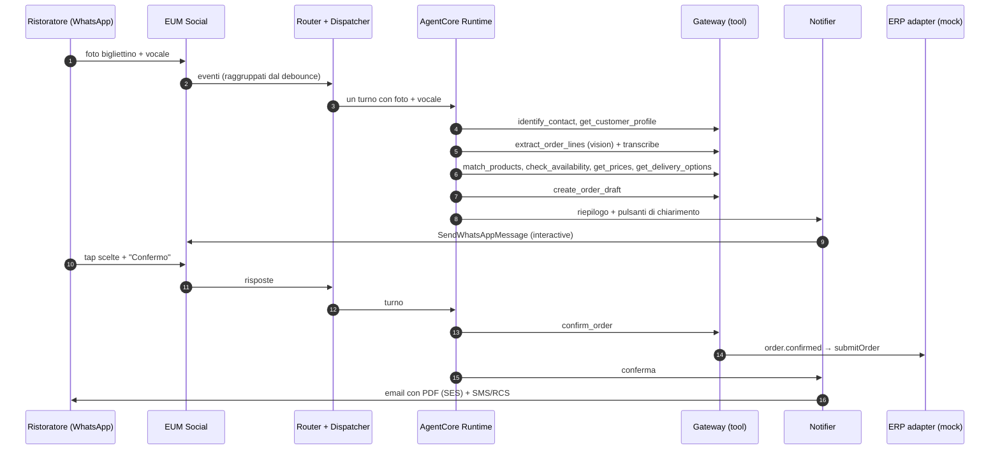

# SuppliAgent – Infrastructure Design

> AWS CDS Agentic AI Partner Hackathon · Team beSharp
> Stato: **v1.0 – allineato alla submission** (T-72, 28/10/2026) · IaC: **AWS CDK (TypeScript)** · Agent: **Strands Agents su Amazon Bedrock AgentCore** · Region: **eu-west-1**
> Diagramma: [`architecture.drawio`](./architecture.drawio)

---

## 1. Obiettivi e principi di design

| Obiettivo | Scelta progettuale |
|---|---|
| Punteggio "Technical Execution" (40%) | 3 servizi CDS **bidirezionali** + AgentCore (Runtime, Memory, Gateway, Identity, Observability) + Bedrock Knowledge Base |
| Riproducibilità | Tutto in CDK, deploy con `npx cdk deploy --all`; prerequisiti di canale documentati (§11) |
| Serverless / scale-to-zero | Nessun server sempre acceso; nessun servizio con costo fisso orario elevato (es. niente OpenSearch cluster) |
| Scalabilità + ordine per chat | **SQS standard** + idempotenza su `providerMessageId`: chat diverse in **parallelo**; l'ordine nella chat viene dal timestamp di ricezione AWS e il lock per conversazione del debounce serializza i turni (SNS standard non consegna a code FIFO, decisione del 26/10) |
| Una risposta per raffica | **Debounce applicativo** per conversazione (§5.2.2) |
| Due tipi di utente, un solo agente | Ruolo risolto dall'identità (`CUSTOMER_CONTACT` / `SALES_REP` / `BACKOFFICE`) → set di tool e istruzioni diversi |
| Contesto cross-canale | Identità canonica come `actorId` di AgentCore Memory |
| Integrazione futura con l'ERP reale | **ERP adapter** dietro interfaccia; implementazione mock per l'hackathon |
| Dati in Europa | `eu-west-1`, Amazon Nova via inference profile **`eu.`** |
| Sicurezza by default | KMS, IAM least privilege, Guardrails, Cognito, dati anonimizzati |

## 2. Account, region e ambienti

- **Account** AWS `471112860008` (decisione del 24/10): account **condiviso** con altri progetti beSharp, già con bootstrap CDK. Per questo il CDK **non crea AWS Budgets** (un budget conterebbe la spesa di tutto l'account); i costi SuppliAgent si isolano con i tag obbligatori (`Project`, `Owner`, `Env`) in Cost Explorer.
- **Region: `eu-west-1` (Irlanda)**. Vincolo: **dati e inferenza restano in Europa**.
- **Modello**: **Amazon Nova** tramite inference profile **`eu.`**: `eu.amazon.nova-pro-v1:0` (ragionamento, tool use, vision) e `eu.amazon.nova-lite-v1:0` (classificazioni veloci); il profilo `global.` **non** si usa. *Decisione del 25/10*: sull'account `471112860008` (in *channel program*) Claude non è invocabile; se verrà abilitato, il passaggio a Claude sarà un task pianificato (cambio di `modelId`/`fastModelId` + eval di confronto).
- **Ambiente**: solo `dev` (decisione del 27/10): sviluppo, video e judging; attivo fino al 12/11/2026. Selezionato con `-c env=dev`.
- **Naming**: `suppliagent-<env>-<componente>`; tag: `Project=Hackathon AWS CDS`, `Owner=matteo.goretti@besharp.it`, `Env=<env>` (decisione del 24/10: i primi due sono obbligatori su **tutte** le risorse dell'account).

Disponibilità servizi verificata il 09–12/10/2026:

| Servizio | eu-west-1 |
|---|---|
| AgentCore Runtime, Memory, Gateway, Identity, Observability | ✅ |
| EUM Social (WhatsApp), EUM SMS v2, RCS (Italia supportata) | ✅ |
| SES v2 + email receiving (receipt rules) | ✅ |
| Bedrock Amazon Nova Pro/Lite (profilo `eu.`, verificato il 25/10), Titan Text Embeddings V2, Cohere Embed Multilingual | ✅ |
| Bedrock Knowledge Bases, **S3 Vectors** | ✅ |
| Transcribe, Textract | ✅ |

## 3. Vista d'insieme

1. **Channels (CDS)** – EUM Social (WhatsApp), SES v2 (outbound + inbound), EUM SMS/RCS v2.
2. **Ingestion & Routing** – SNS → SQS `inbound` → Inbound Router → TurnBuffer + `turn-flush` → Turn Dispatcher.
3. **Agent** – AgentCore Runtime (Strands) + Memory + Gateway (tool MCP su Lambda) + Identity + Observability; Bedrock Amazon Nova `eu.` + Guardrails; Transcribe.
4. **Catalog intelligence** – indice prodotti su **S3 Vectors** (ricerca semantica) + matching ibrido; **Bedrock Knowledge Base** sulle schede tecniche.
5. **Order & Outbound** – servizio ordini, generazione PDF, **ERP adapter** (mock), **Notifier** con policy di canale, EventBridge Scheduler.
6. **Proactive** – job giornaliero di **analisi riordini e insight cliente**.
7. **Data** – DynamoDB (anagrafiche, catalogo, listini, stock, ordini, conversazioni), S3.
8. **Console** – CloudFront + S3 (React), Cognito, API Gateway REST (+ WebSocket per la **chat web agenti**, T-64). Niente analytics su Athena (T-09 tolto il 27/10).

## 4. Stack CDK

| # | Stack | Risorse principali | Dipende da |
|---|---|---|---|
| 1 | `FoundationStack` | KMS CMK, bucket S3 (media, inbound-mail, documents, catalog-assets, analytics, access-logs), event bus applicativo, parametri SSM | – |
| 2 | `DataStack` | Tabelle DynamoDB (§5.7) con Streams e PITR, custom resource di seed (rinviata a T-04) | Foundation |
| 3 | `CatalogStack` | S3 Vectors bucket + indice `products`, Lambda di indicizzazione catalogo, **Bedrock Knowledge Base** (schede tecniche, vector store S3 Vectors) + data source S3 | Foundation, Data |
| 4 | `ChannelsStack` | SES (identity dominio, configuration set, receipt rule set → S3 + SNS), EUM SMS/RCS (configuration set, event destinations, opt-out list), EUM Social (event destination SNS), topic SNS inbound | Foundation |
| 5 | `AgentStack` | AgentCore Runtime (zip, code deploy, ADOT), AgentCore Gateway + target Lambda dei tool, AgentCore Memory, Bedrock Guardrail, log group del Runtime (CMK, retention), ruoli IAM | Foundation, Data, Catalog |
| 6 | `MessagingStack` | SQS `inbound` + DLQ, SQS `turn-flush` + DLQ, Lambda Inbound Router (con il download dei media), Turn Dispatcher, Notifier, Order PDF Generator, ERP Adapter, EventBridge Scheduler | Foundation, Channels, Agent, Data |
| 7 | `ProactiveStack` | EventBridge Scheduler giornaliero, Lambda **Insights & Reorder Analyzer**, Lambda **Proactive Trigger** | Data, Messaging |
| 8 | `ConsoleStack` | Cognito (gruppi `backoffice`, `sales_rep`, `judge`), API Gateway REST + WebSocket, Lambda API/broadcaster/rep-chat, S3 + CloudFront (OAC) + WAF | Data, Messaging, Agent |
| 9 | `AnalyticsStack` | **Vuoto** (T-09 tolto il 27/10: niente Firehose, Glue, Athena); allarmi CloudWatch negli stack dei componenti | Foundation |

> Verificato il 23/10/2026 su `aws-cdk-lib` 2.274.0:
> - **AgentCore**: L2 **stabili** in `aws-cdk-lib/aws-bedrockagentcore` (`Runtime`, `RuntimeEndpoint`, `Gateway`, `GatewayTarget`, `WorkloadIdentity`, `Memory`); il pacchetto `@aws-cdk/aws-bedrock-agentcore-alpha` serve solo per Policy e non si usa.
> - **S3 Vectors**: solo L1 (`CfnVectorBucket`, `CfnIndex`). **Knowledge Base**: L1 `CfnKnowledgeBase` con `storageConfiguration.type = S3_VECTORS` (l'L2 alpha supporta solo OpenSearch).
> - **cdk-nag v3** gira come plugin di policy validation (`Validations.of(app).addPlugins(...)`): un errore non riconosciuto fa fallire `cdk synth`; le eccezioni si dichiarano con `Validations.of(scope).acknowledge({ id, reason })`.
> - Stack env-agnostic sull'account (region fissa `eu-west-1`), così `cdk synth` gira in CI senza credenziali. Gli stack 3–9 sono per ora vuoti e collegati nell'ordine di dipendenza.

## 5. Dettaglio componenti

### 5.1 Canali CDS

#### WhatsApp – AWS End User Messaging Social
- **Prerequisito**: WABA già verificata collegata a EUM Social + numero dedicato.
- **Inbound**: eventi su SNS `suppliagent-wa-events`.
- **Media**: `GetWhatsAppMessageMedia` con `destinationS3File` → S3 `media/<contactId|conversationId>/<messageId>/<mediaId>.<ext>` (foto bigliettini, vocali, PDF). Il servizio scrive con i permessi del chiamante (Inbound Router: `s3:PutObject` su `media/*` + CMK); ID del numero letto a runtime da SSM `waPhoneNumberId`.
- **Outbound**: `SendWhatsAppMessage` (testo, immagini, **interactive buttons/list** per chiarimenti e conferma, documento PDF dell'ordine, template).
- **Template** (fuori finestra 24h): `order_confirmation`, `reorder_suggestion`, `delivery_update`, `order_pending_reminder`.
- Usato da **due ruoli**: ristoratori (ordini) e agenti di commercio (copilota).

#### Email – Amazon SES v2
- **Identity**: dominio dedicato (es. `ordini.<dominio-demo>`), Easy DKIM, SPF, DMARC, custom MAIL FROM.
- **Outbound**: `SendEmail` – conferma d'ordine con **PDF allegato**, briefing agenti, riepiloghi; configuration set `suppliagent-cs`.
- **Inbound**: MX → receipt rule set → S3 `inbound-mail` + SNS. Casi: **ordini inviati via email** (testo, foto, PDF) e risposte alle conferme. Reply-To `ordine+<orderId>@ordini.<dominio>` per la correlazione.
- **Eventi**: send, delivery, open, click, bounce, complaint.

#### RCS / SMS – AWS End User Messaging SMS v2
- **Outbound**: `SendRcsMessage` (conferma d'ordine, avviso di consegna con **suggested replies** *Ricevuto / Segnala problema*, proposta di riordino per chi non usa WhatsApp) con **fallback** `SendTextMessage`.
- **Inbound two-way** → SNS `suppliagent-sms-inbound` (risposte, postback, STOP).
- Configuration set con event destinations (SNS). Agente RCS registrato, device tester invitati, registrazione Italia (`IT_RCS_LAUNCH_REGISTRATION`).
- *Stato (M-11, 28/10)*: agente RCS **di test** `ACTIVE` con un tester Android verificato (solo tester, niente lancio verso gli operatori) e sender ID `SUPPLIAGENT` per IT (one-way); account SMS in sandbox. In Italia RCS non arriva su iPhone. Procedura, ID e vincoli: [RCS_SMS_SETUP.md](./RCS_SMS_SETUP.md).
- *Stato (T-27)*: `ChannelsStack` con topic `sms-inbound` (two-way dell'agente attivato da custom resource `UpdateRcsAgent`) e `sms-events` (configuration set `suppliagent-<env>-sms-cs`, tutti gli eventi), parametri SSM `rcsAgentArn` / `smsSenderId` / `smsConfigurationSet`. Il Router normalizza SMS e RCS (canale `SMS`; un tap su un suggested reply arriva come `messageBody` JSON `type = SUGGESTION` con il nostro `postbackData`, gli indicatori di scrittura si scartano). Il Notifier invia con `SendRcsMessage` dall'agente e `FallbackConfiguration` SMS dal sender ID: risposte sul canale `SMS` (opzioni come suggested reply, max 11, 25 caratteri), conferma breve accanto all'email (`order.pdf_ready`, chiave `order-sms#<orderId>#<revision>`, best effort) e avviso di consegna (F-12), solo verso un'identità `SMS#` verificata del contatto. Permessi: `sms-voice:SendRcsMessage` / `SendTextMessage` su agente, sender ID e configuration set.

### 5.2 Ingestion & Routing

```
SNS (wa-events | sms-inbound | mail-inbound)
   → SQS standard "inbound"   (SSE-KMS, DLQ dopo 3 ricezioni; envelope SNS conservato)
   → Lambda Inbound Router     (batch size 1, scala con i messaggi in coda)
        ├─ append su DynamoDB "TurnBuffer"
        └─ SQS standard "turn-flush" (DelaySeconds = finestra di attesa)
   → Lambda Turn Dispatcher    (debounce + lock per conversazione)
   → AgentCore Runtime         (un turno con tutti i messaggi raccolti)
   DLQ su entrambe le code (maxReceiveCount = 3)
```

La chat web degli agenti di commercio entra dalla console (WebSocket → Lambda `rep-chat`) e usa lo **stesso** TurnBuffer/Dispatcher, con `channel = WEB`.

**Inbound Router** (`services/inbound_router`; stato al 26/10 tra parentesi)
1. **Normalizza** l'evento nel `NormalizedMessage` (WhatsApp ed email in T-21; SMS/RCS con T-27, chat web con T-64).
2. **Risolve l'identità e il ruolo**: `ChannelIdentities` → `contactId`, `role` (`CUSTOMER_CONTACT` | `SALES_REP`), `customerIds[]` (un contatto può gestire più locali; un agente ha un portafoglio). Fail-closed come `caller_scope`: un contatto `PENDING_VERIFICATION` ha `customerIds` vuoto, altri stati → `UNKNOWN`. Email: identità solo con DMARC `PASS` e un solo indirizzo `From` uguale a quello valutato da SES (§5.3.2), altrimenti `senderVerified = false`; `orderId` da `ordine+<id>@` solo sul dominio SES e da mittente verificato. Una conversazione per contatto su tutti i canali (`conv_<contactId>`, F-15), oppure quella in cui l'indirizzo è stato identificato (`ChannelIdentities.conversationId`, scritto da `identify_contact`); mittenti sconosciuti: una per indirizzo, separata per le email non verificate; evento `conversation.started` alla creazione.
3. **Idempotenza** su `providerMessageId` (E-01): `TransactWriteItems` del messaggio e di una guardia `dedup#<messageId>` con TTL nel TurnBuffer.
4. **Media** → S3 `media/<contactId|conversationId>/<messageId>/`, **dentro il Router** (deciso il 26/10, T-23: niente Lambda Media Fetcher separata, così il messaggio entra nel TurnBuffer solo con i media già salvati e senza coordinamento asincrono col debounce). WhatsApp: `GetWhatsAppMessageMedia` per immagini, audio e documenti ammessi, max 10 MB (dimensione dell'oggetto scaricato su S3: il `fileSize` della risposta è in byte, non in KB come da documentazione API). Email: immagini JPEG/PNG/WebP/GIF/HEIC, PDF, XLSX, CSV, solo se la firma dei primi byte corrisponde al tipo, max 10 MB e 10 allegati, solo con virus scan SES `PASS`; chiave `<indice>.<estensione del tipo>` (mai il nome file), documenti con `Content-Disposition: attachment`. Niente SVG né `.xls`. Un allegato rifiutato resta senza `s3Uri` (E-13). Video e sticker non scaricati. **Media simulati** (T-14, `scripts/simulate_channel.py`): un `mediaId` del formato `sim_<32 hex>` non passa da EUM Social; il Router copia `sim/<mediaId>/<file>` in `media/<contactId|conversationId>/<messageId>/<mediaId>.<ext>` (stessa forma di un download vero, quindi il resto del flusso è quello reale) **solo se** SSM `notifierSandbox` è `true` (parametro assente = no, a differenza del Notifier); in `demo` il ramo non si attiva. Il Router ha `s3:GetObject`/`ListBucket` su `sim/*` (condizione sul prefisso). Download fallito → errore, retry SQS ×3, poi DLQ (E-02, allarme `suppliagent-<env>-inbound-dlq`); niente scritture prima del download. Testo email troncato a 4000 caratteri; dall'HTML sono tolti script, stili e commenti.
5. **Read receipt** WhatsApp per ogni messaggio nuovo: invoke asincrono del Notifier (unico che chiama le API di invio), best effort (un errore non fa riconsegnare il messaggio). Il Notifier lo invia solo se `providerMessageId` è un messaggio WhatsApp in ingresso di *quella* conversazione.
6. **Handoff check**: `mode = HUMAN` → solo `Messages` e console (il Router non azzera mai `mode`). Stessa regola per le email con `senderVerified = false`: nessun turno, quindi nessuna risposta (backscatter).
7. **Accoda nel TurnBuffer** e programma il flush (T-22): `Put` del messaggio, guardia di dedup e `Update` del TurnBuffer sono **una sola transazione**, quindi una riconsegna non aggiunge due volte il messaggio né lo perde. Il flush (`turn-flush`, `DelaySeconds` = debounce testo o media) parte anche su un duplicato: costa poco e copre un crash tra transazione e invio.
8. Sulla conversazione registra, solo per mittenti verificati e solo se il messaggio è più recente di quanto già scritto (una riconsegna o un vecchio messaggio in redrive non fa tornare indietro i valori), dove rispondere (`lastInboundAt`, `lastInboundChannel`, `lastInboundFrom`, `lastInboundLocale`; per un'email anche il thread, T-26b: `lastEmailSubject` e `lastEmailMessageId`, l'header `Message-ID` solo se ASCII stampabile tra `<>`, stringa vuota se manca) e l'inizio della finestra WhatsApp 24h (`lastWhatsappInboundAt`): sono gli unici dati che il Notifier usa come destinatario.
9. Scrive in `Messages` → Stream → console live.

**NormalizedMessage** (`suppliagent_shared.messages`; campi assenti = `null`)

```json
{
  "messageId": "msg_<uuid5 di providerMessageId>",
  "providerMessageId": "wamid.HBg...",
  "channel": "WHATSAPP | EMAIL | RCS | SMS | WEB",
  "direction": "INBOUND",
  "contactId": "con_123 | rep_001 | assente se UNKNOWN",
  "role": "CUSTOMER_CONTACT | SALES_REP | UNKNOWN",
  "customerIds": ["cus_45"],
  "conversationId": "conv_456",
  "orderId": "ord_789 | null",
  "from": "+39333...",
  "senderVerified": true,
  "text": "aggiungi 2 kg di burro",
  "attachments": [{ "type": "image | audio | document | video | sticker", "s3Uri": "s3://... (assente se non salvato)", "mimeType": "image/jpeg", "mediaId": "id WhatsApp" }],
  "interactiveReply": { "id": "line_3_opt_1", "title": "Fior di latte 1 kg", "contextId": "wamid del messaggio con il pulsante" },
  "receivedAt": "2026-10-20T07:41:00.123Z",
  "locale": "it-IT"
}
```

`interactiveReply.id` si può falsificare: le azioni (es. `confirm_order`) devono verificare `contextId` contro il messaggio inviato e l'ordine contro lo scope del contatto.

#### 5.2.1 Parallelismo e ordinamento
- **Perché non FIFO** (decisione del 26/10, T-21): SES e EUM Social pubblicano solo su topic SNS **standard** (EUM Social non supporta topic FIFO) e un topic standard non consegna a code FIFO. Un forwarder verso una FIFO aggiungerebbe una Lambda per un ordinamento che il debounce già garantisce.
- Chat diverse sono elaborate **in parallelo**; due messaggi della stessa chat possono essere elaborati in parallelo dal Router, ma: `Messages` ha sort key `receivedAt#messageId` (timestamp di ricezione AWS, 1 ms tra i messaggi dello stesso evento), il TurnBuffer va riletto in ordine di `receivedAt`, il lock del Dispatcher serializza i turni. Le scritture del Router sono atomiche (creazione conversazione con `UpdateItem`, `PutItem` condizionata).
- Un messaggio in errore viene ritentato 3 volte e poi finisce in DLQ senza bloccare altre chat (E-10).

#### 5.2.2 Debounce
- Tabella `TurnBuffer` (PK `conversationId`; stessa tabella ospita le guardie `dedup#…`): `pending` (messaggi in attesa: `messageId`, `ts` del provider, `at` = istante di arrivo in epoch ms, `text`, `attachments`, `interactiveReply`, `orderId`), `caller` (canale, mittente, ruolo, `contactId`, `customerIds`, `locale` dell'ultimo messaggio), `lockUntil` (lock con scadenza), `afterTurn` (i messaggi in coda sono arrivati durante il turno precedente), `expiresAt` (TTL, 24 h).
- Il Router accoda e invia un flush ritardato. Un flush è solo un invito a guardare la conversazione, ne possono esistere molti: il Dispatcher agisce solo se la raffica è finita (silenzio per il debounce, testo o media, oppure `debounceMaxMs` dal primo messaggio) e il lock è libero; il debounce si calcola dagli `at` dei messaggi in attesa (niente contatori separati: i messaggi rimasti dopo un turno conservano la loro età); se è troppo presto si rimette in coda per il tempo mancante, se il lock è preso si rimette in coda alla sua scadenza (copre un titolare crashato, E-11).
- Presa del lock con `UpdateItem` condizionale (`lockUntil` assente o scaduto); l'item com'era (con `pending`) è lo snapshot del turno, ordinato per `receivedAt`. Dopo il lock il Dispatcher rilegge la conversazione (lettura consistente): se `mode` non è `AGENT` (handoff arrivato dopo l'append del Router) non invoca né agente né Notifier e scarta i messaggi dal buffer, che l'operatore legge in `Messages`. A fine turno `REMOVE pending[0..n-1]` + lock in un solo update condizionato al proprio `lockUntil`; se restano messaggi (arrivati nel frattempo) lo stesso update imposta `afterTurn` e un nuovo flush li raggruppa in **un solo** turno (`afterTurn` si legge alla presa del lock e si cancella solo quando un turno si completa, così sopravvive a un retry). Un errore (agente, Notifier) rilascia il lock **senza** rimuovere i messaggi e fa riprovare il flush (SQS ×3, poi DLQ con allarme). *T-67*: un errore dell'**agente** incrementa `turnFailures` nel TurnBuffer (sotto lock). Al primo errore il Dispatcher manda un messaggio di cortesia (Notifier, chiave `courtesy#<primo messaggio>`), tiene il lock per metà di `turnLockTtlMs` (backoff: gli altri flush della raffica lo trovano preso e tornano dopo) e lascia riprovare SQS. Al secondo di fila fa handoff `LOW_CONFIDENCE` (`by = AGENT`, riassunto per la console), avvisa il cliente (`handoff#<primo messaggio>`) e toglie i messaggi dal buffer, senza rilanciare l'errore. Un turno riuscito azzera il contatore. Un turno prende al massimo `turnMaxMessages` messaggi (i più vecchi): gli altri restano in `pending` e passano al turno successivo con `afterTurn`.
- Il turno dura meno del lock (Lambda 115 s < `turnLockTtlMs` 120 s) e la coda ha visibilità 120 s. Chiave di idempotenza della risposta = id del primo e dell'ultimo messaggio del turno: un turno ritentato non invia due risposte. **Limiti noti**: un messaggio con `receivedAt` precedente che arriva dopo la presa del lock finisce nel turno successivo; se il Notifier fallisce per un errore *transitorio* il turno è ritentato e l'agente rieseguito sugli stessi messaggi (gli errori permanenti — `AccessDenied`, `ChannelUnavailable`, `InvalidInput` — chiudono il turno senza retry); `pending` non ha un tetto (con flush in DLQ per ore cresce fino a 400 KB e il Router fallirebbe: allarme sulla DLQ `turn-flush`); un messaggio su un altro canale arrivato a metà turno può far uscire la risposta su quel canale (il Notifier usa l'ultimo indirizzo verificato).
- Finestre: testo ~3 s, media ~6 s, massimo 15 s dal primo messaggio. Il batching window nativo di Lambda non raggruppa per chat, quindi il debounce è applicativo.
- Dettaglio dei casi: [02 §3.3](./02_TECHNICAL_FLOWS.md).

### 5.3 Agent layer – Amazon Bedrock AgentCore

| Componente | Configurazione |
|---|---|
| **Runtime** | **Code deploy** (zip ARM64, Python 3.12, Strands), niente container né ECR: dipendenze dal `uv.lock` installate per `aarch64` al `cdk synth` (`infra/lib/constructs/uv-bundling.ts`, serve `uv`); `runtimeSessionId` derivato da `conversationId` (02 §6.2); env: `GATEWAY_URL`, `MODEL_ID`, `MEMORY_ID`, `GUARDRAIL_ID`/`GUARDRAIL_VERSION`, variabili OTel (T-54); entrypoint `opentelemetry-instrument main.py` (ADOT); il testo dei messaggi arriva al modello dentro `<user_message>` come contenuto non fidato; ARN pubblicato su SSM `/suppliagent/<env>/agentRuntimeArn` |
| **Modello** | **Nova Pro** (`eu.amazon.nova-pro-v1:0`) per ragionamento e **lettura dei bigliettini** (vision); **Nova Lite** (`eu.amazon.nova-lite-v1:0`) per classificazioni veloci. Claude è il target futuro se abilitato (vedi §2) |
| **Ruoli** | Il Dispatcher passa `role`; il Runtime carica istruzioni e **sottoinsieme di tool** per ruolo (§5.3.1) |
| **Memory** | `suppliagent_<env>_memory`, CMK, eventi per 30 giorni (T-54). `actorId = contactId`, `sessionId = conversationId`; una conversazione iniziata da un mittente sconosciuto (`conv_u…`) tiene per sempre come actor l'hash dell'indirizzo (mai il numero in chiaro), anche dopo l'identificazione, per non perdere lo storico, e richiama in più le note del contatto; strategie *user preference* (`/preferences/{actorId}`: lingua, canale, abitudini), *semantic* (`/facts/{actorId}`: prodotti abituali, note), *summary* (`/summaries/{actorId}/{sessionId}`). L'agente usa `AgentCoreMemorySessionManager`: lo storico della sessione è ripristinato a ogni turno e preferenze e fatti sono richiamati in `<user_context>` (continuità cross-canale, FN-25). Senza `MEMORY_ID` (test, esecuzioni locali) lo storico resta nel processo del Runtime |
| **Gateway** | Endpoint MCP con target Lambda; autenticazione in ingresso **AWS IAM (SigV4)** (deciso il 26/10: solo il ruolo del Runtime ha `bedrock-agentcore:InvokeGateway`, niente Cognito né Identity); nessuna ricerca semantica (sarebbe un tool in più per il modello); **autorizzazione per ruolo** sui tool |
| **Identity** | Workload identity del Runtime (default); nessun provider di credenziali: il Gateway usa IAM |
| **Observability** | ADOT (`aws-opentelemetry-distro`) nel Runtime: span OTel → CloudWatch GenAI Observability (Transaction Search attivo sull'account) con latenza per turno, token, tool, errori; testi dei messaggi, prompt e input/output dei tool **oscurati** negli span (`OTEL_SEMCONV_STABILITY_OPT_IN=gen_ai_unredacted_attributes=`). `tracingEnabled` e log applicativi su `/aws/vendedlogs/bedrock-agentcore/suppliagent-<env>-agent` (CMK, retention). Il log group creato dal Runtime (`/aws/bedrock-agentcore/runtimes/<id>-DEFAULT`) riceve retention, CMK e tag da custom resource (T-54) |
| **Evaluations** | AgentCore Evaluations (GA, disponibile in eu-west-1): valutazioni on-demand sul dataset di progetto (lettura bigliettini, matching, intento, uso dei tool) ed evaluator built-in di qualità/sicurezza; usabile anche in CI |
| **Guardrails** | `suppliagent-<env>-agent` (T-54), tier *Standard* (italiano) col profilo `eu.guardrail.v1:0`, CMK, versione pubblicata a ogni cambio di policy. Controlla l'**ultimo messaggio dell'utente** in ingresso e ogni risposta in uscita (non i risultati dei tool né il system prompt). Filtri contenuti (MEDIUM) e prompt attack in ingresso; topic negati: *sconti non autorizzati* solo in uscita (la richiesta di sconto deve arrivare all'agente, che fa handoff `OUT_OF_SCOPE`), *consigli sanitari* sulla salute della persona (non i fatti di prodotto: allergeni, lattosio e glutine sono risposte delle schede, FN-21; il 28/10 "La burrata contiene lattosio?" era bloccata); PII bloccati: carte, PIN, password, chiavi AWS. Nessun filtro su nomi, telefoni, email, P.IVA (servono all'identificazione). I *dati di altri clienti* sono negati dai tool (controllo di scope sul `caller`), non dal guardrail. Intervento → risposta sicura localizzata (E-06) |
| **AI services** | **Transcribe** per i vocali; **Nova Pro vision** per bigliettini e foto; **Textract** come fallback per documenti stampati (DDT, PDF) |

#### 5.3.1 Tool esposti dal Gateway

| Tool | Lambda | Ruoli | Dati |
|---|---|---|---|
| `identify_contact` | `tool-customers` | tutti | Contacts, Customers |
| `update_privacy` | `tool-customers` | solo `CUSTOMER_CONTACT` (il proprio contatto) | Contacts |
| `set_order_email` | `tool-customers` | solo `CUSTOMER_CONTACT` (il proprio contatto) | Contacts (`orderEmail`) |
| `get_customer_profile` | `tool-customers` | tutti (agente: solo portafoglio) | Customers, CustomerInsights |
| `extract_order_lines` | `tool-order-intake` (target Gateway `order-intake`: i nomi dei target non ammettono `_`) | tutti i ruoli noti (non `UNKNOWN`) | S3 `media/<contactId\|conversationId>/…` del solo chiamante → Nova Pro vision / testo; vocali via Transcribe (job `ordint-<hash>`, trascrizione in `transcripts/` dello stesso bucket, stesso ciclo di vita di 90 gg) |
| `match_products` | `tool-catalog` (target Gateway `catalog`) | tutti i ruoli noti, solo clienti del chiamante | S3 Vectors + Products + OrderHistory (+ Stock per i sostituti) |
| `search_catalog` | `tool-catalog` | tutti i ruoli noti | S3 Vectors + Products |
| `ask_product_sheets` (T-44b) | `tool-catalog` | tutti i ruoli noti | Bedrock Knowledge Base (schede tecniche): `bedrock:Retrieve` sulla sola KB, id da SSM `productSheetsKbId` risolto al deploy |
| `check_availability` | `tool-inventory-pricing` (target Gateway `inventory-pricing`) | tutti i ruoli noti (giacenza esatta solo `SALES_REP`) | Products, Stock |
| `get_prices` | `tool-inventory-pricing` | tutti i ruoli noti, solo clienti del chiamante (listino del cliente) | Customers, PriceLists, Promotions |
| `get_delivery_options` | `tool-inventory-pricing` | tutti i ruoli noti, solo clienti del chiamante | Customers, DeliveryCalendar |
| `recommend_products` / `record_suggestion_outcome` | `tool-reco` (target Gateway `reco`, T-50) | tutti i ruoli noti, solo clienti del chiamante; senza ordine (briefing) solo `SALES_REP`; per il cliente serve il consenso proattivo | CustomerInsights, OrderHistory, Promotions, Products, Stock, PriceLists; scrive solo `Orders.suggestion` e `CustomerInsights.rejectedSuggestions` |
| `create_order_draft` / `update_order_draft` / `request_order_confirmation` | `tool-orders` (target Gateway `orders`) | tutti i ruoli noti, solo clienti del chiamante | Orders, Products, PriceLists, Promotions, DeliveryCalendar |
| `confirm_order` / `cancel_order` | `tool-orders` | cliente; agente di commercio per il suo portafoglio | Orders → evento `order.confirmed` → ERP adapter |
| `get_order_status` | `tool-orders` | tutti i ruoli noti, solo clienti del chiamante | Orders, Deliveries |
| `report_delivery_issue` | `tool-orders` | tutti i ruoli noti, solo clienti del chiamante | Issues (foto: solo `media/<chiamante>/…`) |
| `get_rep_agenda` / `get_customer_briefing` | `tool-sales` | `SALES_REP` | Customers, CustomerInsights, Orders |
| `send_notification` | `notifier` | tutti | → canali CDS |
| `handoff_to_human` | `tool-orders` | tutti | Conversations |

#### 5.3.2 Contesto chiamante e autorizzazione nei tool (deciso il 26/10, T-42)

- Ogni tool del Gateway riceve, oltre ai propri argomenti, un argomento **`caller`** = `{role, contactId, channelAddress, conversationId}`. Lo imposta il **codice dell'agente** (T-41) dalla richiesta di turno del Dispatcher (02 §6.2): è tolto dallo schema mostrato al modello e **sovrascritto** a ogni chiamata (`{**argomenti_del_modello, "caller": contesto}`, con test in T-41), quindi il modello non può né vederlo né cambiarlo. Dopo un `identify_contact` → `MATCHED` l'agente rilegge il contesto da `ChannelIdentities` (o al turno successivo dal Dispatcher), mai dall'output del tool.
- `channelAddress` è il **mittente verificato** normalizzato dal Dispatcher (`CANALE#indirizzo`, telefono E.164), mai testo del messaggio o `Reply-To`. **Requisito per T-21** (fatto: il Router associa un'identità a un'email solo con `dmarcVerdict = PASS`, l'unico verdetto che verifica l'allineamento con il `From`; altrimenti `UNKNOWN`): le email in ingresso senza verdetti SES `PASS` di SPF/DKIM (o DMARC) non vengono associate a un'identità (resta `UNKNOWN`), altrimenti basta falsificare il `From` per avere lo scope di un contatto.
- Il tool si fida solo di **chi** è il chiamante (`role` + `contactId`); **cosa** può vedere lo ricava sempre da DynamoDB (`suppliagent_shared.auth.caller_scope`): `Contacts.customerIds` per un contatto, `Customers.repId` (GSI `by-repId`) per un agente; mai da `customerIds` passati nella chiamata. Campi in più in `caller` → `INVALID_INPUT`.
- **Fail-closed**: `Scope.customer_ids` contiene solo i locali di un contatto `VERIFIED` (o il portafoglio dell'agente); i locali di un contatto `PENDING_VERIFICATION` stanno in `Scope.pending_customer_ids`, che un tool usa **solo se lo dichiara** (oggi: profilo base del locale; il tool `orders` **non** le usa: per un contatto in verifica le bozze d'ordine sono negate, limite noto di F-02.C2). Prezzi, ordini e storico: solo `customer_ids`. Qualsiasi altro stato del contatto → nessun accesso.
- Identificazione (`identify_contact`, chiamante `UNKNOWN`): servono codice cliente o P.IVA **e** nome del locale; massimo **3 tentativi per conversazione** (contatore `Conversations.identifyAttempts`), poi `IDENTIFICATION_FAILED` → handoff (F-02.C4). Un indirizzo già registrato non viene mai riassegnato. Limite residuo: chi usa indirizzi email sempre nuovi ottiene conversazioni nuove (aggiungere un limite per dominio o globale se serve).
- Confine di fiducia: solo il ruolo del Runtime può invocare il Gateway (IAM); le Lambda dei tool sono invocabili solo dal ruolo del Gateway. Limite: un principal dell'account con `bedrock-agentcore:*` su `*` può invocare Runtime o Gateway con un `caller` arbitrario; con T-22 limitare `InvokeAgentRuntime` al ruolo del Dispatcher (resource policy, se disponibile). Lo storico in sessione è legato a `conversationId` **e** `channelAddress`; il Dispatcher deriva `runtimeSessionId` solo da `conversationId` (02 §6.2).
- Errori verso l'agente solo come codice (`{"error": "ACCESS_DENIED" | "NOT_FOUND" | "INVALID_INPUT" | "UNKNOWN_TOOL" | "INTERNAL_ERROR"}`), mai stack trace; nei log ID e codici, mai contenuti o indirizzi.
- Eventi applicativi con `Source = suppliagent.<componente>` (es. `suppliagent.tool-customers`).

### 5.4 Catalog intelligence

**Indice prodotti (S3 Vectors)**
- Per ogni SKU un documento testuale: nome, marca, categoria, formato/pezzatura, unità di vendita, **sinonimi e abbreviazioni** (es. "fdl" → fior di latte, "pelati" → pomodori pelati), descrizione breve.
- Embedding **Titan Text Embeddings V2** (o Cohere Embed Multilingual), indice `products` con metadati filtrabili (categoria, attivo, unità).
- Lambda `catalog-indexer` (T-06): evento `{"mode": "full"}` (scan di `Products`) o `{"skus": [...]}`; upsert degli SKU attivi (`PutVectors`, batch da 500), `DeleteVectors` per quelli inattivi o assenti dalla tabella. Va invocata dal seed/`reset.py` dopo il caricamento di `Products` (nessuno stream sulla tabella). Una run completa non vede gli SKU cancellati dalla tabella (niente sweep con `ListVectors`): si passano con `skus`.
- Indice `products`: 1024 dimensioni, `float32`, cosine; chiave del vettore = `sku`; metadati `category`, `unit`, `active` (filtrabili) e `text` (documento, **non** filtrabile). Titan V2 con `normalize: true`.

**Matching ibrido (`match_products`)**
1. Candidati semantici da S3 Vectors (top-k 10).
2. Punteggio lessicale (fuzzy match su nome, codici, sinonimi).
3. **Boost storico**: prodotti già acquistati dal cliente, frequenza e recency ("il solito olio" → olio acquistato più spesso).
4. Compatibilità unità/quantità (es. "3 casse" vs prodotto venduto a cartone da 6).
5. Output per riga: candidati ordinati con `confidence`; soglie: ≥ 0,85 abbinamento automatico, 0,5–0,85 **chiarimento con pulsanti**, < 0,5 riga non riconosciuta.

**Schede tecniche (Bedrock Knowledge Base)**
- Data source S3 `catalog-assets/sheets/` (schede tecniche MD o PDF: allergeni, conservazione, uso).
- Vector store **S3 Vectors**; nessun chunking (le schede sono brevi: un chunk per scheda, la citazione è la scheda intera); metadati `sku`, `category` dai sidecar `<file>.metadata.json`.
- *Stato (T-06b)*: `CatalogStack` con indice `product-sheets` nello stesso vector bucket (1024, `float32`, cosine; `AMAZON_BEDROCK_TEXT` e `AMAZON_BEDROCK_METADATA` non filtrabili), `CfnKnowledgeBase` `suppliagent-<env>-product-sheets` (Titan Text Embeddings V2, `S3_VECTORS`), data source S3 `catalog-assets/sheets/` (`DataDeletionPolicy = DELETE`), ruolo dedicato (trust `bedrock.amazonaws.com` con `aws:SourceAccount` e `knowledge-base/*`; solo `InvokeModel` di Titan V2, `s3vectors` sull'indice `product-sheets`, lettura di `sheets/*`, CMK). Id in SSM `productSheetsKbId` / `productSheetsDataSourceId`. Il bucket `catalog-assets` è riferito per nome (niente export dal `FoundationStack`: il deploy di `catalog` non richiede quello di `foundation`). Le 12 schede **sintetiche** stanno in `seed/data/sheets/` (`<sku>.md` + sidecar); `seed/seed.py` le carica e avvia l'ingestion (`--skip-sheets` per saltarla). Nessun costo fisso. Il tool `ask_product_sheets` è T-44b.
- `ask_product_sheets` (T-44b) usa `Retrieve` (mai `RetrieveAndGenerate`: la risposta la scrive l'agente) con filtro `equals sku` quando lo SKU è noto; tiene i passaggi con punteggio ≥ 0,65 (misurato sulla KB demo: scheda giusta 0,72–0,80, domande senza risposta ~0,61); con lo SKU (filtro sulla scheda del prodotto) basta 0,4: "lattosio" da solo sulla burrata vale 0,51 e li restituisce con la scheda da citare, altrimenti `NOT_FOUND` e l'agente dice che le schede non lo riportano. Evento `rep.query` (`type = sheets`) per gli agenti di commercio.

### 5.5 Ordini, ERP e outbound

**Servizio ordini** (`tool-orders`): ciclo di vita e regole in [02 §2.3](./02_TECHNICAL_FLOWS.md); validazioni: disponibilità, multipli di confezione, minimo d'ordine, **cut-off** e giorni di consegna per zona.

*Stato (T-45, T-46, T-47):* tre Lambda nell'`AgentStack`/`MessagingStack`.
- `tool-inventory-pricing` (sola lettura, nessun evento): stock con sostituti e multipli, listino del cliente con la promo valida, date di consegna da `Customers.deliveryDays`, eccezioni di `DeliveryCalendar` e cut-off (`DELIVERY_CUTOFF`, `Europe/Rome`: dopo il cut-off la consegna slitta di un giorno).
- `tool-orders` (scrive solo `Orders` e `Issues`, più `mode`/`handoff` della conversazione del chiamante con `handoff_to_human`): è il tool a calcolare nomi, unità, prezzi (`price_of`, listino del cliente) e totale; il modello propone solo SKU e quantità. Macchina a stati in `suppliagent_shared.orders` (02 §2.3 più `DELIVERED → DELIVERY_ISSUE`), scritture condizionali su `status` e `version` (una modifica concorrente dà `CONFLICT`, non sovrascrive). `confirm_order` solo da `PENDING_CONFIRMATION`, idempotente: la seconda chiamata risponde `ALREADY_CONFIRMED`; `order.confirmed` è emesso una volta (`confirmedEventAt`) e, se la prima emissione fallisce, la ripetizione lo rimanda. Un tap su pulsante richiede `interactiveReply.contextId == summaryMessageId` (campo che T-25 scriverà quando il Notifier invia il riepilogo con pulsanti; finché non c'è, solo conferma a parole). Dopo la conferma l'ordine si modifica o annulla fino al cut-off del giorno prima della consegna (`order.updated` → ERP e PDF), poi `ORDER_LOCKED`.
- `order-sweeper` (MessagingStack, schedule ogni 15 minuti sul bus default): per ogni ordine in `PENDING_CONFIRMATION` (GSI `by-status`), promemoria dopo `pendingReminderHours` (una volta per riepilogo, `reminderSentAt`) e `EXPIRED` a mezzanotte `Europe/Rome` del giorno del riepilogo con messaggio; fascia notturna `quietHours`: non scrive niente. Passa dal Notifier (`reply`, testo libero entro 24h; fuori finestra `ChannelUnavailable` e solo la transizione, template con T-29). Scrittura condizionale su `version`: se il cliente ha modificato l'ordine nel frattempo, non lo fa scadere.
- `tool-reco` (T-50, FN-11/FN-20): suggerimenti dai dati (`CustomerInsights` di T-08, ultimo acquisto da `OrderHistory`, promozioni valide oggi), solo prodotti attivi, in stock e nel listino del cliente. Con `orderId` (solo con l'ordine in `PENDING_CONFIRMATION`, cioè a riepilogo prodotto): al massimo **uno per ordine** (scrittura condizionale di `Orders.suggestion`, senza toccare `version`), per un `CUSTOMER_CONTACT` solo con `proactiveConsent = true`, mai un prodotto rifiutato negli ultimi 30 giorni; priorità riordino scaduto entro la data di consegna > locali simili > promozione. Con `customerId` (solo agente di commercio): fino a 3, una per tipo (riordini scaduti, prodotti smessi, locali simili, promozioni). `record_suggestion_outcome` segna l'esito sull'ordine (`accepted`, `value` = totale della riga aggiunta), emette `order.suggestion` e, se rifiutato, aggiunge lo SKU a `CustomerInsights.rejectedSuggestions` (l'analizzatore notturno non lo sovrascrive).
- **Limiti noti**: nessun controllo di stock alla conferma (solo `check_availability` prima); la conferma aggiornata via SMS dopo una modifica è di T-26b (l'email aggiornata c'è, T-26); l'annullo non chiama l'ERP; per i contatti `PENDING_VERIFICATION` niente bozze.

**ERP adapter**
- Su `order.confirmed` (EventBridge) → Lambda `erp-adapter`.
- Interfaccia: `submitOrder(order) → { erpOrderNumber, status }`, `getOrderStatus(erpOrderNumber)`.
- **Implementazione hackathon: mock** (scrive su DynamoDB/S3, simula numero d'ordine, genera eventi di avanzamento e consegna).
- Implementazioni future possibili: API REST dell'ERP, EDI, file CSV/XML su SFTP (AWS Transfer Family).
- *Stato (T-07):* Lambda `erp-adapter` con interfaccia `ErpAdapter` (`submit_order / update_order / cancel_order / get_order_status`) e `MockErpAdapter`. Legge l'ordine da `Orders` (non si fida dell'evento): `CONFIRMED → SUBMITTED` con scrittura condizionale e numero `ERP-<id senza ord_>` (deterministico e reversibile, quindi un evento doppio restituisce lo stesso numero e non emette nulla; `get_order_status` non ha bisogno di indici). Ordine non `CONFIRMED` e senza numero → `InvalidInput`. Eventi: `erp.submitted`, `order.status_changed`, `erp.failed`. **ERP non disponibile** (SSM `erpMockFailure = true`, E-08): l'ordine resta `CONFIRMED`, la Lambda solleva `ErpUnavailableError` → retry asincroni di Lambda (2, circa 3 minuti, `maxEventAge` 1 h) → DLQ `suppliagent-<env>-erp-adapter-dlq` da riprocessare a mano; allarmi su errori e DLQ. Pianificazione e consegna si simulano a mano con `{"action":"advance","orderId","to"}` (`SUBMITTED → SCHEDULED → OUT_FOR_DELIVERY → DELIVERED`, un passo per volta, scrive `Deliveries` con fascia 08:00–12:00): nessuno scheduler finché non serve (T-08). `update_order` è chiamato dall'evento `order.updated` (modifica di un ordine confermato entro il cut-off, T-46: `SUBMITTED` → stesso numero; ancora `CONFIRMED` → niente da fare, il primo invio legge l'ordine modificato). `cancel_order` dell'ERP non è collegato: `cancel_order` del tool aggiorna solo `Orders` (limite: con un ERP reale serve la chiamata).

**Order PDF Generator**: Lambda che genera il PDF dell'ordine (S3 `documents/`), usato da email e WhatsApp.

*Stato (T-07):* Lambda `order-pdf`, attivata da `order.confirmed` (PDF pronto prima dell'email, T-26) o invocata con `{"orderId"}`. Legge l'ordine da `Orders`, scrive `documents/orders/<orderId>.pdf` (chiave stabile: si rigenera sul posto dopo una modifica), restituisce `{"s3Uri"}`. PDF scritto a mano, **senza dipendenze** (Helvetica, A4, più pagine, testo WinAnsi con `?` per i caratteri non codificabili, niente a-capo automatico né logo): se per la demo serve un documento curato si passa a una libreria dietro `render_order_pdf(order) -> bytes`. Solo `orderId`, `customerId`, righe attive (non `REMOVED`) e note: nessun dato di contatto. Dopo un trigger EventBridge emette `order.pdf_ready` (`orderId`, `reason`, `revision`) per l'email di conferma (T-26). Contratto `Orders` letto: `status`, `deliveryDate`, `deliveryNotes`, `erpOrderNumber`, `lines[] {sku, name | rawText | description, quantity, unit}` (T-45/T-46 lo scrivono).

**Notifier** – unico punto di uscita (agente, console, scheduler, proattività):
1. Risposta → **stesso canale** del messaggio.
2. Conferma d'ordine → **email con PDF** + **RCS/SMS** breve (+ WhatsApp se la conversazione è lì).
3. Azioni rapide (consegna, riordino per chi non usa WhatsApp) → **RCS** con suggested replies, fallback **SMS**.
4. WhatsApp fuori finestra 24h → **template**.
5. Preferenze, opt-out, fasce orarie.

*Stato (T-24 base):* Lambda `notifier`, invocata da Dispatcher, Router, Order Sweeper e console (operatore), più la regola `order-pdf-ready` e la sottoscrizione ai bounce SES (T-26, sotto); due richieste: `reply` (`conversationId`, `idempotencyKey`, `text`, `interactive?`) e `read_receipt`. Con `interactive` (T-25, contratto in 02 §6.2) su WhatsApp invia un messaggio `interactive`: pulsanti `reply` se le opzioni sono al massimo 3 con titolo ≤ 20 caratteri, altrimenti una `list`; un testo oltre i 1024 caratteri del corpo parte prima come messaggio a sé e i pulsanti seguono con una domanda breve. Opzioni con id o titoli ripetuti sono rifiutate (`ValidationError`: il Dispatcher reinvia il solo testo); se WhatsApp rifiuta il messaggio interattivo, la risposta parte una volta sola senza pulsanti (mai un secondo invio del testo già partito). Per un `ORDER_SUMMARY` scrive l'id del messaggio in `Orders.summaryMessageId` (`UpdateItem` condizionato a `conversationId` della richiesta e stato `PENDING_CONFIRMATION`; un errore è solo loggato: il cliente conferma a parole). Su email le opzioni sono ignorate (sono già nel testo). In sandbox un messaggio con pulsanti riceve un id sintetico `wamid.sandbox_…`, registrato in `Messages` e sull'ordine, così `scripts/simulate_channel.py --tap` può rispondere. Il **destinatario non è mai nella richiesta**: canale e indirizzo sono quelli verificati salvati dal Router sulla conversazione (`lastInbound*`); senza, o con conversazione ignota, `AccessDenied`. WhatsApp: testo libero dentro la finestra 24h (`lastWhatsappInboundAt`), con il markdown del modello (`**grassetto**`, titoli `#`) convertito nel grassetto di WhatsApp (`*grassetto*`, T-68; in `Messages` resta il testo originale), fuori `ChannelUnavailable` (template con T-29); email: SES v2 con mittente e configuration set da SSM, nello stesso thread dell'ultima email del contatto (T-26b): oggetto `Re: <oggetto>` (invariato se è già una risposta; senza oggetto "La tua richiesta"/"Your request") e header `In-Reply-To`/`References` col suo `Message-ID`; SMS/RCS con T-27. Idempotenza con un claim `dedup#out#<key>` nel TurnBuffer: rilasciato se l'invio fallisce, marcato `sent` (7 giorni) subito dopo l'invio, prima di registrare il messaggio (un errore nella registrazione è solo loggato: meglio perdere il record che inviare due volte); un secondo tentativo con il claim ancora in corso riceve `SendInProgressError` (ritentabile), non `DUPLICATE`. Il read receipt legge il messaggio con la sua chiave (lettura consistente) e verifica `providerMessageId`, canale e direzione. Ogni uscita è registrata in `Messages` (`direction = OUTBOUND`, `status = SENT | SANDBOX`) ed emette `notification.sent` / `notification.failed`. **Sandbox**: parametro SSM `/suppliagent/<env>/notifierSandbox` (`false` in `dev` da T-68: invio reale, anche per i giudici; se manca vale `true`): con `true` niente invii, solo la registrazione in `Messages`; si cambia senza redeploy (cache 60 s).

*Stato (T-24)*: **Notifier completo**: `reply` con `template` facoltativo (finestra chiusa → template approvato, F-11.C2); fallback di canale WhatsApp → RCS/SMS (identità `SMS#` verificata) se la finestra è chiusa senza template o WhatsApp fallisce ancora dopo i retry; RCS rifiutato → `SendTextMessage` dal sender ID; `_call` con 3 retry e backoff esponenziale sugli errori transitori (E-09); opt-out (`optedOutAt` su `ChannelIdentities`, scritto dal Router su STOP/START con la sola condizione IAM `dynamodb:Attributes = channelAddress, optedOutAt`); fascia notturna (`QUIET_HOURS`) per `reorder_suggestion`. Router: E-02 all'ultima ricezione (`MAX_RECEIVES`) il media non scaricato passa senza `s3Uri`. `order-sweeper` con `DELIVERY_CUTOFF` per le variabili di `order_pending_reminder`.

*Stato (T-52)*: **template WhatsApp** (approvati con T-29) su due eventi del bus applicativo: `reorder.due` → `reorder_suggestion` (F-13) e `order.status_changed` con `to = OUT_FOR_DELIVERY` → `delivery_update` (F-12). Destinatario: l'indirizzo verificato della conversazione WhatsApp più recente del contatto (GSI `Conversations.by-contactId`), mai dall'evento; consenso e stato del contatto riletti al momento dell'invio; niente invio in handoff. I quick reply portano payload nostri (`reorder_*`, `delivery_*`), che il Router passa come `interactiveReply`. Idempotenza `dedup#out#reorder#<customerId>#<contactId>#<giorno>` e `dedup#out#delivery#<orderId>`; in `Messages` con `template` e le opzioni; in sandbox id sintetico per `simulate_channel.py --tap`. Permessi in più: `GetItem` su `Products`, `Deliveries`, `DeliveryCalendar`, `Query` su `OrderHistory`.

*Stato (T-26)*: **email di conferma d'ordine** su `order.pdf_ready` (regola `suppliagent-<env>-order-pdf-ready`): destinatario risolto lato server (`suppliagent_shared.contacts.order_email`: `Contacts.orderEmail` del contatto che ha confermato, altrimenti la sua identità `EMAIL#` verificata; mai dall'evento), `sesv2:SendEmail` `Simple` con HTML + testo IT/EN e il PDF da `documents/orders/<orderId>.pdf` in `Attachments`, Reply-To `ordine+<orderId>@<dominio>`, tag SES `template`/`orderId`/`contactId`; idempotenza `dedup#out#order-email#<orderId>#<revision>` con la revisione dell'evento (un evento di una revisione già superata non invia niente: arriva quello della nuova); registrata in `Messages` della conversazione dell'ordine (`channel = EMAIL`, solo l'oggetto, mai l'indirizzo). **Bounce**: sottoscrizione Lambda al topic `email-events` del configuration set con filtro sul corpo `eventType = Bounce`; per un bounce permanente con tag `order_confirmation` di un contatto cliente cancella `orderEmail` (solo se è ancora l'indirizzo rimbalzato), scrive `orderEmailBouncedAt` e chiede un nuovo indirizzo nella conversazione dell'ordine (per un agente di commercio solo `notification.failed`: l'indirizzo è la sua identità, lo corregge il back office) (`reply`, idempotente sul messageId SES; fuori finestra WhatsApp niente, template con T-29).

**EventBridge Scheduler**: promemoria bozze non confermate (T+2h), avviso di consegna (giorno di consegna 07:00), briefing agenti (giorni lavorativi 07:30).

### 5.6 Proattività

- **Insights & Reorder Analyzer** (Lambda, ogni notte): sullo storico ordini calcola per cliente:
  - frequenza di riordino per prodotto e **riordini scaduti** (oltre 1,5× l'intervallo medio);
  - **prodotti smessi** (acquistati regolarmente, assenti da > 2 intervalli);
  - **prodotti mancanti** rispetto a locali simili (stessa tipologia di cucina/zona);
  - promozioni pertinenti.
  Risultato in `CustomerInsights`.
- **Proactive Trigger**: per i riordini scaduti (max 1 proposta/settimana per cliente, rispettando fasce orarie e opt-out) avvia un **turno proattivo** dell'agente → messaggio `reorder_suggestion` con pulsanti *Riordina uguale / Modifica / No grazie*.
- Gli stessi insight alimentano `recommend_products` e i briefing agenti.

*Stato (T-08):* Lambda `insights-analyzer` (regola EventBridge alle 01:00 UTC) e `proactive-trigger` (08:00 UTC), entrambe invocabili a comando. L'Analyzer, da `Customers`, `OrderHistory` (lo storico del seed), gli ordini fatti con SuppliAgent (`Orders` da `CONFIRMED` in poi, righe attive: un riordino accettato sposta `lastOrderedAt`) e `Promotions`, scrive per ogni cliente `expectedReorders` (SKU comprati almeno 2 volte: `everyDays` = intervallo medio arrotondato, `lastOrderedAt`, `dueAt` = ultimo ordine + intervallo; lo storico ha solo il giorno, l'ora è 09:00 UTC come nel seed), `droppedProducts` (comprati almeno 3 volte e assenti da più di 2 intervalli), `suggestions` (max 3: prodotti mai comprati dal cliente ma comprati da locali dello stesso `venueType`, poi della stessa zona, poi promozioni attive, prima quelle sui prodotti del cliente; `reason` in italiano) e `updatedAt`, con un `UpdateItem` che lascia gli altri attributi. Con `{"asOf": "<ISO>"}` il calcolo è deterministico sul seed. Il Trigger (con `{"now": "<ISO>"}` per la demo) non scrive nulla fuori dalla fascia `quietHours`; per un cliente con un riordino scaduto (adesso ≥ `lastOrderedAt` + `reorderDueFactor` × `everyDays`) non fa nulla se ha ordini in corso (stato diverso da `DELIVERED`, `DELIVERY_ISSUE`, `CANCELLED`, `EXPIRED`; F-13.C1) o se la scrittura condizionata di `CustomerInsights.lastProposalAt` fallisce (proposta o segnalazione negli ultimi `reorderCooldownDays`; F-13.C2). Altrimenti emette `reorder.due` (customerId, contactIds, skus) per il turno proattivo (T-52), se almeno un contatto **verificato** ha `proactiveConsent = true` (i contatti `PENDING_VERIFICATION` non contano), oppure `reorder.skipped` (`NO_CONSENT`, per l'agente di commercio; F-13.C4). Nessuna delle due invia messaggi.

### 5.7 Data layer

**DynamoDB** (on-demand, PITR, SSE-KMS con la CMK del `FoundationStack`; nome fisico `suppliagent-<env>-<tabella-in-kebab-case>`, es. `suppliagent-dev-turn-buffer`):

| Tabella | PK | SK | GSI | Note |
|---|---|---|---|---|
| `Customers` | `customerId` | – | `repId`, `zone` | locali: ragione sociale, tipologia, zona, giorni consegna, agente, listino; `autoVerifyContacts` solo per i clienti di prova dei giudici (F-02.C7) |
| `Contacts` | `contactId` | – | `customerId` | persone: ruolo, lingua, preferenze, consenso, `orderEmail` (solo conferme d'ordine, T-26) |
| `ChannelIdentities` | `channelAddress` (`channel#address`) | – | `contactId` | phone/email → contatto; include agenti di commercio |
| `SalesReps` | `repId` | – | – | agenti: portafoglio, zona |
| `Products` | `sku` | – | `category` | catalogo: `name`, `brand`, `category`, `format`, `unit`, `synonyms` (lista), `description`, `multiple` (pezzi per confezione, 1 = nessun vincolo), `active` (booleano, assente = attivo) |
| `PriceLists` | `priceListId` | `sku` | – | `price` per listino (EUR, IVA esclusa) |
| `Promotions` | `promoId` | – | `sku` | `description`, `promoPrice`, validità `validFrom`–`validTo` (date locali, inclusive) |
| `Stock` | `sku` | – | – | `quantity`, `nextArrival` (data del riassortimento), `substitutes` (SKU, il migliore per primo) |
| `DeliveryCalendar` | `zone` | `date` | – | solo **eccezioni** ai giorni di consegna del cliente (`closed`, `reason`); i giorni serviti sono in `Customers.deliveryDays`, il cut-off è il parametro `deliveryCutoff` |
| `Orders` | `orderId` | – | `customerId`+`createdAt`, `status`+`updatedAt`, `repId` | testata (`status`, `deliveryDate`, `deliveryNotes`, `total`, `createdBy`, `conversationId`, `source`, `version` per le scritture condizionali, `pendingSince`, `reminderSentAt`, `confirmedAt`/`confirmedBy`/`idempotencyKey`/`confirmedEventAt`, `revision`, `summaryMessageId`, `erpOrderNumber`) + righe (`lineId`, raw text, candidati, SKU, nome, unità, quantità, `unitPrice`, `lineTotal`, stato riga); **Stream** |
| `OrderHistory` | `customerId` | `dateOrderId` (`date#orderId`) | – | storico (seed sintetico) per insight e matching |
| `CustomerInsights` | `customerId` | – | – | riordini attesi, prodotti smessi, suggerimenti (Analyzer); `lastProposalAt` (Proactive Trigger, cooldown) |
| `Deliveries` | `orderId` | – | `date` | fascia oraria, stato consegna |
| `Issues` | `issueId` | – | `orderId` | problemi di consegna con foto |
| `Conversations` | `conversationId` | – | `contactId` | `mode = AGENT \| HUMAN`, ruolo; `handoff` (reason, summary, by, at) finché `HUMAN`, `releasedAt` |
| `Messages` | `conversationId` | `tsMessageId` (`ts#messageId`) | `providerMessageId` | storico multicanale; **Stream** |
| `TurnBuffer` | `conversationId` | – | – | debounce e lock |
| `WsConnections` | `connectionId` | – | `userId` | connessioni console/chat web; TTL |

Convenzioni implementate (T-03): attributi chiave tutti stringa; GSI chiamati `by-<partition key>` (es. `by-customerId`); `a`+`b` = partition key `a`, sort key `b`; TTL su `TurnBuffer` e `WsConnections` con attributo `expiresAt` (epoch seconds); Streams `NEW_AND_OLD_IMAGES` su `Orders` e `Messages`. `date` e `status` sono parole riservate DynamoDB: nelle espressioni usare `ExpressionAttributeNames`. **Removal policy `DESTROY`** su tabelle e bucket in tutti gli ambienti: i dati sono sintetici e si ripopolano con `seed/seed.py` / `seed/reset.py` (T-04); PITR resta attivo.

**S3** (Block Public Access, SSE-KMS; eccezione: `access-logs` usa SSE-S3 perché la destinazione dei server access log S3 non supporta SSE-KMS):

| Bucket | Contenuto | Lifecycle |
|---|---|---|
| `media` | foto bigliettini, vocali, foto problemi di consegna | 90 gg |
| `inbound-mail` | email grezze | 90 gg |
| `documents` | PDF ordini | 365 gg |
| `catalog-assets` | export catalogo, schede tecniche PDF, immagini prodotto | – |
| `analytics` | vuoto (creato dal `FoundationStack`; gli eventi Parquet erano di T-09, tolto) | 365 gg |
| `console-site` | build React | – |
| `access-logs` | log | 30 gg |

**S3 Vectors**: vector bucket `suppliagent-<env>-vectors-<account>` (SSE-KMS con la CMK; la key policy del `FoundationStack` autorizza `indexing.s3vectors.amazonaws.com`) con indici `products` (T-06) e `product-sheets` (Knowledge Base, T-06b).

### 5.8 Console (back office + chat agenti)

- **Frontend** React (Vite) su S3 + CloudFront (OAC) + WAF.
- **Auth** Cognito: `backoffice` (tutto + handoff), `sales_rep` (chat copilota + propri clienti e ordini), `judge` (sola lettura + chat demo).
- **Viste**: inbox ordini (stato, confidenza, righe corrette, **immagine originale del bigliettino affiancata alle righe**), conversazioni live, problemi di consegna, clienti.
- **Chat web agenti**: WebSocket → `rep-chat` → TurnBuffer/Dispatcher → stesso agente con `role = SALES_REP`; risposte in streaming via WebSocket.
- **Real-time**: Streams di `Messages`/`Orders` → Broadcaster → WebSocket.
- **Handoff**: `mode = HUMAN`, risposta del back office via Notifier, *Release* all'agente.

Stato (T-60, T-62, T-63, 28/10): implementati Cognito (utenti creati dall'admin; per un `sales_rep` impostare l'attributo `custom:repId`), S3 + CloudFront (OAC) e API REST `/v1/orders` (`services/console_api`, ruolo dai claim del token): `GET /orders` (con `customerName`, `uncertainLines`, `handoff` da `Customers` e `Conversations`), `GET /orders/{orderId}` (righe nel contratto di 02 §6.3, URL pre-firmato del bigliettino) e `PATCH /orders/{orderId}/lines/{lineId}` con `{sku, quantity?}`: solo `backoffice` e il `sales_rep` del portafoglio (`judge` mai), solo ordini `DRAFT`/`NEEDS_CLARIFICATION` e solo uno dei `candidates` della riga; la riga diventa `MATCHED` con `correctedBy`, prezzo e totale ricalcolati, scrittura condizionata su `version`, eventi `order.line_corrected` e `order.status_changed`. La foto è `imageS3Uri` se presente, altrimenti la prima immagine in ingresso della conversazione dell'ordine (preferita quella di `sourceMessageId`). **Conversazioni e handoff (T-63)**: `GET /conversations` (con `mode`, `handoff`, nome del contatto e del locale; in `HUMAN` prima), `GET /conversations/{id}` (ultimi 100 messaggi con canale, direzione, stato e `sentBy`; mai indirizzi né URI dei media), `POST /conversations/{id}/takeover | reply | release` (F-14). Lettura per `backoffice` e `judge`, scrittura solo `backoffice` (un `sales_rep` è rifiutato: le conversazioni non sono per portafoglio); la risposta passa dal Notifier (`lambda:InvokeFunction` solo su quella funzione, nessun permesso di invio CDS per la console). La Lambda `console-api` impacchetta `suppliagent_shared` (`TABLE_PREFIX`) e legge `Contacts`. **Real-time per polling ogni 2 s** (nessun WebSocket/broadcaster: soddisfa FN-28 "entro 2 s"; `WsConnections` e gli Streams restano per T-64). **Non ancora**: WAF (costo fisso, da decidere prima della demo), WebSocket/broadcaster, `rep-chat` (T-64); `imageRegion` e confidenza per riga non sono scritti dall'agente (riquadri assenti, confidenza 100% per le righe con SKU).

### 5.9 Observability

- Eventi applicativi ([02 §6.4](./02_TECHNICAL_FLOWS.md)) sul bus EventBridge; l'export Firehose → S3 → Glue → Athena e le viste KPI sono fuori dalla gara (T-09, T-65 tolti il 27/10).
- AgentCore Observability: tracce per turno (T-54).
- CloudWatch: dashboard unica e allarmi (DLQ, errori Notifier, errori ERP adapter). Log JSON (Powertools) con `conversationId`/`orderId`, senza contenuti dei messaggi.

## 6. Flussi principali (sintesi)

Dettaglio completo in [02 – Flussi tecnici](./02_TECHNICAL_FLOWS.md).

### 6.1 Ordine da foto su WhatsApp



### 6.2 Copilota agente di commercio

`Agente (WhatsApp o web) → "cosa propongo domani alla Trattoria X?" → get_customer_briefing + recommend_products + ask_product_sheets → risposta con 3 proposte motivate e link alle schede`

### 6.3 Riordino proattivo

`Scheduler notturno → Analyzer → CustomerInsights → Proactive Trigger → Agent (turno proattivo) → template reorder_suggestion → tap "Riordina uguale" → create_order_draft da ultimo ordine → conferma → flusso 6.1`

### 6.4 Consegna e problemi

`ERP mock: consegna pianificata → Notifier RCS (fascia oraria + "Ricevuto / Segnala problema") → tap → se problema: richiesta foto → report_delivery_issue → console`

## 7. Sicurezza e IAM

- Ruoli Lambda dedicati e minimi; solo il Notifier può inviare su canali CDS.
- **Autorizzazione per ruolo** nei tool: un ristoratore vede solo i propri ordini e il proprio listino; un agente solo il proprio portafoglio. I controlli sono **nel tool** (non solo nel prompt).
- AgentCore Runtime: `bedrock:InvokeModel*` solo su profili `eu.` scelti, `ApplyGuardrail` sul guardrail e sul profilo `eu.guardrail`, Memory in lettura e scrittura eventi, `DeleteEvent` solo per sostituire nello storico un messaggio bloccato dal guardrail (niente admin né cancellazione dei record a lungo termine), Gateway e Knowledge Base.
- KMS su DynamoDB, S3, SQS, SNS, EventBridge (event bus applicativo), log; Secrets Manager; CloudTrail; WAF; CORS ristretto; **cdk-nag** in pipeline.
- **Dati del cliente**: catalogo anonimizzato o sintetico, nessun dato personale reale, nessun prezzo reale se non autorizzato.

## 8. Resilienza e scalabilità

- Coda inbound idempotente + debounce con lock per conversazione; DLQ con allarmi; idempotenza su `providerMessageId` e su `confirm_order` (chiave di idempotenza per evitare ordini doppi).
- Retry con backoff su CDS, Bedrock, ERP adapter; fallback di canale.
- ERP non disponibile → ordine `CONFIRMED` con invio all'ERP in coda (retry), il cliente riceve comunque conferma di presa in carico.
- Tutto serverless/managed; nessuna capacità fissa.

## 9. Stima costi (ordini di grandezza, da validare con AWS Pricing Calculator)

| Voce | Driver | Peso atteso |
|---|---|---|
| Bedrock Amazon Nova (testo + vision) | token per turno, immagini dei bigliettini | **Alto** |
| AgentCore | consumo per sessione/chiamata | Medio |
| Embedding + S3 Vectors + Knowledge Base | indicizzazione catalogo, query | Basso |
| WhatsApp | tariffe Meta + fee AWS | Basso–medio |
| SMS/RCS | per messaggio | Basso |
| SES, Lambda, DynamoDB, SQS, SNS, API GW, S3 | pay-per-use | Trascurabile |
| CloudFront + WAF | costo fisso WAF | Basso |
| Dominio custom console (certificato ACM) | gratis; fuori da CloudFormation, da rimuovere a mano allo spegnimento (il CNAME va via con la stack) | Nullo |

> Scelta deliberata di **S3 Vectors** invece di OpenSearch Serverless: nessun costo minimo orario, adatto ai crediti dell'hackathon.

## 10. CI/CD e struttura del repository

```
SuppliAgent/
├── infra/                     # CDK app (TypeScript): 9 stack
├── agent/                     # Strands agent (Python), prompt per ruolo in src/suppliagent_agent/prompts/, eval
├── services/                  # Lambda: router (con media), dispatcher, notifier, pdf, erp-adapter,
│                              #         tools/*, insights, proactive, console-api, rep-chat, broadcaster
├── console/                   # React (Vite): back office + chat agenti
├── seed/                      # catalogo anonimizzato, listini, clienti, storico ordini, bigliettini di test
├── docs/
├── .github/workflows/         # lint, test, cdk synth + cdk-nag, deploy
├── LICENSE
└── README.md
```

- GitHub Actions: CI (T-02, `.github/workflows/ci.yml`) su PR e push su `main` con lint, type check, test e `cdk synth` + cdk-nag, senza credenziali AWS.
- **Deploy da locale** (decisione del 25/10): `cd infra && npx cdk deploy --all -c env=<env>` con il profilo AWS dello sviluppatore; nessuna pipeline di deploy (OIDC) per l'hackathon. La CI resta un controllo automatico e non blocca il deploy.

## 11. Configurazione e prerequisiti manuali

| Parametro | Esempio |
|---|---|
| `env` / `region` | `dev` / `eu-west-1` |
| `waPhoneNumberId` | ID numero WhatsApp su EUM Social (`infra/config/environments.ts` → SSM; `UNSET` finché non è valorizzato; `-c waPhoneNumberId=…` lo sovrascrive) |
| `sesDomain` | `ordini.example.com` (`infra/config/environments.ts`, `-c sesDomain=…` lo sovrascrive: crea identity e rule set inbound; `dev` = `suppliagent.stonecutters.besharp.net`) |

| `consoleDomain` / `consoleCertificateArn` | hostname della console (CNAME → CloudFront) e certificato ACM in `us-east-1` (`infra/config/environments.ts`; vanno impostati insieme; `dev` = `app.suppliagent.stonecutters.besharp.net`). Il certificato è un passo manuale (README, passo 7); il CNAME lo crea la stack se `consoleHostedZone` (id e nome della zona Route 53) è impostato; senza i due valori la console resta su `*.cloudfront.net` |

> `waPhoneNumberId` e `sesDomain` stanno nella config per ambiente (T-15): un deploy di `ChannelsStack` (anche indiretto) non li perde. Valori attuali in SSM `/suppliagent/<env>/sesDomain` e `/suppliagent/<env>/waPhoneNumberId`.
| `rcsAgentId` / `smsSenderId` | agente RCS / sender ID del fallback in `infra/config/environments.ts` (`dev`: `rcs-83650561df2543e1942ccb9a500fa736` / `SUPPLIAGENT/IT`), pubblicati in SSM come ARN (`rcsAgentArn`, `smsSenderId`) con `smsConfigurationSet` (T-27) |
| `modelId` / `fastModelId` | `eu.amazon.nova-pro-v1:0` / `eu.amazon.nova-lite-v1:0` |
| `embeddingModelId` | `amazon.titan-embed-text-v2:0` |
| `matchAutoThreshold` / `matchAskThreshold` | `0.85` / `0.5` |
| `debounceTextMs` / `debounceMediaMs` / `debounceMaxMs` | `3000` / `6000` / `15000` |

Prerequisiti non automatizzabili:
1. WABA collegata a EUM Social; **template WhatsApp approvati**.
2. Dominio SES verificato, uscita dalla sandbox, MX per l'inbound.
3. Agente RCS, inviti tester, origination identity SMS ([RCS_SMS_SETUP.md](./RCS_SMS_SETUP.md)).
4. Accesso ai modelli Bedrock (Amazon Nova, Titan Embeddings) in eu-west-1: già disponibili sull'account `471112860008`. Claude richiede l'abilitazione tramite il distributore/AWS (vedi §12).
5. **Export del catalogo dal cliente** (anonimizzato) e schede tecniche.

## 12. Punti aperti

> Qui restano solo i **rischi di sicurezza accettati** (scelte di design). Hardening non pianificato (il repo serve solo alla gara, `START_HERE.md` §4.4); decisioni: `START_HERE.md` §6. Storico dei punti chiusi: [OLD/DONE.md](./OLD/DONE.md).

- [ ] **Rischi di sicurezza accettati** (revisione T-21/T-23, decisione del 26/10: si lasciano così fino alla demo):
  - i topic `wa-events` e `mail-inbound` accettano pubblicazioni da qualunque regola SES o WABA dell'account (condizione solo `aws:SourceAccount`, senza `aws:SourceArn`); il Router sceglie il parser dal contenuto, non dal `TopicArn`;
  - le grant KMS del Router (`kms:Decrypt`, `kms:GenerateDataKey` sulla CMK unica) non hanno la condizione `kms:ViaService`;
  - `social-messaging:GetWhatsAppMessageMedia` è concesso su `phone-number-id/*` dell'account, non sul solo numero della demo;
  - il `conversationId` dei mittenti sconosciuti è uno SHA-256 troncato dell'indirizzo (invertibile per forza bruta sui numeri di telefono) e compare nei log come correlation id; la correzione sarebbe un HMAC con segreto (Secrets Manager, costo fisso);
  - testo nascosto via CSS (`display:none`) nelle email HTML non rimosso.
