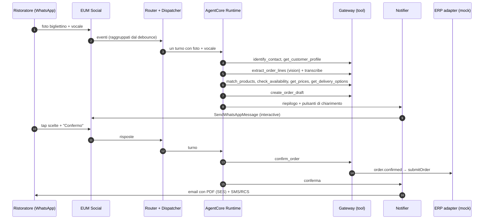

# SuppliAgent – Infrastructure Design

> AWS CDS Agentic AI Partner Hackathon · Team beSharp
> Stato: **v0.2 (draft)** · IaC: **AWS CDK (TypeScript)** · Agent: **Strands Agents su Amazon Bedrock AgentCore** · Region: **eu-west-1**
> Diagramma: [`architecture.drawio`](./architecture.drawio)

---

## 1. Obiettivi e principi di design

| Obiettivo | Scelta progettuale |
|---|---|
| Punteggio "Technical Execution" (40%) | 3 servizi CDS **bidirezionali** + AgentCore (Runtime, Memory, Gateway, Identity, Observability) + Bedrock Knowledge Base |
| Riproducibilità | Tutto in CDK, deploy con `npx cdk deploy --all`; prerequisiti di canale documentati (§11) |
| Serverless / scale-to-zero | Nessun server sempre acceso; nessun servizio con costo fisso orario elevato (es. niente OpenSearch cluster) |
| Scalabilità + ordine per chat | **SQS FIFO** con `MessageGroupId = chat`: chat diverse in **parallelo**, messaggi della stessa chat **in sequenza** |
| Una risposta per raffica | **Debounce applicativo** per conversazione (§5.2.2) |
| Due tipi di utente, un solo agente | Ruolo risolto dall'identità (`CUSTOMER_CONTACT` / `SALES_REP` / `BACKOFFICE`) → set di tool e istruzioni diversi |
| Contesto cross-canale | Identità canonica come `actorId` di AgentCore Memory |
| Integrazione futura con l'ERP reale | **ERP adapter** dietro interfaccia; implementazione mock per l'hackathon |
| Dati in Europa | `eu-west-1`, Claude via inference profile **`eu.`** |
| Sicurezza by default | KMS, IAM least privilege, Guardrails, Cognito, dati anonimizzati |

## 2. Account, region e ambienti

- **Account** AWS dedicato all'hackathon (crediti promozionali), **AWS Budgets** con alert 25/50/80%: creato dal `FoundationStack` solo con `-c budgetAlertEmail=<email>`; il budget copre l'intero account, quindi va passato in **un solo** ambiente.
- **Region: `eu-west-1` (Irlanda)**. Vincolo: **dati e inferenza restano in Europa**.
- **Modello**: Claude tramite inference profile **`eu.`**; il profilo `global.` **non** si usa.
- **Ambienti**: `dev` e `demo` (congelato per video e judging, attivo fino al 12/11/2026). Parametri via CDK context (`-c env=demo`).
- **Naming**: `suppliagent-<env>-<componente>`; tag: `Project=SuppliAgent`, `Env`, `Owner=beSharp`, `Hackathon=AWS-CDS-2026`.

Disponibilità servizi verificata il 09–12/10/2026:

| Servizio | eu-west-1 |
|---|---|
| AgentCore Runtime, Memory, Gateway, Identity, Observability | ✅ |
| EUM Social (WhatsApp), EUM SMS v2, RCS (Italia supportata) | ✅ |
| SES v2 + email receiving (receipt rules) | ✅ |
| Bedrock Claude (profilo `eu.`), Titan Text Embeddings V2, Cohere Embed Multilingual | ✅ |
| Bedrock Knowledge Bases, **S3 Vectors** | ✅ |
| Transcribe, Textract | ✅ |

## 3. Vista d'insieme

1. **Channels (CDS)** – EUM Social (WhatsApp), SES v2 (outbound + inbound), EUM SMS/RCS v2.
2. **Ingestion & Routing** – SNS → SQS FIFO → Inbound Router → TurnBuffer + `turn-flush` → Turn Dispatcher.
3. **Agent** – AgentCore Runtime (Strands) + Memory + Gateway (tool MCP su Lambda) + Identity + Observability; Bedrock Claude `eu.` + Guardrails; Transcribe.
4. **Catalog intelligence** – indice prodotti su **S3 Vectors** (ricerca semantica) + matching ibrido; **Bedrock Knowledge Base** sulle schede tecniche.
5. **Order & Outbound** – servizio ordini, generazione PDF, **ERP adapter** (mock), **Notifier** con policy di canale, EventBridge Scheduler.
6. **Proactive** – job giornaliero di **analisi riordini e insight cliente**.
7. **Data** – DynamoDB (anagrafiche, catalogo, listini, stock, ordini, conversazioni), S3.
8. **Console & Analytics** – CloudFront + S3 (React), Cognito, API Gateway REST + WebSocket (anche **chat web agenti**), Firehose → S3 → Glue/Athena.

## 4. Stack CDK

| # | Stack | Risorse principali | Dipende da |
|---|---|---|---|
| 1 | `FoundationStack` | KMS CMK, bucket S3 (media, inbound-mail, documents, catalog-assets, analytics, access-logs), event bus applicativo, parametri SSM, Budgets | – |
| 2 | `DataStack` | Tabelle DynamoDB (§5.7) con Streams e PITR, custom resource di seed (rinviata a T-04) | Foundation |
| 3 | `CatalogStack` | S3 Vectors bucket + indice `products`, Lambda di indicizzazione catalogo, **Bedrock Knowledge Base** (schede tecniche, vector store S3 Vectors) + data source S3 | Foundation, Data |
| 4 | `ChannelsStack` | SES (identity dominio, configuration set, receipt rule set → S3 + SNS), EUM SMS/RCS (configuration set, event destinations, opt-out list), EUM Social (event destination SNS), topic SNS inbound | Foundation |
| 5 | `AgentStack` | ECR image, AgentCore Runtime + Endpoint, AgentCore Memory, AgentCore Gateway + target Lambda, Bedrock Guardrail, ruoli IAM | Data, Catalog |
| 6 | `MessagingStack` | SQS FIFO inbound + DLQ, SQS `turn-flush` + DLQ, Lambda Inbound Router, Turn Dispatcher, Media Fetcher, Notifier, Order PDF Generator, ERP Adapter, EventBridge Scheduler | Channels, Agent, Data |
| 7 | `ProactiveStack` | EventBridge Scheduler giornaliero, Lambda **Insights & Reorder Analyzer**, Lambda **Proactive Trigger** | Data, Messaging |
| 8 | `ConsoleStack` | Cognito (gruppi `backoffice`, `sales_rep`, `judge`), API Gateway REST + WebSocket, Lambda API/broadcaster/rep-chat, S3 + CloudFront (OAC) + WAF | Data, Messaging, Agent |
| 9 | `AnalyticsStack` | Firehose (eventi CDS + applicativi) → S3 Parquet, Glue Catalog, Athena workgroup e viste KPI, CloudWatch Dashboard + allarmi | Channels, Foundation |

> Verificato il 23/10/2026 su `aws-cdk-lib` 2.274.0:
> - **AgentCore**: L2 **stabili** in `aws-cdk-lib/aws-bedrockagentcore` (`Runtime`, `RuntimeEndpoint`, `Gateway`, `GatewayTarget`, `WorkloadIdentity`, `Memory`); il pacchetto `@aws-cdk/aws-bedrock-agentcore-alpha` serve solo per Policy e non si usa.
> - **S3 Vectors**: solo L1 (`CfnVectorBucket`, `CfnIndex`). **Knowledge Base**: L1 `CfnKnowledgeBase` con `storageConfiguration.type = S3_VECTORS` (l'L2 alpha supporta solo OpenSearch).
> - **cdk-nag v3** gira come plugin di policy validation (`Validations.of(app).addPlugins(...)`): un errore non riconosciuto fa fallire `cdk synth`; le eccezioni si dichiarano con `Validations.of(scope).acknowledge({ id, reason })`.
> - Stack env-agnostic sull'account (region fissa `eu-west-1`), così `cdk synth` gira in CI senza credenziali. Gli stack 3–9 sono per ora vuoti e collegati nell'ordine di dipendenza.

## 5. Dettaglio componenti

### 5.1 Canali CDS

#### WhatsApp – AWS End User Messaging Social
- **Prerequisito**: WABA già verificata collegata a EUM Social + numero dedicato.
- **Inbound**: eventi su SNS `suppliagent-wa-events`.
- **Media**: `GetWhatsAppMessageMedia` → S3 `media/<contactId>/<messageId>` (foto bigliettini, vocali, PDF).
- **Outbound**: `SendWhatsAppMessage` (testo, immagini, **interactive buttons/list** per chiarimenti e conferma, documento PDF dell'ordine, template).
- **Template** (fuori finestra 24h): `order_confirmation`, `reorder_suggestion`, `delivery_update`, `order_pending_reminder`.
- Usato da **due ruoli**: ristoratori (ordini) e agenti di commercio (copilota).

#### Email – Amazon SES v2
- **Identity**: dominio dedicato (es. `ordini.<dominio-demo>`), Easy DKIM, SPF, DMARC, custom MAIL FROM.
- **Outbound**: `SendEmail` – conferma d'ordine con **PDF allegato**, briefing agenti, riepiloghi; configuration set `suppliagent-cs`.
- **Inbound**: MX → receipt rule set → S3 `inbound-mail` + SNS. Casi: **ordini inviati via email** (testo, foto, PDF) e risposte alle conferme. Reply-To `ordine+<orderId>@ordini.<dominio>` per la correlazione.
- **Eventi**: send, delivery, open, click, bounce, complaint.

#### RCS / SMS – AWS End User Messaging SMS v2
- **Outbound**: `SendRcsMessage` (conferma d'ordine, avviso di consegna con **suggested replies** *Ricevuto / Segnala problema*, proposta di riordino per chi non usa WhatsApp) con **fallback** `SendTextMessage`.
- **Inbound two-way** → SNS `suppliagent-sms-inbound` (risposte, postback, STOP).
- Configuration set con event destinations (Firehose + SNS). Agente RCS registrato, device tester invitati, registrazione Italia (`IT_RCS_LAUNCH_REGISTRATION`).

### 5.2 Ingestion & Routing

```
SNS (wa-events | sms-inbound | mail-inbound)
   → SQS FIFO "inbound.fifo"   (MessageGroupId = chat, dedup = providerMessageId)
   → Lambda Inbound Router     (batch size 1, scala con i message group attivi)
        ├─ append su DynamoDB "TurnBuffer"
        └─ SQS standard "turn-flush" (DelaySeconds = finestra di attesa)
   → Lambda Turn Dispatcher    (debounce + lock per conversazione)
   → AgentCore Runtime         (un turno con tutti i messaggi raccolti)
   DLQ su entrambe le code (maxReceiveCount = 3)
```

La chat web degli agenti di commercio entra dalla console (WebSocket → Lambda `rep-chat`) e usa lo **stesso** TurnBuffer/Dispatcher, con `channel = WEB`.

**Inbound Router**
1. **Normalizza** l'evento nel `NormalizedMessage`.
2. **Risolve l'identità e il ruolo**: `ChannelIdentities` → `contactId`, `role` (`CUSTOMER_CONTACT` | `SALES_REP`), `customerIds[]` (un contatto può gestire più locali; un agente ha un portafoglio).
3. **Idempotenza** su `providerMessageId`.
4. **Media** → Media Fetcher (WhatsApp) o estrazione allegati MIME (email).
5. **Read receipt** WhatsApp immediato.
6. **Handoff check**: `mode = HUMAN` → solo console.
7. **Accoda nel TurnBuffer** e programma il flush.
8. Scrive in `Messages` → Stream → console live.

**NormalizedMessage**

```json
{
  "messageId": "uuid",
  "providerMessageId": "wamid.HBg...",
  "channel": "WHATSAPP | EMAIL | RCS | SMS | WEB",
  "direction": "INBOUND",
  "contactId": "con_123",
  "role": "CUSTOMER_CONTACT | SALES_REP",
  "customerIds": ["cus_45"],
  "conversationId": "conv_456",
  "orderId": "ord_789 | null",
  "from": "+39333...",
  "text": "aggiungi 2 kg di burro",
  "attachments": [{ "type": "image | audio | document", "s3Uri": "s3://...", "mimeType": "image/jpeg" }],
  "interactiveReply": { "id": "line_3_opt_1", "title": "Fior di latte 1 kg" },
  "receivedAt": "2026-10-20T07:41:00Z",
  "locale": "it-IT"
}
```

#### 5.2.1 Parallelismo e ordinamento
- L'ordine FIFO vale solo **dentro lo stesso `MessageGroupId`** (una chat): chat diverse sono elaborate **in parallelo**, la concorrenza Lambda cresce con le chat attive.
- **High-throughput mode** attivo; un messaggio in errore blocca solo la propria chat.

#### 5.2.2 Debounce
- Tabella `TurnBuffer` (PK `conversationId`): messaggi in attesa, `lastMessageAt`, `firstMessageAt`, lock `turnInProgress` con TTL.
- Il Router accoda e invia un flush ritardato con `token = lastMessageAt`; il Dispatcher procede solo se nessun messaggio più recente è arrivato e nessun turno è in corso, poi **svuota il buffer atomicamente** e invoca l'agente **una volta**.
- Finestre: testo ~3 s, media ~6 s, massimo 15 s dal primo messaggio. Il batching window nativo di Lambda non è disponibile su FIFO, quindi il debounce è applicativo.
- Dettaglio dei casi: [02 §3.3](./02_TECHNICAL_FLOWS.md).

### 5.3 Agent layer – Amazon Bedrock AgentCore

| Componente | Configurazione |
|---|---|
| **Runtime** | Container ARM64 (Python 3.12, Strands) da ECR; `runtimeSessionId = conversationId`; env: `MEMORY_ID`, `GATEWAY_URL`, `GUARDRAIL_ID`, `MODEL_ID` |
| **Modello** | Claude (Sonnet più recente con profilo `eu.`) per ragionamento e **lettura dei bigliettini** (vision); modello più leggero (es. Haiku `eu.`) per classificazioni veloci |
| **Ruoli** | Il Dispatcher passa `role`; il Runtime carica istruzioni e **sottoinsieme di tool** per ruolo (§5.3.1) |
| **Memory** | `actorId = contactId`; strategie *semantic* (preferenze, prodotti abituali, note), *summary*, *user preference* (canale, lingua, orari) |
| **Gateway** | Endpoint MCP con target Lambda; autenticazione OAuth (Cognito client credentials); **autorizzazione per ruolo** sui tool |
| **Identity** | Workload identity del Runtime; credenziali outbound verso il Gateway |
| **Observability** | Tracce OTel → CloudWatch GenAI Observability: latenza per turno, token, tool, errori |
| **Evaluations** | AgentCore Evaluations (GA, disponibile in eu-west-1): valutazioni on-demand sul dataset di progetto (lettura bigliettini, matching, intento, uso dei tool) ed evaluator built-in di qualità/sicurezza; usabile anche in CI |
| **Guardrails** | PII, topic negati (prezzi di altri clienti, sconti non autorizzati, consigli sanitari), filtri contenuti |
| **AI services** | **Transcribe** per i vocali; **Claude vision** per bigliettini e foto; **Textract** come fallback per documenti stampati (DDT, PDF) |

#### 5.3.1 Tool esposti dal Gateway

| Tool | Lambda | Ruoli | Dati |
|---|---|---|---|
| `identify_contact` | `tool-customers` | tutti | Contacts, Customers |
| `get_customer_profile` | `tool-customers` | tutti (agente: solo portafoglio) | Customers, CustomerInsights |
| `extract_order_lines` | `tool-order-intake` | tutti | S3 media → Claude vision / testo |
| `match_products` | `tool-catalog` | tutti | S3 Vectors + Products + storico ordini |
| `search_catalog` | `tool-catalog` | tutti | S3 Vectors + Products |
| `ask_product_sheets` | `tool-catalog` | tutti | Bedrock Knowledge Base (schede tecniche) |
| `check_availability` | `tool-inventory` | tutti | Stock |
| `get_prices` | `tool-pricing` | tutti (solo listino del cliente) | PriceLists, Promotions |
| `get_delivery_options` | `tool-orders` | tutti | DeliveryCalendar |
| `recommend_products` | `tool-reco` | tutti | CustomerInsights, Promotions, Products |
| `create_order_draft` / `update_order_draft` | `tool-orders` | tutti | Orders |
| `confirm_order` / `cancel_order` | `tool-orders` | cliente; agente con delega | Orders → ERP adapter |
| `get_order_status` | `tool-orders` | tutti | Orders, Deliveries |
| `report_delivery_issue` | `tool-orders` | cliente | Issues |
| `get_rep_agenda` / `get_customer_briefing` | `tool-sales` | `SALES_REP` | Customers, CustomerInsights, Orders |
| `send_notification` | `notifier` | tutti | → canali CDS |
| `handoff_to_human` | `tool-orders` | tutti | Conversations |

### 5.4 Catalog intelligence

**Indice prodotti (S3 Vectors)**
- Per ogni SKU un documento testuale: nome, marca, categoria, formato/pezzatura, unità di vendita, **sinonimi e abbreviazioni** (es. "fdl" → fior di latte, "pelati" → pomodori pelati), descrizione breve.
- Embedding **Titan Text Embeddings V2** (o Cohere Embed Multilingual), indice `products` con metadati filtrabili (categoria, attivo, unità).
- Lambda `catalog-indexer` reindicizza su modifica del catalogo (S3 event / custom resource al seed).

**Matching ibrido (`match_products`)**
1. Candidati semantici da S3 Vectors (top-k 10).
2. Punteggio lessicale (fuzzy match su nome, codici, sinonimi).
3. **Boost storico**: prodotti già acquistati dal cliente, frequenza e recency ("il solito olio" → olio acquistato più spesso).
4. Compatibilità unità/quantità (es. "3 casse" vs prodotto venduto a cartone da 6).
5. Output per riga: candidati ordinati con `confidence`; soglie: ≥ 0,85 abbinamento automatico, 0,5–0,85 **chiarimento con pulsanti**, < 0,5 riga non riconosciuta.

**Schede tecniche (Bedrock Knowledge Base)**
- Data source S3 `catalog-assets/sheets/` (PDF schede tecniche, allergeni, conservazione).
- Vector store **S3 Vectors**; chunking semantico; metadati `sku`, `category`.
- `ask_product_sheets` usa `RetrieveAndGenerate`/`Retrieve` con filtro per SKU quando noto, risposta con **citazione della scheda**.

### 5.5 Ordini, ERP e outbound

**Servizio ordini** (`tool-orders`): ciclo di vita e regole in [02 §2.3](./02_TECHNICAL_FLOWS.md); validazioni: disponibilità, multipli di confezione, minimo d'ordine, **cut-off** e giorni di consegna per zona.

**ERP adapter**
- Su `order.confirmed` (EventBridge) → Lambda `erp-adapter`.
- Interfaccia: `submitOrder(order) → { erpOrderNumber, status }`, `getOrderStatus(erpOrderNumber)`.
- **Implementazione hackathon: mock** (scrive su DynamoDB/S3, simula numero d'ordine, genera eventi di avanzamento e consegna).
- Implementazioni future possibili: API REST dell'ERP, EDI, file CSV/XML su SFTP (AWS Transfer Family).

**Order PDF Generator**: Lambda che genera il PDF dell'ordine (S3 `documents/`), usato da email e WhatsApp.

**Notifier** – unico punto di uscita (agente, console, scheduler, proattività):
1. Risposta → **stesso canale** del messaggio.
2. Conferma d'ordine → **email con PDF** + **RCS/SMS** breve (+ WhatsApp se la conversazione è lì).
3. Azioni rapide (consegna, riordino per chi non usa WhatsApp) → **RCS** con suggested replies, fallback **SMS**.
4. WhatsApp fuori finestra 24h → **template**.
5. Preferenze, opt-out, fasce orarie.

**EventBridge Scheduler**: promemoria bozze non confermate (T+2h), avviso di consegna (giorno di consegna 07:00), briefing agenti (giorni lavorativi 07:30).

### 5.6 Proattività

- **Insights & Reorder Analyzer** (Lambda, ogni notte): sullo storico ordini calcola per cliente:
  - frequenza di riordino per prodotto e **riordini scaduti** (oltre 1,5× l'intervallo medio);
  - **prodotti smessi** (acquistati regolarmente, assenti da > 2 intervalli);
  - **prodotti mancanti** rispetto a locali simili (stessa tipologia di cucina/zona);
  - promozioni pertinenti.
  Risultato in `CustomerInsights`.
- **Proactive Trigger**: per i riordini scaduti (max 1 proposta/settimana per cliente, rispettando fasce orarie e opt-out) avvia un **turno proattivo** dell'agente → messaggio `reorder_suggestion` con pulsanti *Riordina uguale / Modifica / No grazie*.
- Gli stessi insight alimentano `recommend_products` e i briefing agenti.

### 5.7 Data layer

**DynamoDB** (on-demand, PITR, SSE-KMS con la CMK del `FoundationStack`; nome fisico `suppliagent-<env>-<tabella-in-kebab-case>`, es. `suppliagent-dev-turn-buffer`):

| Tabella | PK | SK | GSI | Note |
|---|---|---|---|---|
| `Customers` | `customerId` | – | `repId`, `zone` | locali: ragione sociale, tipologia, zona, giorni consegna, agente, listino |
| `Contacts` | `contactId` | – | `customerId` | persone: ruolo, lingua, preferenze, consenso |
| `ChannelIdentities` | `channelAddress` (`channel#address`) | – | `contactId` | phone/email → contatto; include agenti di commercio |
| `SalesReps` | `repId` | – | – | agenti: portafoglio, zona |
| `Products` | `sku` | – | `category` | catalogo, sinonimi, unità, multipli, attivo |
| `PriceLists` | `priceListId` | `sku` | – | prezzi per listino |
| `Promotions` | `promoId` | – | `sku` | promozioni con validità |
| `Stock` | `sku` | – | – | disponibilità, prossimo arrivo, sostituti suggeriti |
| `DeliveryCalendar` | `zone` | `date` | – | giorni di consegna, cut-off |
| `Orders` | `orderId` | – | `customerId`+`createdAt`, `status`+`updatedAt`, `repId` | testata + righe (raw text, candidati, SKU scelto, confidence, stato riga); **Stream** |
| `OrderHistory` | `customerId` | `dateOrderId` (`date#orderId`) | – | storico (seed sintetico) per insight e matching |
| `CustomerInsights` | `customerId` | – | – | riordini attesi, prodotti smessi, suggerimenti |
| `Deliveries` | `orderId` | – | `date` | fascia oraria, stato consegna |
| `Issues` | `issueId` | – | `orderId` | problemi di consegna con foto |
| `Conversations` | `conversationId` | – | `contactId` | `mode = AGENT \| HUMAN`, ruolo |
| `Messages` | `conversationId` | `tsMessageId` (`ts#messageId`) | `providerMessageId` | storico multicanale; **Stream** |
| `TurnBuffer` | `conversationId` | – | – | debounce e lock |
| `WsConnections` | `connectionId` | – | `userId` | connessioni console/chat web; TTL |

Convenzioni implementate (T-03): attributi chiave tutti stringa; GSI chiamati `by-<partition key>` (es. `by-customerId`); `a`+`b` = partition key `a`, sort key `b`; TTL su `TurnBuffer` e `WsConnections` con attributo `expiresAt` (epoch seconds); Streams `NEW_AND_OLD_IMAGES` su `Orders` e `Messages`. `date` e `status` sono parole riservate DynamoDB: nelle espressioni usare `ExpressionAttributeNames`. **Removal policy `DESTROY`** su tabelle e bucket in tutti gli ambienti: i dati sono sintetici e si ripopolano con `seed/seed.py` / `seed/reset.py` (T-04); PITR resta attivo.

**S3** (Block Public Access, SSE-KMS; eccezione: `access-logs` usa SSE-S3 perché la destinazione dei server access log S3 non supporta SSE-KMS):

| Bucket | Contenuto | Lifecycle |
|---|---|---|
| `media` | foto bigliettini, vocali, foto problemi di consegna | 90 gg |
| `inbound-mail` | email grezze | 90 gg |
| `documents` | PDF ordini | 365 gg |
| `catalog-assets` | export catalogo, schede tecniche PDF, immagini prodotto | – |
| `analytics` | eventi Parquet | 365 gg |
| `console-site` | build React | – |
| `access-logs` | log | 30 gg |

**S3 Vectors**: vector bucket `suppliagent-vectors` con indici `products` e `product-sheets` (Knowledge Base).

### 5.8 Console (back office + chat agenti)

- **Frontend** React (Vite) su S3 + CloudFront (OAC) + WAF.
- **Auth** Cognito: `backoffice` (tutto + handoff), `sales_rep` (chat copilota + propri clienti e ordini), `judge` (sola lettura + chat demo).
- **Viste**: inbox ordini (stato, confidenza, righe corrette, **immagine originale del bigliettino affiancata alle righe**), conversazioni live, problemi di consegna, clienti, KPI.
- **Chat web agenti**: WebSocket → `rep-chat` → TurnBuffer/Dispatcher → stesso agente con `role = SALES_REP`; risposte in streaming via WebSocket.
- **Real-time**: Streams di `Messages`/`Orders` → Broadcaster → WebSocket.
- **Handoff**: `mode = HUMAN`, risposta del back office via Notifier, *Release* all'agente.

### 5.9 Analytics & Observability

- Eventi CDS (SES, EUM SMS/RCS, EUM Social) + eventi applicativi ([02 §6.4](./02_TECHNICAL_FLOWS.md)) → Firehose → S3 Parquet → Glue → Athena.
- **Viste KPI**: tempo foto→conferma, % righe auto-abbinate, correzioni, % ordini senza intervento umano, valore suggerimenti accettati, conversione riordini proattivi, delivery/read rate per canale, problemi di consegna.
- CloudWatch: dashboard unica e allarmi (DLQ, errori Notifier, errori ERP adapter, budget). Log JSON (Powertools) con `conversationId`/`orderId`, senza contenuti dei messaggi.

## 6. Flussi principali (sintesi)

Dettaglio completo in [02 – Flussi tecnici](./02_TECHNICAL_FLOWS.md).

### 6.1 Ordine da foto su WhatsApp



### 6.2 Copilota agente di commercio

`Agente (WhatsApp o web) → "cosa propongo domani alla Trattoria X?" → get_customer_briefing + recommend_products + ask_product_sheets → risposta con 3 proposte motivate e link alle schede`

### 6.3 Riordino proattivo

`Scheduler notturno → Analyzer → CustomerInsights → Proactive Trigger → Agent (turno proattivo) → template reorder_suggestion → tap "Riordina uguale" → create_order_draft da ultimo ordine → conferma → flusso 6.1`

### 6.4 Consegna e problemi

`ERP mock: consegna pianificata → Notifier RCS (fascia oraria + "Ricevuto / Segnala problema") → tap → se problema: richiesta foto → report_delivery_issue → console`

## 7. Sicurezza e IAM

- Ruoli Lambda dedicati e minimi; solo il Notifier può inviare su canali CDS.
- **Autorizzazione per ruolo** nei tool: un ristoratore vede solo i propri ordini e il proprio listino; un agente solo il proprio portafoglio. I controlli sono **nel tool** (non solo nel prompt).
- AgentCore Runtime: `bedrock:InvokeModel*` solo su profili `eu.` scelti, `ApplyGuardrail`, accesso a Memory, Gateway e Knowledge Base.
- KMS su DynamoDB, S3, SQS, SNS, EventBridge (event bus applicativo), log; Secrets Manager; CloudTrail; WAF; CORS ristretto; **cdk-nag** in pipeline.
- **Dati del cliente**: catalogo anonimizzato o sintetico, nessun dato personale reale, nessun prezzo reale se non autorizzato.

## 8. Resilienza e scalabilità

- FIFO per chat + debounce; DLQ con allarmi; idempotenza su `providerMessageId` e su `confirm_order` (chiave di idempotenza per evitare ordini doppi).
- Retry con backoff su CDS, Bedrock, ERP adapter; fallback di canale.
- ERP non disponibile → ordine `CONFIRMED` con invio all'ERP in coda (retry), il cliente riceve comunque conferma di presa in carico.
- Tutto serverless/managed; nessuna capacità fissa.

## 9. Stima costi (ordini di grandezza, da validare con AWS Pricing Calculator)

| Voce | Driver | Peso atteso |
|---|---|---|
| Bedrock Claude (testo + vision) | token per turno, immagini dei bigliettini | **Alto** |
| AgentCore | consumo per sessione/chiamata | Medio |
| Embedding + S3 Vectors + Knowledge Base | indicizzazione catalogo, query | Basso |
| WhatsApp | tariffe Meta + fee AWS | Basso–medio |
| SMS/RCS | per messaggio | Basso |
| SES, Lambda, DynamoDB, SQS, SNS, API GW, S3, Firehose, Athena | pay-per-use | Trascurabile |
| CloudFront + WAF | costo fisso WAF | Basso |

> Scelta deliberata di **S3 Vectors** invece di OpenSearch Serverless: nessun costo minimo orario, adatto ai crediti dell'hackathon.

## 10. CI/CD e struttura del repository

```
SuppliAgent/
├── infra/                     # CDK app (TypeScript): 9 stack
├── agent/                     # Strands agent (Python) + Dockerfile, prompt per ruolo, eval
├── services/                  # Lambda: router, dispatcher, media-fetcher, notifier, pdf, erp-adapter,
│                              #         tools/*, insights, proactive, console-api, rep-chat, broadcaster
├── console/                   # React (Vite): back office + chat agenti
├── seed/                      # catalogo anonimizzato, listini, clienti, storico ordini, bigliettini di test
├── docs/
├── .github/workflows/         # lint, test, cdk synth + cdk-nag, deploy
├── LICENSE
└── README.md
```

- GitHub Actions: CI (T-02, `.github/workflows/ci.yml`) su PR e push su `main` con lint, type check, test e `cdk synth` + cdk-nag, senza credenziali AWS. **Da fare**: deploy con **OIDC** (`main` → `dev`, manuale → `demo`); oggi il deploy è manuale.

## 11. Configurazione e prerequisiti manuali

| Parametro | Esempio |
|---|---|
| `env` / `region` | `demo` / `eu-west-1` |
| `waPhoneNumberId` | ID numero WhatsApp su EUM Social |
| `sesDomain` | `ordini.example.com` |
| `rcsAgentId` / `smsOriginationIdentity` | agente RCS / sender |
| `modelId` / `fastModelId` | profili Claude `eu.` |
| `embeddingModelId` | `amazon.titan-embed-text-v2:0` |
| `matchAutoThreshold` / `matchAskThreshold` | `0.85` / `0.5` |
| `debounceTextMs` / `debounceMediaMs` / `debounceMaxMs` | `3000` / `6000` / `15000` |

Prerequisiti non automatizzabili:
1. WABA collegata a EUM Social; **template WhatsApp approvati**.
2. Dominio SES verificato, uscita dalla sandbox, MX per l'inbound.
3. Agente RCS, inviti tester, origination identity SMS.
4. Accesso ai modelli Bedrock (Claude, Titan Embeddings) in eu-west-1.
5. **Export del catalogo dal cliente** (anonimizzato) e schede tecniche.

## 12. Punti aperti

- [x] Region `eu-west-1`, profilo Claude `eu.`
- [ ] ID esatto del profilo `eu.` per la versione Claude scelta
- [ ] Formato e dimensione del catalogo del cliente; schede tecniche disponibili
- [x] Copertura CDK di S3 Vectors / Knowledge Base con S3 Vectors → L1 (vedi nota §4)
- [ ] Key policy della CMK: oggi concede solo CloudWatch Logs ed EventBridge; aggiungere `ses.amazonaws.com` (inbound-mail, T-20) e `sns.amazonaws.com` (SNS → SQS cifrate, T-21) quando servono
- [ ] Versione del layer Powertools (oggi 40 in `infra/config/environments.ts`): confermare con `aws ssm get-parameter --name /aws/service/powertools/python/arm64/python3.12/latest` prima del primo deploy
- [ ] ERP del cliente (per documentare l'adapter futuro)
- [ ] Soglie di matching tarate sui bigliettini reali
